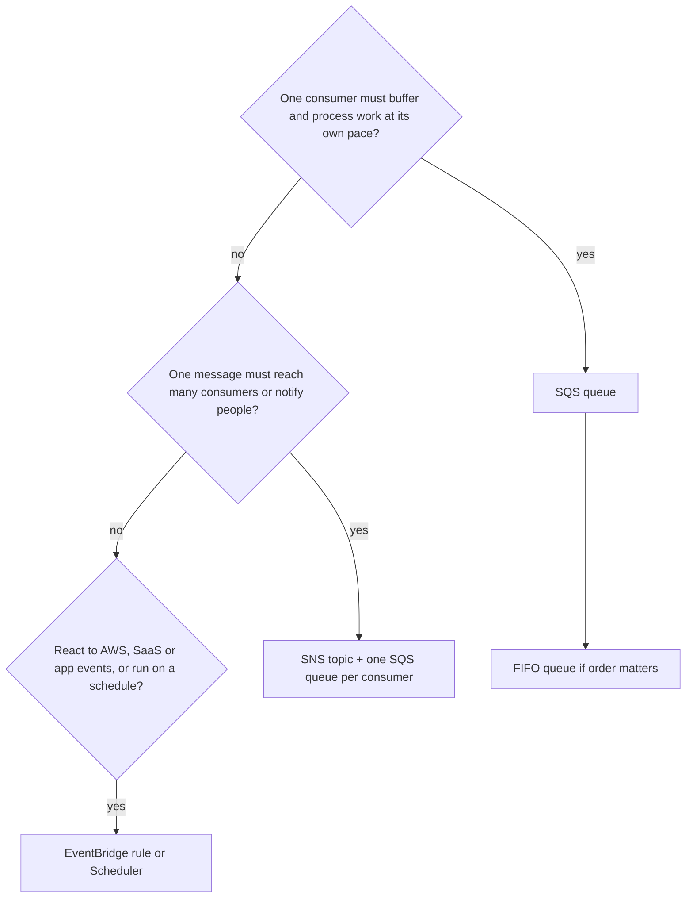

# Decoupling (index)

This topic was too large for one note. It maps to exam task statement 2.1 (design scalable and loosely coupled architectures). SQS, SNS and EventBridge are in the exam guide's in-scope services list under Application Integration.[^1]

- [[sqs]] — queues, standard vs FIFO, visibility timeout, dead-letter queues.
- [[sns-and-fan-out]] — topics, subscribers, filter policies, the SNS + SQS fan-out pattern.
- [[eventbridge]] — event buses, rules, targets, Scheduler.

> [!info] How to read this
> Read the requirement and follow the first question that matches. Fan-out combines two services: SNS delivers, SQS buffers.

Simplified: this is a first-pass guide. Details such as high fan-out (SNS) versus content routing (EventBridge) are in [[eventbridge]].

Related: [[elastic-load-balancing]] · [[ec2-auto-scaling]]

[^1]: SAA-C03 exam guide, in-scope services appendix — https://d1.awsstatic.com/training-and-certification/docs-sa-assoc/AWS-Certified-Solutions-Architect-Associate_Exam-Guide.pdf (cached in `_exam-guide.md`, accessed 2026-11-08)
