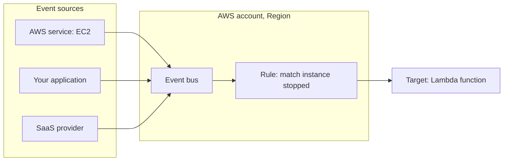
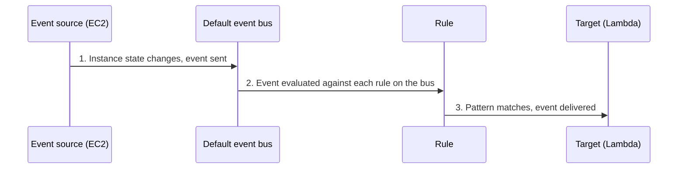

# Amazon EventBridge

> [!summary] TL;DR
> - EventBridge is a serverless service that uses events to connect application components.[^1]
> - An **event bus** receives events. **Rules** on the bus match events and send them to **targets**. A rule can have up to five targets.[^2]
> - Event sources can be AWS services, your own applications, or SaaS providers.[^2]
> - EventBridge was formerly known as CloudWatch Events.[^3]
> - Choose it for routing events by content. Choose SNS for very high fan-out.[^4]

## Why this exists
AWS services produce state changes, such as an EC2 instance starting or stopping. Without a router, you would poll the APIs or wire each service to each consumer. EventBridge receives the events and routes them by rules you write, so a change can start a Lambda function or reach another account without custom glue code.

## Mental model
Think of an event bus as a router with `if` rules: each rule checks the event, and if it matches, forwards it to up to five targets.

**Where this analogy breaks:** A router forwards traffic by header fields. A rule matches on the content of the event body (event pattern), and each matching rule sends to its own targets.[^4][^2]

## Core concepts
- **Event**: the message an event source (an AWS service, your own application, or a SaaS provider) sends to an event bus.[^2]
- **Event bus**: a router that receives events and delivers them to zero or more targets.[^1]
- **Default event bus**: exists in every account and automatically receives events from AWS services. Example: when an EC2 instance changes state, EC2 sends the event to the default event bus.[^2]
- **Custom event bus**: a bus you create yourself, in addition to the default bus.[^2]
- **Rule**: associated with one event bus. It checks whether each event matches the rule's pattern. An event can match several rules. If it matches none, EventBridge takes no action.[^2]
- **Target**: where a matching event is delivered. Each rule can specify up to five targets.[^2] Targets include AWS services, Lambda, API destinations, and event buses in other AWS accounts.[^3]
- **EventBridge Scheduler**: a serverless scheduler. It creates schedules with cron and rate expressions for recurring patterns, or one-time invocations.[^1]
- **EventBridge Pipes**: for point-to-point integrations. Each pipe receives events from one source and delivers to one target.[^1]

## Where it lives

> [!info] How to read this
> Rules belong to a specific event bus and only see events that reach that bus.[^2]

Simplified: one rule and one target are drawn; a rule can have up to five targets.[^2] Partner bus details are left out.

## How it works

1. The source sends an event to the bus.
2. EventBridge evaluates the event against each rule defined for that bus.
3. For each matching rule, EventBridge delivers the event to the rule's targets. No match means no action.[^2]

> [!info] How to read this
> The producer never names the consumer. Only the rule connects them.

## Key facts and limits
| Fact | Value | Source |
|---|---|---|
| Targets per rule | Up to five | [^2] |
| DLQ for a target | Optional; only standard SQS queues, not FIFO | [^5] |
| Ordering | No ordering guarantee | [^3] |
| Delivery | At-least-once | [^3] |
| Cross-account | A target can be the default bus or another bus in another account | [^4] |

## Comparisons
| | EventBridge | SNS | SQS |
|---|---|---|---|
| Model | Rules route events to targets | Push to all topic subscribers | Consumers poll |
| Filtering | Event pattern and content-based | Subscription filter policies | None by message |
| Persistence | Events do not persist | Messages do not persist | Persist until consumed or expired |
| Best fit | Reacting to events from AWS services, your apps, SaaS; cross-account sharing | High fan-out (thousands or millions of endpoints) | Buffering work |
Sources: [^3][^4]. See [[sns-and-fan-out]] and [[sqs]].

## Choosing in exam scenarios
- "React when an AWS resource changes state" → EventBridge rule on the default bus.[^2]
- "Route events from a SaaS partner" → EventBridge.[^3]
- "Run a task on a cron or rate schedule, or once" → EventBridge Scheduler.[^1]
- "Route by event content to different targets" → EventBridge.[^3]
- "Thousands or millions of endpoints" → SNS.[^4]
- "Protect against lost events when a target fails" → add a DLQ (standard SQS queue) to the target.[^5]

## Common traps and misconceptions
- **Misconception**: EventBridge and CloudWatch Events are different services. → **Reality**: EventBridge is formerly known as CloudWatch Events.[^3]
- **Misconception**: EventBridge keeps events for slow targets. → **Reality**: events do not persist; use a DLQ to avoid losing failed deliveries.[^3][^5]
- **Misconception**: A FIFO queue can be the EventBridge DLQ. → **Reality**: only standard queues are supported.[^5]
- **Misconception**: Events are ordered. → **Reality**: no ordering guarantees.[^3]

## Self-check
**Q1.** When any EC2 instance in the account stops, a Lambda function must run. Least operational effort?
A. A cron Lambda that polls EC2  B. EventBridge rule on the default event bus targeting Lambda  C. SQS queue polled by Lambda  D. SNS topic with email

> [!question]- Answer
> **B.** The default bus receives EC2 state changes and a rule delivers them to a target.[^2] A adds polling code. C needs something to put the events in the queue. D notifies people but does not run the function.

**Q2.** An app must send one notification to millions of mobile endpoints. Which service?
A. EventBridge  B. SNS  C. SQS  D. EventBridge Pipes

> [!question]- Answer
> **B.** The EventBridge FAQ recommends SNS for high fan-out.[^4] A is for event routing. C needs consumers to poll. D is one source to one target.[^1]

**Q3.** Failed deliveries to a rule's target must be kept for review. What do you configure?
A. SQS FIFO queue as DLQ  B. Standard SQS queue as DLQ  C. Longer visibility timeout  D. A second default bus

> [!question]- Answer
> **B.** EventBridge DLQs are standard SQS queues.[^5] A: FIFO is not supported. C and D do not store failed events.

## Related
[[_index-decoupling]] · [[sqs]] · [[sns-and-fan-out]]

## Sources
[^1]: Amazon EventBridge: What is — https://docs.aws.amazon.com/eventbridge/latest/userguide/eb-what-is.html (accessed 2026-11-08)
[^2]: EventBridge event buses — https://docs.aws.amazon.com/eventbridge/latest/userguide/eb-event-bus.html (accessed 2026-11-08)
[^3]: Choosing between SNS, SQS and EventBridge (AWS decision guide) — https://docs.aws.amazon.com/decision-guides/latest/sns-or-sqs-or-eventbridge/sns-or-sqs-or-eventbridge.html (accessed 2026-11-08)
[^4]: Amazon EventBridge FAQs — https://aws.amazon.com/eventbridge/faqs/ (accessed 2026-11-08)
[^5]: EventBridge dead-letter queues — https://docs.aws.amazon.com/eventbridge/latest/userguide/eb-rule-dlq.html (accessed 2026-11-08)
