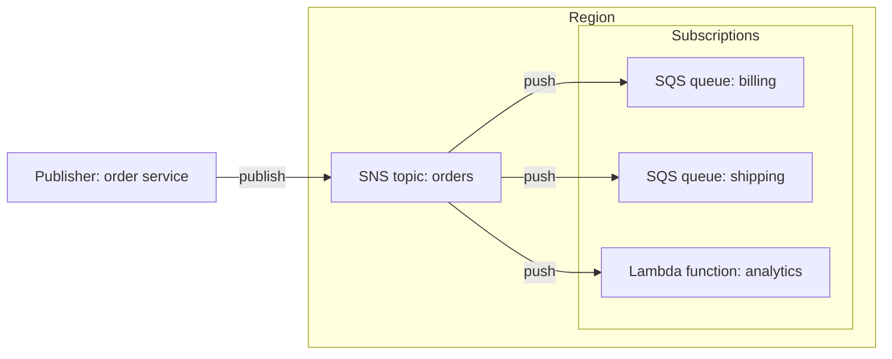
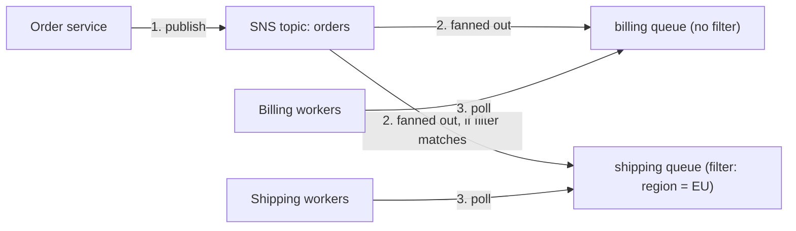

# Amazon SNS and the fan-out pattern

> [!summary] TL;DR
> - SNS is publish-subscribe: a publisher sends one message to a **topic**, and SNS **pushes** it to every subscriber.[^1]
> - Subscribers can be SQS queues, Lambda functions, HTTP/S endpoints, email, SMS and mobile push.[^1]
> - **Fan-out** = one SNS topic, many SQS queues. Each queue gets the message, and each team processes it at its own pace.[^1]
> - A **filter policy** on a subscription lets a subscriber receive only some messages. Without one, it receives all.[^2]
> - SNS does not hold messages for later reading. SQS does.[^3]

## Why this exists
One event often matters to several systems. An order must reach billing, shipping, and analytics. If the order service calls each one directly, it must know every consumer, and one slow consumer slows the others. With a topic, the order service publishes once and does not know who listens.

## Mental model
Think of a topic as a Kafka topic where every subscriber gets its own copy of each message, delivered by push.

**Where this analogy breaks:** A Kafka topic keeps messages, so a consumer can read them later. SNS delivers to subscribers and does not persist messages for them; if delivery fails after the retries, SNS discards the message unless a DLQ is attached to the subscription.[^3][^1]

## Core concepts
- **Topic**: an access point that identifies a specific subject or event type.[^1]
- **Publisher**: sends a message to a topic.[^1]
- **Subscriber**: a client interested in a topic's notifications. It can subscribe itself or be subscribed by the topic owner.[^1]
- **Standard topic**: SNS attempts to deliver messages in publish order, but network issues can cause out-of-order or occasional duplicate messages at the subscriber.[^1]
- **FIFO topic**: for when delivery must be in order and once only. It delivers ordered messages to SQS FIFO queues.[^1]
- **Filter policy**: a JSON object that defines which messages a subscriber receives. SNS compares each message to the policy of each subscription and does not send non-matching messages to that subscriber.[^2]

## Where it lives

> [!info] How to read this
> One publish, three deliveries. The topic knows its subscribers; the publisher does not.

Simplified: topic policies, encryption and cross-Region delivery are left out.

## How it works

1. The publisher sends the message to the topic.
2. SNS fans the message out to each subscribed SQS queue. A subscription with a filter policy gets the message only if it matches.[^1][^2]
3. Workers poll their own queue (see [[sqs]]). If billing workers are down, messages wait in the billing queue, and shipping is not affected.

> [!info] How to read this
> SNS pushes (step 2). SQS holds the message until a worker polls (step 3). The queue is what makes slow or offline consumers safe.

Step 3's "messages wait in the queue" relies on SQS keeping messages until consumed or expired.[^3]

## Key facts and limits
| Fact | Value | Source |
|---|---|---|
| Maximum message size | Default 256 KiB; up to 1 MiB by setting the `MaximumMessageSize` topic attribute (not SMS) | [^1] |
| Failed delivery | 4-phase retry policy; after it is used up, SNS can move the message to a DLQ, or discards it if no DLQ is attached | [^1] |
| SQS subscription | The SQS queue owner must subscribe the queue to the topic | [^1] |
| Filtering default | A subscription with no filter policy receives every message | [^2] |

## Comparisons
| | SNS | SQS | EventBridge |
|---|---|---|---|
| Model | Push to subscribers | Consumers poll | Rules match events and route to targets |
| Persistence | Messages do not persist | Persist until consumed or expired | Events do not persist |
| Ordering | FIFO topics guarantee order | FIFO queues give strict order | No ordering guarantee |
| Filtering | Subscription filter policies | None by message; use SNS filtering with SQS | Event pattern matching and content-based filtering |
Source: [^3]. For more on EventBridge see [[eventbridge]].

## Choosing in exam scenarios
- "One event, several independent consumers" or "fan out" → SNS topic + one SQS queue per consumer.[^1]
- "Each consumer should only see some of the messages" → add filter policies to the subscriptions.[^2]
- "Notify people by email or SMS" → SNS.[^1]
- "Thousands or millions of endpoints" → SNS. The EventBridge FAQ recommends SNS for high fan out.[^4]
- "Buffer work for one consumer" → [[sqs]] alone is enough.

## Common traps and misconceptions
- **Misconception**: SNS stores messages until the subscriber reads them. → **Reality**: it pushes; undeliverable messages are retried, then discarded unless a DLQ is attached.[^1][^3]
- **Misconception**: A standard topic keeps strict order. → **Reality**: it attempts publish order; out-of-order and duplicates can happen.[^1]
- **Misconception**: A filtered-out subscriber still receives the message. → **Reality**: SNS does not send it to that subscriber.[^2]
- **Misconception**: SQS can pick consumers by message content. → **Reality**: it cannot. The AWS decision guide says to use SNS message filtering with SQS.[^3]

## Self-check
**Q1.** One "image uploaded" event must start thumbnail creation, virus scanning, and an audit log write. Each step is owned by a different team and may be slow. Best design?
A. One SQS queue read by all three  B. SNS topic with one SQS queue per step  C. Three direct API calls from the uploader  D. One SQS FIFO queue

> [!question]- Answer
> **B.** Fan-out gives each team its own copy and its own buffer.[^1] A: a message is processed by one consumer and then deleted, so the three steps would compete for messages (see [[sqs]]). C couples the uploader to each team. D adds ordering the case does not need.

**Q2.** A topic receives orders from all regions. The EU warehouse queue must get only EU orders. What is the least effort?
A. Filter in the warehouse code  B. A filter policy on the EU queue's subscription  C. One topic per region only  D. A Lambda function that routes

> [!question]- Answer
> **B.** A filter policy is attached to the subscription and non-matching messages are not sent.[^2] A works but wastes deliveries and adds code. C and D add resources the feature already covers.

**Q3.** A subscriber endpoint is down for a day. Which statement is true when it subscribes directly (no queue)?
A. SNS keeps the messages for a day  B. After the retry policy is exhausted SNS discards the message unless a DLQ is attached  C. SNS blocks the topic  D. The publisher receives an error

> [!question]- Answer
> **B.** [^1] A: SNS does not persist messages for subscribers.[^3] C and D: nothing in the sources says the topic blocks or that the publisher is told.

## Related
[[_index-decoupling]] · [[sqs]] · [[eventbridge]] · [[elastic-load-balancing]]

## Sources
[^1]: Amazon SNS FAQs — https://aws.amazon.com/sns/faqs/ (accessed 2026-11-08)
[^2]: SNS message filtering — https://docs.aws.amazon.com/sns/latest/dg/sns-message-filtering.html (accessed 2026-11-08)
[^3]: Choosing between SNS, SQS and EventBridge (AWS decision guide) — https://docs.aws.amazon.com/decision-guides/latest/sns-or-sqs-or-eventbridge/sns-or-sqs-or-eventbridge.html (accessed 2026-11-08)
[^4]: Amazon EventBridge FAQs — https://aws.amazon.com/eventbridge/faqs/ (accessed 2026-11-08)
