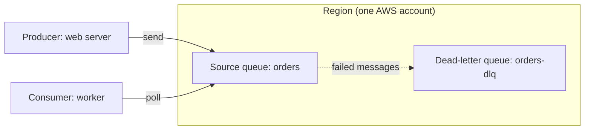
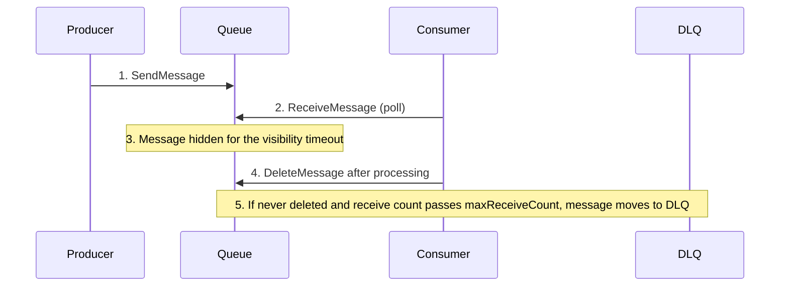

# Amazon SQS (queues)

> [!summary] TL;DR
> - SQS is a managed message queue. Consumers poll it to get messages; SQS does not push to them.[^1]
> - **Standard queue**: at-least-once delivery, best-effort ordering. **FIFO queue**: order kept within each message group.[^4]
> - A received message is hidden for the **visibility timeout** (default 30 seconds). If the consumer does not delete it in time, it becomes visible again.[^2]
> - A **dead-letter queue (DLQ)** collects messages that fail too many times (`maxReceiveCount`).[^3]
> - Messages stay in the queue until they are consumed or expire.[^5]

## Why this exists
If a web server calls a slow worker directly, a traffic spike or a worker failure hurts the web server. A queue sits between them: the web server writes a message and moves on, and workers read at their own speed. SQS can be used to decouple sending and receiving components.[^1]

## Mental model
Think of SQS as a Kafka topic with one consumer group, where workers take jobs from a shared list.

**Where this analogy breaks:** In SQS the consumer does not move an offset. SQS tracks each message: a received message is hidden by the visibility timeout, and the consumer must delete it after processing.[^2]

## Core concepts
- **Producer**: the application that sends messages to the queue (`SendMessage`).[^4]
- **Consumer**: the application that polls the queue (`ReceiveMessage`) and then deletes the message (`DeleteMessage`).[^4][^2]
- **Polling model**: consumers ask SQS for messages. SQS contrasts this with SNS, which uses a push mechanism.[^1]
- **Short polling** returns immediately, even if the queue is empty. **Long polling** waits until a message arrives or the long poll times out. Long polling is preferable in almost all cases, and it is billed the same as short polling.[^1]
- **Visibility timeout**: a period during which SQS prevents other consumers from receiving a message that one consumer has received.[^1]
- **Message group ID** (FIFO): all messages with the same group ID are sent and received in strict order. Messages with different group IDs might be out of order. Every FIFO message needs a group ID.[^1]
- **Dead-letter queue (DLQ)**: a queue that a source queue sends messages to when the source queue's consumer cannot process them. The trigger is `maxReceiveCount`, set in a redrive policy.[^1][^3]

## Where it lives

> [!info] How to read this
> The source queue and its DLQ must be in the same AWS account and Region.[^3] Producers and consumers poll or send to the queue; the queue never connects out to them.

Simplified: networking, queue policies and encryption are left out.

## How it works

1. The producer sends a message to the queue.
2. A consumer polls and receives the message.
3. SQS hides the message from other consumers during the visibility timeout.[^1]
4. The consumer is expected to process and delete the message within that time.[^2]
5. If the consumer does not delete it, the message becomes visible again and another attempt can happen.[^2] After the message has been received `maxReceiveCount` times, SQS moves it to the DLQ.[^3]

> [!info] How to read this
> Delete is the consumer's job. The visibility timeout only hides the message; it does not remove it.

### Worked example
The default visibility timeout is 30 seconds.[^2] A worker needs 45 seconds per message and never extends the timeout. At second 30 the message becomes visible again, so a second worker can receive it while the first is still working. Both finish: the message was processed twice (45 − 30 = 15 seconds of overlap). Fix: raise the visibility timeout above 45 seconds, or call `ChangeMessageVisibility` to extend it.[^2] The maximum is 12 hours from when the message is first received.[^2]

## Key facts and limits
| Fact | Value | Source |
|---|---|---|
| Retention period | 1 minute to 14 days; default 4 days | [^1] |
| Maximum message size | 1 MiB (1,048,576 bytes) | [^1] |
| Visibility timeout | Default 30 seconds; maximum 12 hours | [^2] |
| Long-poll timeout | Use at most 20 seconds | [^1] |
| FIFO throughput | 300 API calls per second per method without batching; 3,000 messages per second with batching | [^4] |
| FIFO high throughput mode | Up to 70,000 messages per second without batching | [^1] |
| DLQ location | Same AWS account and Region as the source queue | [^3] |

## Comparisons
| | Standard queue | FIFO queue |
|---|---|---|
| Delivery | At-least-once; a message may be delivered more than once | Each message delivered once, kept until processed and deleted |
| Ordering | Best-effort, not guaranteed | In order within each message group |
| Throughput | Very high, nearly unlimited API calls per second | Limits in the table above |
| Choose when | Throughput matters; the app can handle out-of-order and duplicates | Order of events matters |
Sources: [^4]

## Choosing in exam scenarios
- "Decouple the web tier from background processing" or "absorb traffic spikes" → SQS. The docs give "decouple live user requests from intensive background work" as a standard queue use.[^4]
- "Messages must be processed in order" → FIFO queue.[^4]
- "Isolate messages that fail repeatedly for later analysis" → DLQ.[^1]
- "Many different services must each get every message" → not SQS alone. See [[sns-and-fan-out]].

## Common traps and misconceptions
- **Misconception**: SQS pushes messages to consumers. → **Reality**: consumers poll.[^1]
- **Misconception**: Standard queues keep the order. → **Reality**: ordering is best-effort and not guaranteed.[^4]
- **Misconception**: The visibility timeout deletes the message. → **Reality**: if you do not delete it, it becomes visible again.[^2]
- **Misconception**: A DLQ is safe to add to any FIFO queue. → **Reality**: the docs warn against it if you want to keep the exact order of messages or operations.[^3]
- **Misconception**: A short DLQ retention period is fine. → **Reality**: for standard queues, expiry is based on the original enqueue timestamp, which does not change when the message moves. The docs recommend a DLQ retention period longer than the source queue's.[^3]
- **Misconception**: A FIFO message group can be read by many consumers at once. → **Reality**: FIFO queues do not serve messages from the same group to more than one consumer at a time.[^1]

## Self-check
**Q1.** An order service must hand work to a fleet of workers. Workers are sometimes slow, and the order service must never wait for them. Which service fits?
A. SNS topic with HTTP subscribers  B. SQS queue  C. EventBridge schedule  D. ELB with a target group

> [!question]- Answer
> **B.** The queue lets the producer send and move on while workers poll at their own speed.[^1] A pushes to endpoints and does not hold messages for slow subscribers (see [[sns-and-fan-out]]). C is for schedules and event routing (see [[eventbridge]]). D balances live requests and does not buffer work (see [[elastic-load-balancing]]).

**Q2.** Bank transactions for one account must be processed in the order they were sent. Which queue design fits?
A. Standard queue  B. FIFO queue with the account ID as message group ID  C. Standard queue with long polling  D. Standard queue with a DLQ

> [!question]- Answer
> **B.** FIFO keeps order within a message group.[^1][^4] A and C: ordering is best-effort only; long polling changes how consumers wait, not the order. D: a DLQ collects failures; it does not order messages.

**Q3.** A worker takes 60 seconds per message. Messages are processed twice. Default settings are used. What is the most direct fix?
A. Add a DLQ  B. Raise the visibility timeout above 60 seconds  C. Switch to short polling  D. Lower the retention period

> [!question]- Answer
> **B.** The default visibility timeout is 30 seconds, so the message reappears while the first worker still runs.[^2] A handles repeated failure, not slow processing. C does not change visibility. D changes how long unconsumed messages are kept.[^1]

## Related
[[_index-decoupling]] · [[sns-and-fan-out]] · [[eventbridge]] · [[ec2-auto-scaling]] · [[elastic-load-balancing]]

## Sources
[^1]: Amazon SQS FAQs — https://aws.amazon.com/sqs/faqs/ (accessed 2026-11-08)
[^2]: SQS visibility timeout — https://docs.aws.amazon.com/AWSSimpleQueueService/latest/SQSDeveloperGuide/sqs-visibility-timeout.html (accessed 2026-11-08)
[^3]: SQS dead-letter queues — https://docs.aws.amazon.com/AWSSimpleQueueService/latest/SQSDeveloperGuide/sqs-dead-letter-queues.html (accessed 2026-11-08)
[^4]: SQS queue types — https://docs.aws.amazon.com/AWSSimpleQueueService/latest/SQSDeveloperGuide/sqs-queue-types.html (accessed 2026-11-08)
[^5]: Choosing between SNS, SQS and EventBridge (AWS decision guide) — https://docs.aws.amazon.com/decision-guides/latest/sns-or-sqs-or-eventbridge/sns-or-sqs-or-eventbridge.html (accessed 2026-11-08)
