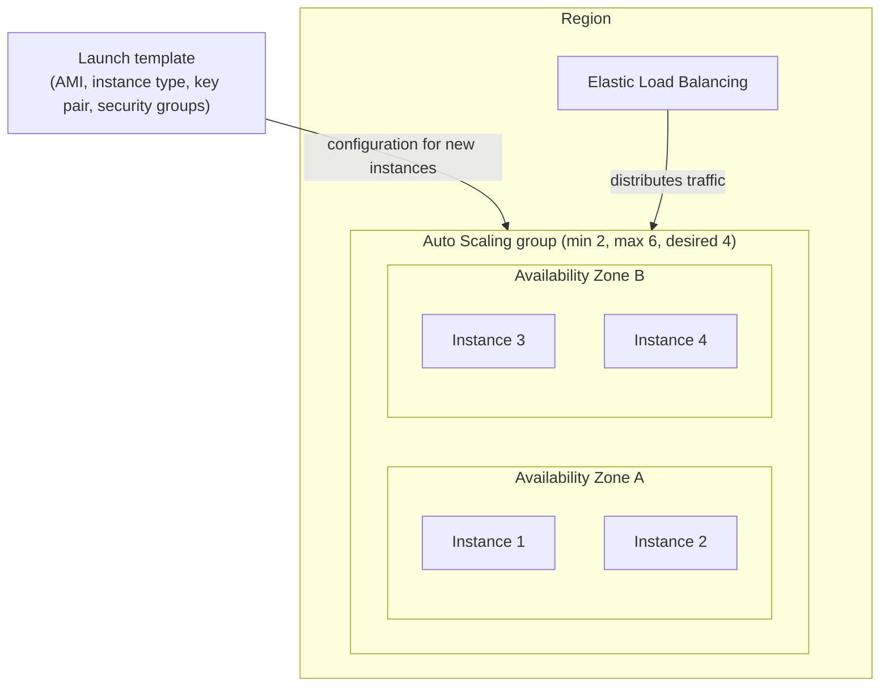
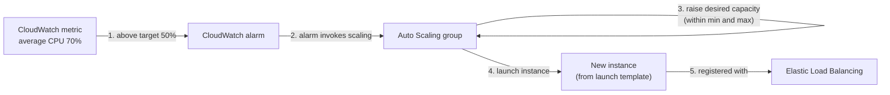
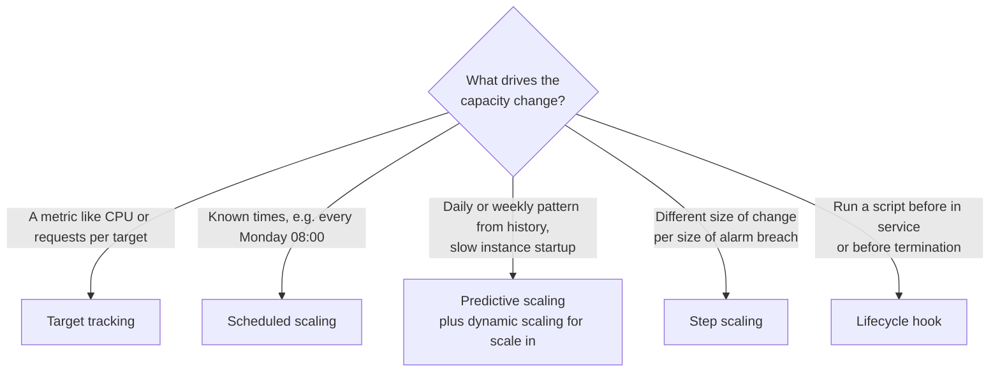

# EC2 Auto Scaling

> [!summary] TL;DR
> - An **Auto Scaling group (ASG)** is a collection of EC2 instances managed as one unit for scaling and replacement.[^2]
> - You set minimum, maximum and optional desired capacity. The group never goes below the minimum or above the maximum.[^1]
> - A **launch template** says what each new instance looks like (AMI, instance type, key pair, security groups).[^3]
> - Scaling types: dynamic (target tracking, step, simple), scheduled, predictive. AWS strongly recommends target tracking.[^4]
> - Unhealthy instances are replaced. ELB health checks are off by default.[^10]

Exam scope: task statements 2.1, 2.2 (Domain 2) and 3.2 "Design high-performing and elastic compute solutions" (Domain 3). "EC2 Auto Scaling" is in the guide's in-scope services list.[^14]

## Why this exists
A fixed number of servers is too many at night and too few at a traffic peak. A failed server also needs someone to replace it. EC2 Auto Scaling changes the number of instances for you and replaces failed ones, so you do not run these steps by hand.

## Mental model
Think of an ASG as a Kubernetes Deployment plus a Horizontal Pod Autoscaler, but for virtual machines. You say "keep between 2 and 6 instances" and the group does the rest.

**Where this analogy breaks:** an ASG adds or removes whole EC2 instances (VMs), not pods on nodes that already exist, so a scale-out has to launch a new VM from the launch template.

## Core concepts
- **Auto Scaling group (ASG):** a collection of EC2 instances treated as a logical group for automatic scaling and management.[^2]
- **Minimum / maximum / desired capacity:** the group ensures it has at least the minimum and at most the maximum number of instances. If you set a desired capacity, the group ensures it has that many instances.[^1]
- **Launch template:** a template that includes the AMI ID, instance type, key pair, security groups and other launch parameters. It can have multiple versions.[^3]
- **Scaling policy:** a rule that changes the group's capacity as demand changes.[^1]
- **CloudWatch alarm:** an alarm on a CloudWatch metric (a measured value such as average CPU). Alarms trigger some scaling policies.[^6]
- **Instance warmup:** the number of seconds a newly launched instance needs to warm up.[^5]
- **Lifecycle hook:** a pause at instance launch or termination, so you can run a custom action.[^13]

## Where it lives

> [!info] How to read this
> One ASG can span several Availability Zones. The group spreads its desired capacity across them.[^2] The load balancer sends traffic to healthy instances.[^1]

Simplified: VPC and subnets are left out, and the diagram does not show where the launch template is stored.

## How it works

> [!info] How to read this
> This is the target tracking path. The numbers match the list below.

Simplified: warmup, lifecycle hooks and health checks are left out.

1. A metric moves away from the target value. For example, target tracking aims at an average CPU of 50 percent.[^5]
2. For target tracking, EC2 Auto Scaling creates and manages the CloudWatch alarms that invoke scaling.[^5] With step and simple scaling, you create the alarms yourself.[^6]
3. The group changes its desired capacity, between the minimum and maximum you set.[^2]
4. The group launches instances from its launch template.[^1]
5. EC2 Auto Scaling registers new instances with the load balancer and deregisters terminated ones.[^1]

### Scaling types
| Type | What it does | Use when |
|---|---|---|
| Target tracking | You pick a metric and a target value. Works like a thermostat.[^4][^5] | Load follows a metric such as CPU. AWS strongly recommends it.[^4] |
| Step | Different adjustments depending on how far the alarm is breached.[^4] | You need bigger steps for bigger breaches. |
| Simple | One adjustment, with a cooldown period between scaling activities.[^4] | Basic case. |
| Scheduled | Scheduled actions change desired, minimum and maximum capacity at set times.[^7] | Load changes at known times. |
| Predictive | Analyzes historical load for daily or weekly patterns and forecasts capacity needs.[^8] | Cyclical traffic or slow initialization.[^8] |

Predefined target tracking metrics: `ASGAverageCPUUtilization`, `ASGAverageNetworkIn`, `ASGAverageNetworkOut`, `ALBRequestCountPerTarget`.[^5]

### Health checks and replacement
- EC2 status checks are the default health check type.[^10]
- An instance in any EC2 state other than `running`, or with `impaired` status checks, is unhealthy and is replaced.[^10]
- Elastic Load Balancing and EBS health checks run only if you turn them on for the group.[^10]
- When a registered instance is reported `Unhealthy` by Elastic Load Balancing (and the check is on), the group marks it unhealthy on its next periodic check and replaces it.[^10]

### Scale in: which instance goes first
EC2 Auto Scaling tries to keep balance across the enabled Availability Zones. This balance takes precedence over the termination policy.[^12] Predefined policies include `Default`, `OldestInstance`, `NewestInstance`, `OldestLaunchTemplate`, `ClosestToNextInstanceHour` and `AllocationStrategy`.[^12]

## Key facts and limits
| Fact | Value | Source |
|---|---|---|
| Extra charge for EC2 Auto Scaling | None. You pay for the resources used (EC2, EBS, CloudWatch alarms). | [^1] |
| Scheduled actions per group | Maximum 125 | [^7] |
| Scheduled action time zone | UTC by default, can be changed | [^7] |
| Predictive scaling minimum data | At least 24 hours of metric data | [^9] |
| Predictive scaling analysis window | Up to the past 14 days; forecast for the next 48 hours | [^9] |
| Predictive scaling first mode | Starts in forecast only mode | [^9] |
| Lifecycle hook default timeout | One hour (heartbeat timeout) | [^13] |
| Lifecycle hook global timeout | 48 hours or 100 times the heartbeat timeout, whichever is smaller | [^13] |

## Comparisons
| | Target tracking | Step / simple | Scheduled | Predictive |
|---|---|---|---|---|
| Trigger | Metric vs target value | CloudWatch alarm you create | Date and time | Forecast from history |
| Alarms | Managed by EC2 Auto Scaling | You manage | None | None |
| Scales in | Yes (can be disabled)[^5] | Yes | If you schedule a lower capacity | No. Use dynamic scaling to remove capacity.[^9] |
| Effort | Lowest | Higher | You maintain the schedule | Low, needs history |

Predictive and dynamic scaling can be active together. Each policy sets desired capacity on its own, and the maximum wins.[^9]

## Choosing in exam scenarios

> [!info] How to read this
> Start from the keyword in the question, then follow the arrow.

- "Keep average CPU at X percent", "least operational effort" → target tracking, because EC2 Auto Scaling manages the alarms.[^5]
- "Traffic rises at known times" → scheduled scaling.[^7]
- "Pattern repeats daily or weekly, application is slow to start" → predictive scaling.[^8]
- "Install software before the instance gets traffic" or "download logs before termination" → lifecycle hook.[^13]
- "Highly available across Availability Zones" → ASG with several Availability Zones behind a load balancer.[^1]
- "Instance is replaced when the application fails behind a load balancer" → turn on ELB health checks for the group.[^10]

## Common traps and misconceptions
- **Misconception:** ELB health check failures automatically cause replacement. → **Reality:** EC2 Auto Scaling ignores ELB health check results by default. You must turn them on for the group.[^10]
- **Misconception:** Predictive scaling also removes extra capacity. → **Reality:** If the forecast expects lower load, it does not scale in. Create dynamic scaling policies for that.[^9]
- **Misconception:** EC2 Auto Scaling has its own fee. → **Reality:** There are no additional fees. You pay for the underlying resources.[^1]
- **Misconception:** You can tune the CloudWatch alarms of a target tracking policy. → **Reality:** Do not create, edit or delete them. EC2 Auto Scaling manages them.[^5]
- **Misconception:** Mixing target tracking and step scaling is always safe. → **Reality:** AWS recommends caution because conflicts can cause undesirable behavior.[^4]
- **Misconception:** Scale in always removes the oldest instance. → **Reality:** Zonal balance takes precedence over the termination policy.[^12]
- **Misconception:** Target tracking works with any metric. → **Reality:** The metric must be a valid utilization metric that shows how busy an instance is. `RequestCount`, `Latency` and the SQS `ApproximateNumberOfMessagesVisible` are named as not working.[^5]
- **Misconception:** A missing metric still lets target tracking scale. → **Reality:** With missing data points the alarm goes to `INSUFFICIENT_DATA` and the group cannot scale until new data arrives.[^5]

## Self-check
**1.** A web tier behind an ALB must keep average CPU near 50 percent with the least operational effort. Which scaling policy?
A. Scheduled scaling  B. Simple scaling with hand-made alarms  C. Target tracking scaling  D. Lifecycle hook

> [!question]- Answer
> **C.** Target tracking takes a metric and a target value, and EC2 Auto Scaling creates and manages the alarms.[^5] A needs known times.[^7] B needs you to create and manage alarms.[^6] D pauses instances at launch or termination and does not scale.[^13]

**2.** Traffic follows a weekly cycle, the application starts slowly, and capacity must be added before the peak and removed afterwards, without maintaining a schedule. What is the best design?
A. Predictive scaling only  B. Predictive scaling plus a dynamic scaling policy  C. Scheduled scaling only  D. Manually set desired capacity

> [!question]- Answer
> **B.** Predictive scaling forecasts from history and adds capacity early. It does not scale in, so dynamic scaling handles removal.[^9] A cannot remove capacity.[^9] C needs you to create and maintain scheduled actions.[^7] D is manual and is not automatic scaling.

**3.** Instances behind an ALB pass EC2 status checks, but the application hangs. The ALB marks them unhealthy, and the ASG never replaces them. What fixes this?
A. Raise the maximum capacity  B. Turn on Elastic Load Balancing health checks for the ASG  C. Use the `OldestInstance` termination policy  D. Add a scheduled action

> [!question]- Answer
> **B.** The group ignores ELB health check results by default. After you turn them on, an instance the load balancer reports `Unhealthy` is replaced.[^10] A, C and D change capacity or the choice of instance to remove. None changes how health is judged.

## Related
- [[ec2-fundamentals]] — instance types and AMIs used in launch templates.
- [[elastic-load-balancing]] — the load balancer that receives the new instances.
- [[security-groups-vs-nacls]] — security groups named in the launch template.

## Sources
[^1]: What is Amazon EC2 Auto Scaling? — https://docs.aws.amazon.com/autoscaling/ec2/userguide/what-is-amazon-ec2-auto-scaling.html (accessed 2026-11-08)
[^2]: Auto Scaling groups — https://docs.aws.amazon.com/autoscaling/ec2/userguide/auto-scaling-groups.html (accessed 2026-11-08)
[^3]: Launch templates — https://docs.aws.amazon.com/autoscaling/ec2/userguide/launch-templates.html (accessed 2026-11-08)
[^4]: Dynamic scaling — https://docs.aws.amazon.com/autoscaling/ec2/userguide/as-scale-based-on-demand.html (accessed 2026-11-08)
[^5]: Target tracking scaling policies — https://docs.aws.amazon.com/autoscaling/ec2/userguide/as-scaling-target-tracking.html (accessed 2026-11-08)
[^6]: Step and simple scaling policies — https://docs.aws.amazon.com/autoscaling/ec2/userguide/as-scaling-simple-step.html (accessed 2026-11-08)
[^7]: Scheduled scaling — https://docs.aws.amazon.com/autoscaling/ec2/userguide/ec2-auto-scaling-scheduled-scaling.html (accessed 2026-11-08)
[^8]: Predictive scaling — https://docs.aws.amazon.com/autoscaling/ec2/userguide/ec2-auto-scaling-predictive-scaling.html (accessed 2026-11-08)
[^9]: How predictive scaling works — https://docs.aws.amazon.com/autoscaling/ec2/userguide/predictive-scaling-policy-overview.md (accessed 2026-11-08)
[^10]: Health checks for Auto Scaling instances — https://docs.aws.amazon.com/autoscaling/ec2/userguide/health-checks-overview.html (accessed 2026-11-08)
[^12]: Termination policies — https://docs.aws.amazon.com/autoscaling/ec2/userguide/ec2-auto-scaling-termination-policies.html (accessed 2026-11-08)
[^13]: Lifecycle hooks — https://docs.aws.amazon.com/autoscaling/ec2/userguide/lifecycle-hooks.html (accessed 2026-11-08)
[^14]: SAA-C03 exam guide (scope facts only) — https://d1.awsstatic.com/training-and-certification/docs-sa-assoc/AWS-Certified-Solutions-Architect-Associate_Exam-Guide.pdf (accessed 2026-11-08, via `_exam-guide.md`)
