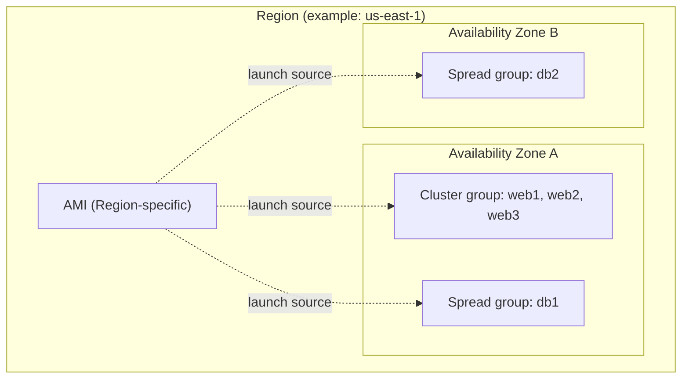
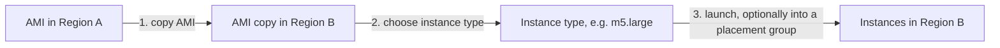
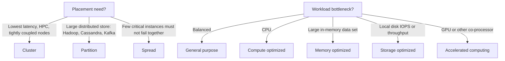

# EC2 fundamentals

> [!summary] TL;DR
> - The **instance type** sets the hardware of the host (CPU, memory, storage, network). Pick the family that matches the bottleneck of your workload.[^5]
> - An **AMI** is the image an instance boots from. It is specific to one Region; copy it to use it in another Region.[^12]
> - **Placement groups** control where instances sit on hardware: **cluster** = close together (low latency), **partition** = groups on separate racks, **spread** = each instance on a different rack.[^1][^2]
> - Cluster stays in one Availability Zone. Partition and spread can span Availability Zones in a Region.[^2]

## Why this exists
An EC2 instance is a virtual server. You must decide three things: how big it is and what resources it is strong in (instance type), what software it starts with (AMI), and how it is placed on the physical hardware (placement group). The exam tests all three as trade-offs between performance and failure isolation.

## Mental model
An AMI is like a VM template. The instance type is the size and shape of the VM you create from it. A placement group is a rule about which physical hosts and racks the VMs may land on.
**Where this analogy breaks:** an AMI is specific to a Region. To launch instances in another Region, you copy the AMI there first.[^12]

## Core concepts
- **Instance type:** a named combination of CPU, memory, storage and networking capacity. Types with similar capabilities are grouped into an **instance family**.[^5]
- **Instance families (categories):** General purpose, Compute optimized, Memory optimized, Storage optimized, Accelerated computing, and High-performance computing.[^5][^6]
- **AMI (Amazon Machine Image):** an image with the software needed to set up and boot an instance, plus a block device mapping that says which block devices to attach.[^12]
- **Placement group:** a setting that tells EC2 how to place a set of instances on underlying hardware. There is no charge for creating one.[^1]

| Family | What AWS says it is for |
|---|---|
| General purpose | A balance of compute, memory and networking, such as web servers and code repositories[^7] |
| Compute optimized | Compute-intensive work: batch processing, media transcoding, HPC, scientific modeling, machine learning inference[^8] |
| Memory optimized | Workloads that process large data sets in memory[^9] |
| Storage optimized | High sequential read/write on very large data sets on local storage; tens of thousands of low-latency random IOPS[^10] |
| Accelerated computing | Hardware accelerators (co-processors) for floating point calculations, graphics processing, or data pattern matching[^11] |

Burstable performance (`T`) instances give a baseline CPU level with the ability to burst above it. Bursting is governed by CPU credits, and the `T` types are listed under General purpose.[^6]

## Where it lives

> [!info] How to read this
> The AMI and the placement groups both belong to one Region. The cluster group sits inside one Availability Zone. The spread group has instances in two Availability Zones.

Simplified: partition groups are not drawn. They can also have partitions in several Availability Zones of one Region.[^2]

## How it works

> [!info] How to read this
> Follow the numbers. The AMI must exist in the Region where you launch. The instance type and the placement group are chosen at launch.

1. Copy the AMI to the target Region. You can copy an AMI to another Region and then launch instances from it there.[^12]
2. Choose an instance type. It determines the hardware of the host.[^5]
3. Launch. You can launch many instances from one AMI.[^12] An instance can be in one placement group at a time.[^1]

### Placement group strategies

| | Cluster | Partition | Spread |
|---|---|---|---|
| Idea | Packs instances close together[^1] | Groups of instances in one partition do not share hardware with other partitions[^1] | Each instance on a different rack, each rack with its own network and power source[^2] |
| Availability Zones | One AZ only[^2] | Can have partitions in several AZs of one Region[^2] | Rack-level group can span several AZs of one Region[^2] |
| Limit | See note below | Maximum seven partitions per AZ[^2] | Maximum seven running instances per AZ[^2] |
| Typical use | HPC, low latency, high network throughput[^1][^2] | Large distributed and replicated workloads such as Hadoop, Cassandra, Kafka[^1] | Small number of critical instances kept separate[^2] |

A cluster group can span peered VPCs in the same Region (see [[vpc-peering-and-transit-gateway]]).[^2] If you add instances later or mix instance types in a cluster group, the chance of an insufficient capacity error goes up.[^2]

## Key facts and limits
| Fact | Value | Source |
|---|---|---|
| Spread: running instances per AZ per group | 7 | [^2] |
| Partition: partitions per AZ | 7 | [^2] |
| Placement groups per Region | 500 maximum | [^4] |
| Cost of creating a placement group | No charge | [^1] |
| Move an instance into, between or out of placement groups | Allowed, but the instance must be `stopped` first | [^3] |
| Merge placement groups | Not possible | [^1] |
| Dedicated Hosts in placement groups | Cannot launch | [^1] |
| Spot Instance set to stop or hibernate on interruption | Cannot launch in a placement group | [^1] |

## Comparisons
| | Cluster | Partition | Spread |
|---|---|---|---|
| Goal | Performance (latency, throughput) | Isolate failure of a group of instances | Isolate failure of single instances |
| Failure isolation | Low: instances are packed close together | Per partition (partitions do not share racks)[^2] | Per instance (separate racks)[^2] |
| Scale | Larger groups of instances | Large workloads | Small groups (7 per AZ) |

## Choosing in exam scenarios

> [!info] How to read this
> Top half: placement groups. Bottom half: instance families. They are independent choices.

- "Lowest network latency between nodes" or HPC → **cluster**, because it packs instances close inside one AZ.[^1][^2]
- "Large distributed, replicated workload (Hadoop, Cassandra, Kafka), isolate hardware failure per group" → **partition**.[^1][^2]
- "Small number of critical instances, each must be kept separate" → **spread**.[^2]
- "Balanced web server" → general purpose. "Process a large data set in memory" → memory optimized. "High local random IOPS" → storage optimized.[^7][^9][^10]

## Common traps and misconceptions
- **Cluster is highly available** → **Reality:** a cluster group is in a single AZ and cannot span AZs, so it trades failure isolation for latency. → **Source:** [^2]
- **Spread can hold any number of instances** → **Reality:** a rack-level spread group supports a maximum of seven running instances per AZ. → **Source:** [^2]
- **An AMI works in every Region** → **Reality:** an AMI is specific to a Region; copy it first. → **Source:** [^12]
- **You can change the placement group of a running instance** → **Reality:** the instance must be `stopped` first. → **Source:** [^3]

## Self-check
1. A risk-simulation job runs on 40 tightly coupled nodes and needs the lowest possible network latency between nodes. Which placement strategy fits?
   A. Spread  B. Partition  C. Cluster  D. Spread across three AZs

> [!question]- Answer
> **C.** Cluster packs instances close together in one AZ for low-latency node-to-node traffic.[^1][^2] A and D: spread separates instances onto different racks, which is for failure isolation, not latency, and allows only seven running instances per AZ.[^2] B: partition isolates groups for failure, not latency.

2. You run a replicated Cassandra cluster with 20 nodes. A rack failure must affect only part of the cluster. Which strategy fits?
   A. Cluster  B. Partition  C. Spread  D. No placement group is possible

> [!question]- Answer
> **B.** Partition groups place instances in logical partitions that do not share racks, and Cassandra is a named use case.[^1][^2] A: a cluster group packs instances together, so one hardware problem can hit many nodes. C: spread allows only seven running instances per AZ, so 20 nodes do not fit in one AZ.[^2] D: wrong, partition fits.

3. A team built an AMI in eu-west-1 and wants the same image in ap-southeast-1. What do they do?
   A. Launch directly from the eu-west-1 AMI in ap-southeast-1  B. Copy the AMI to ap-southeast-1, then launch  C. Put the instances in a placement group  D. Nothing; AMIs are global

> [!question]- Answer
> **B.** An AMI is specific to a Region, and you can copy it to another Region and launch there.[^12] A and D: the AMI is Region-specific. C: placement groups do not move images.

## Related
- [[vpc-peering-and-transit-gateway]], [[vpc-fundamentals]], [[security-groups-vs-nacls]]
- Later topics: Elastic Load Balancing, EC2 Auto Scaling, EBS vs instance store, EC2 purchasing options.

## Sources
[^1]: Placement groups — https://docs.aws.amazon.com/AWSEC2/latest/UserGuide/placement-groups.html (accessed 2026-11-08)
[^2]: Placement strategies — https://docs.aws.amazon.com/AWSEC2/latest/UserGuide/placement-strategies.html (accessed 2026-11-08)
[^3]: Change the placement group for an instance — https://docs.aws.amazon.com/AWSEC2/latest/UserGuide/change-instance-placement-group.html (accessed 2026-11-08)
[^4]: Create a placement group — https://docs.aws.amazon.com/AWSEC2/latest/UserGuide/create-placement-group.html (accessed 2026-11-08)
[^5]: Amazon EC2 instance types (User Guide) — https://docs.aws.amazon.com/AWSEC2/latest/UserGuide/instance-types.html (accessed 2026-11-08)
[^6]: Amazon EC2 Instance Types Guide — https://docs.aws.amazon.com/ec2/latest/instancetypes/instance-types.html (accessed 2026-11-08)
[^7]: General purpose instances — https://docs.aws.amazon.com/ec2/latest/instancetypes/gp.html (accessed 2026-11-08)
[^8]: Compute optimized instances — https://docs.aws.amazon.com/ec2/latest/instancetypes/co.html (accessed 2026-11-08)
[^9]: Memory optimized instances — https://docs.aws.amazon.com/ec2/latest/instancetypes/mo.html (accessed 2026-11-08)
[^10]: Storage optimized instances — https://docs.aws.amazon.com/ec2/latest/instancetypes/so.html (accessed 2026-11-08)
[^11]: Accelerated computing instances — https://docs.aws.amazon.com/ec2/latest/instancetypes/ac.html (accessed 2026-11-08)
[^12]: Amazon Machine Images — https://docs.aws.amazon.com/AWSEC2/latest/UserGuide/AMIs.html (accessed 2026-11-08)
