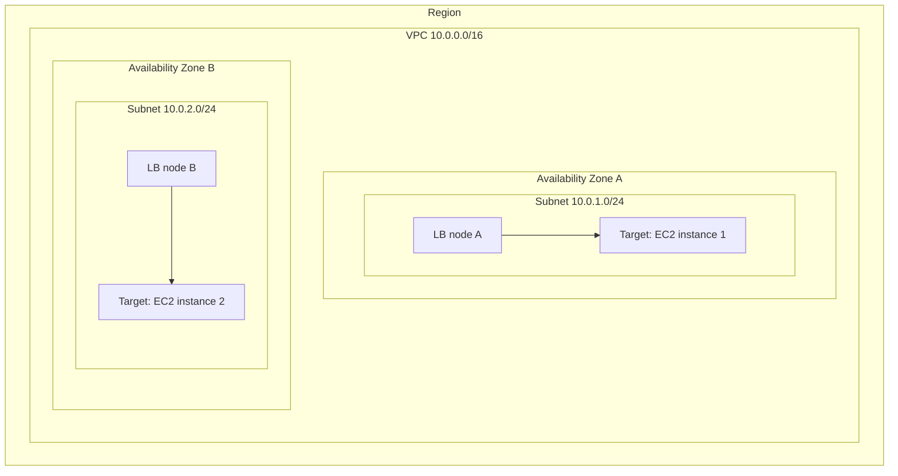
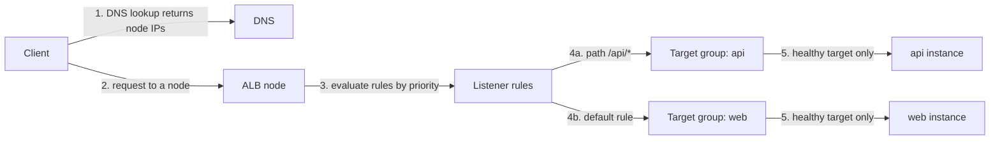
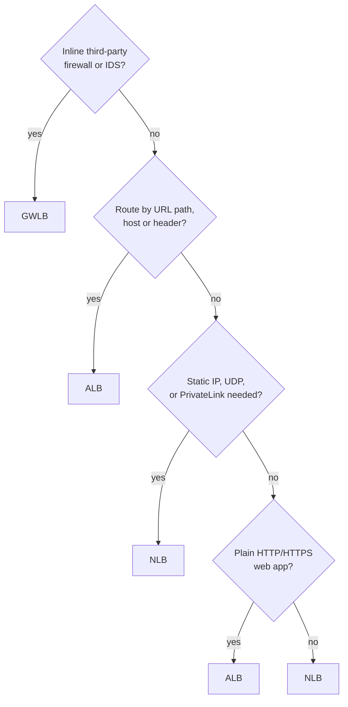

# Elastic Load Balancing (ALB vs NLB vs GWLB)

> [!summary] TL;DR
> - Elastic Load Balancing (ELB) spreads incoming traffic across targets in one or more Availability Zones and sends traffic only to healthy targets.[^2]
> - **ALB** works at layer 7 (HTTP/HTTPS): it routes by path, host, headers and more.[^3][^1]
> - **NLB** works at layer 4 (TCP/UDP/TLS): it gives a static IP per Availability Zone and keeps the client source IP.[^4][^1]
> - **GWLB** works at layer 3: it sends traffic through third-party virtual appliances (firewalls, inspection) using GENEVE on port 6081.[^5][^1]
> - Cross-zone load balancing: ALB always on; NLB and GWLB off by default.[^6]

## Why this exists
One server is a single point of failure and has a fixed capacity. A load balancer gives clients one address and spreads their requests over many servers. ELB is the managed version: it also checks target health and scales its own capacity automatically.[^2]

## Mental model
Think of an ALB as an nginx reverse proxy with `location` blocks: it reads the HTTP request and picks a backend by URL or host name. An NLB is closer to a TCP-mode proxy: it forwards connections without reading HTTP. A GWLB is a different thing: it is a "bump in the wire" that passes traffic through security appliances.

**Where this analogy breaks:** With nginx you run and scale the proxy servers yourself. With ELB, AWS creates the load balancer nodes and scales the capacity automatically.[^2]

## Core concepts
- **Target**: the destination that receives traffic, such as an EC2 instance, a container, or an IP address.[^2]
- **Target group**: a set of targets. A listener rule forwards traffic to a target group. You can register a target with multiple target groups.[^8]
- **Listener**: a process that checks for connection requests, using the protocol and port you configure.[^3]
- **Listener rule** (ALB): has a priority, one or more conditions, and one or more actions. Each listener must have a default rule.[^3]
- **Load balancer node**: when you enable an Availability Zone, ELB creates a node in it.[^6]
- **Scheme**: you choose internal or internet-facing when you create the load balancer. Internet-facing nodes have public IP addresses. Internal nodes have only private IP addresses.[^6]
- **Health check**: ELB monitors registered targets and routes only to healthy ones.[^2]

## Where it lives

> [!info] How to read this
> You enable Availability Zones, and ELB creates one load balancer node in each.[^6] With cross-zone load balancing off, a node sends traffic only to targets in its own zone (the two arrows).[^4]

Simplified: cross-zone arrows (node A to instance 2) are not drawn; see the worked example.

## How it works

1. The client resolves the load balancer DNS name. DNS returns the IP addresses of the load balancer nodes.[^6]
2. The client chooses one IP address and sends the request to that node.[^6]
3. For an ALB, the listener evaluates its rules in priority order.[^6]
4. The matching rule forwards the request to its target group.[^8]
5. The load balancer picks a target from the group. The default routing algorithm is round robin.[^6] Unhealthy targets get no traffic.[^2]

An NLB follows the same path, but it picks a target with a flow hash algorithm and does not read HTTP rules.[^6]

For a GWLB, you set the Gateway Load Balancer endpoint as the next hop in the route table of the application subnet. Traffic goes from the consumer VPC through the endpoint to the GWLB in the provider VPC and returns to the consumer VPC.[^5]

> [!info] How to read this
> The numbers match the list. Step 4 is the ALB-only feature: content-based routing.

Simplified: the ALB node scale-out, TLS handling and the return path of the response are left out.

### Worked example: cross-zone load balancing
An NLB has 2 targets in Zone A and 8 targets in Zone B. Assume clients send 50% of traffic to each node (simplification; the client chooses the IP address[^6]).

| Cross-zone | Traffic per target in Zone A | Traffic per target in Zone B |
|---|---|---|
| Disabled | 50% / 2 = 25% | 50% / 8 = 6.25% |
| Enabled | 100% / 10 = 10% | 100% / 10 = 10% |

When enabled, each node distributes traffic across registered targets in all enabled zones.[^6] The cost: with an NLB or GWLB you are charged for data transfer between Availability Zones when cross-zone is enabled. With an ALB you are not.[^1]

## Key facts and limits
| Fact | Value | Source |
|---|---|---|
| ALB OSI layer | 7 (application layer) | [^3] |
| NLB OSI layer | 4 | [^4] |
| GWLB OSI layer | 3 (network layer) | [^5] |
| ALB target types | `instance`, `ip`, `lambda`; cannot change after creation | [^8] |
| NLB target types | instance IDs, IP addresses, or an ALB | [^4] |
| NLB protocols | TCP, UDP, TCP_UDP, TLS, QUIC, TCP_QUIC | [^4] |
| NLB static IP | One per enabled Availability Zone; optional Elastic IP per subnet on internet-facing | [^4] |
| ALB minimum Availability Zones | At least two | [^6] |
| Cross-zone default | ALB: always on at load balancer level (can be disabled at target group level). NLB, GWLB: disabled by default | [^6] |
| GWLB to appliances | GENEVE, port 6081 | [^5] |
| ALB deregistration delay default | 300 seconds | [^9] |
| ALB default routing algorithm | Round robin (least outstanding requests is an option) | [^9] |
| Classic Load Balancer | Previous generation; AWS recommends migrating | [^2] |

## Comparisons
| | ALB | NLB | GWLB |
|---|---|---|---|
| Layer | 7[^3] | 4[^4] | 3 and 4 (gateway plus load balancing)[^1] |
| Protocols | HTTP, HTTPS (also HTTP/2, gRPC, WebSockets)[^8][^1] | TCP, UDP, TLS[^4] | IP traffic via GENEVE to appliances[^5] |
| Routing | Host, path, HTTP headers, methods, query parameters, source IP[^1] | Flow hash[^6] | Flow stickiness to one appliance[^5] |
| Static / Elastic IP | Not stated in sources used | Yes, per Availability Zone[^4] | Not stated in sources used |
| Source IP preserved | Not stated in sources used | Yes[^1] (depends on target type[^4]) | n/a |
| Security groups | Yes[^1] | Yes, if attached at creation[^7] | Not stated in sources used |
| AWS WAF | Yes[^3] | Not stated in sources used | Not stated in sources used |
| Typical use | Web apps, microservices | Extreme TCP/UDP load, fixed IPs, PrivateLink | Inline firewalls and inspection |

## Choosing in exam scenarios

> [!info] How to read this
> Start at the top. The first "yes" decides. Use the keywords in each box as exam triggers.

- "Route `/images` and `/api` to different services", "host-based routing", "Lambda as target" → **ALB**, because it has path and host conditions and Lambda targets.[^3][^8]
- "Static IP", "Elastic IP", "UDP", "TCP" → **NLB**, because it gives a static IP per Availability Zone and supports TCP and UDP.[^4]
- "Expose a service through AWS PrivateLink" → **NLB** (TCP and TLS listeners can be used for PrivateLink; UDP listeners cannot).[^1] See [[vpc-endpoints-and-privatelink]].
- "Deploy a third-party firewall / deep packet inspection inline" → **GWLB**.[^5]
- "Block SQL injection at the load balancer" → **ALB** with AWS WAF.[^3] See [[waf-and-shield]].
- "Keep a user on the same server" → ALB sticky sessions, enabled at the target group level.[^9]
- "Highest availability" → enable multiple Availability Zones. AWS recommends this for all load balancers.[^6]

## Common traps and misconceptions
- **Misconception:** "An NLB cannot have security groups." → **Reality:** it can, but only if you attach one when you create it. Without one, all client traffic can reach the listeners.[^7] → **Source:** [^7]
- **Misconception:** "Cross-zone load balancing is on for every load balancer." → **Reality:** it is always on for ALB but disabled by default for NLB and GWLB.[^6]
- **Misconception:** "Cross-zone is free everywhere." → **Reality:** NLB and GWLB charge for inter-zone data transfer when it is enabled; ALB does not.[^1]
- **Misconception:** "Removing an instance cuts its connections at once." → **Reality:** by default ELB waits 300 seconds before completing deregistration, so in-flight requests can finish.[^9]
- **Misconception:** "A load balancer needs only one Availability Zone." → **Reality:** an ALB requires at least two enabled.[^6]

## Self-check
**Q1.** A company runs a web app on EC2 instances. Requests to `/video/*` must go to one group of instances and all other requests to another group. Which load balancer fits with the least operational effort?
A. NLB with two listeners  B. ALB with path-based listener rules  C. GWLB  D. Two Route 53 records and no load balancer

> [!question]- Answer
> **B.** ALB listener rules can forward by URL path.[^3] A is wrong: NLB works at layer 4 and has no URL path rules.[^4] C is wrong: GWLB is for virtual appliances.[^5] D is wrong: it does not route by path inside one domain.

**Q2.** A partner allows traffic only from fixed IP addresses. Your TCP service runs in two Availability Zones. Which design works?
A. Internet-facing ALB  B. Internet-facing NLB with one Elastic IP per subnet  C. GWLB  D. Internal ALB

> [!question]- Answer
> **B.** An internet-facing NLB can have one Elastic IP address per subnet.[^4] A: sources used here do not show a static IP for ALB. C: GWLB is for appliances.[^5] D: an internal load balancer has only private IP addresses.[^6]

**Q3.** An NLB has 2 targets in Zone A and 8 in Zone B, cross-zone off. What is the effect, and the fix?
A. Zone A targets get less traffic each; enable cross-zone  B. Zone A targets get more traffic each; enable cross-zone  C. Traffic is even; no change needed  D. Zone B targets fail; add an ALB

> [!question]- Answer
> **B.** With cross-zone off, each node serves only its own zone,[^4] so Zone A targets get 25% each against 6.25% in Zone B (see worked example). Enabling cross-zone spreads traffic across all zones.[^6] A and C are wrong by the numbers. D is wrong: nothing fails; the load is uneven.

## Related
[[ec2-fundamentals]] · [[security-groups-vs-nacls]] · [[vpc-fundamentals]] · [[waf-and-shield]] · [[acm-certificates]] · [[vpc-endpoints-and-privatelink]] · EC2 Auto Scaling and Route 53 (later notes in `_todo.md`)

## Sources
[^1]: Elastic Load Balancing FAQs — https://aws.amazon.com/elasticloadbalancing/faqs/ (accessed 2026-11-08)
[^2]: What is Elastic Load Balancing? — https://docs.aws.amazon.com/elasticloadbalancing/latest/userguide/what-is-load-balancing.html (accessed 2026-11-08)
[^3]: What is an Application Load Balancer? — https://docs.aws.amazon.com/elasticloadbalancing/latest/application/introduction.html (accessed 2026-11-08)
[^4]: What is a Network Load Balancer? — https://docs.aws.amazon.com/elasticloadbalancing/latest/network/introduction.html (accessed 2026-11-08)
[^5]: What is a Gateway Load Balancer? — https://docs.aws.amazon.com/elasticloadbalancing/latest/gateway/introduction.html (accessed 2026-11-08)
[^6]: How Elastic Load Balancing works — https://docs.aws.amazon.com/elasticloadbalancing/latest/userguide/how-elastic-load-balancing-works.html (accessed 2026-11-08)
[^7]: Security groups for your Network Load Balancer — https://docs.aws.amazon.com/elasticloadbalancing/latest/network/load-balancer-security-groups.html (accessed 2026-11-08)
[^8]: Target groups for your Application Load Balancers — https://docs.aws.amazon.com/elasticloadbalancing/latest/application/load-balancer-target-groups.html (accessed 2026-11-08)
[^9]: Target group attributes for your Application Load Balancer — https://docs.aws.amazon.com/elasticloadbalancing/latest/application/edit-target-group-attributes.html (accessed 2026-11-08)
