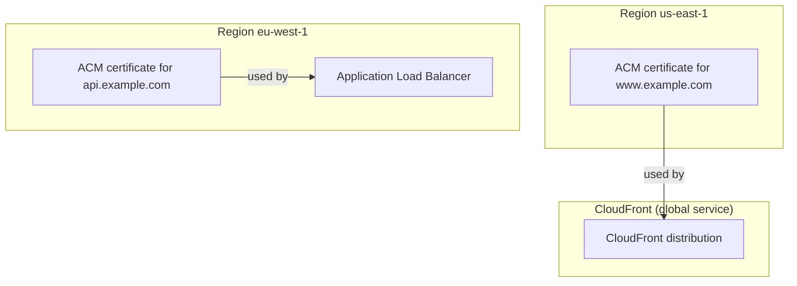
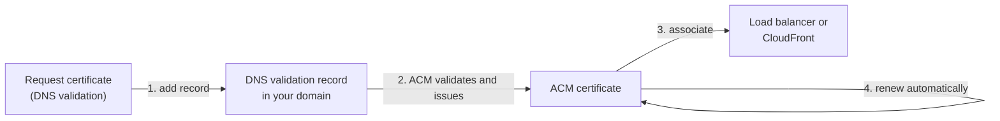
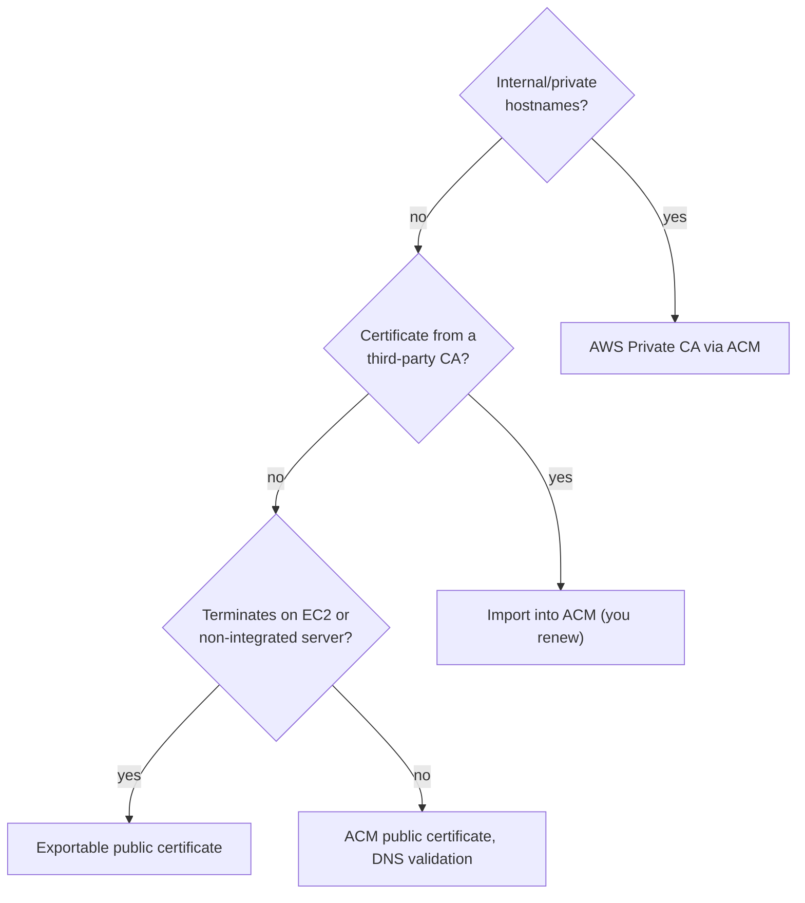

# AWS Certificate Manager (ACM)

> [!summary] TL;DR
> - ACM provisions, manages, and deploys public and private SSL/TLS certificates.[^1]
> - Certificates used only with ACM-integrated services (for example Elastic Load Balancing, CloudFront, API Gateway) are free.[^1]
> - ACM certificates must be in the same Region as the resource that uses them. CloudFront needs the certificate in US East (N. Virginia).[^1]
> - With DNS validation, ACM renews certificates automatically while the validation record stays in place and the certificate is in use.[^1][^2]
> - ACM does not renew imported certificates. You must.[^1][^2]

## Why this exists
HTTPS needs a certificate (a signed file that proves a domain's identity and carries the public key). Normally you buy one, install it on each server, and renew it before it expires. A missed renewal causes an outage. ACM issues the certificate, installs it on supported AWS services, and renews it for you.

## Core concepts
- **TLS certificate:** the file a server shows to clients so they can trust the server's identity and set up an encrypted connection.
- **Public certificate:** issued through ACM for use on the internet.[^1]
- **Private certificate:** issued by a private certificate authority (CA) for internal use. **AWS Private CA** is the service that runs it. You can delegate private certificate management to ACM.[^1]
- **ACM-integrated service:** an AWS service where you attach an ACM certificate directly. The FAQ lists Elastic Load Balancing, CloudFront, API Gateway, CloudFormation, Elastic Beanstalk, Nitro Enclaves, Network Firewall and OpenSearch Service.[^1]
- **DNS validation:** you prove domain ownership with a DNS record. AWS recommends it if you can change the DNS configuration of your domain.[^1]
- **Imported certificate:** a certificate from another CA that you upload to ACM.[^1]
- **Exportable public certificate:** an optional kind of public certificate that you can use outside integrated services. You are charged for issuance, renewal, and related API use.[^1]

## Where it lives

> [!info] How to read this
> The certificate for the ALB sits in the same Region as the ALB. The CloudFront certificate sits in us-east-1, even though CloudFront is global.[^1]

Simplified: API Gateway and the other integrated services are left out. Certificates for the same domain in many Regions are separate and renew independently.[^2]

## How it works
Request, validate, attach, renew:

1. You request a public certificate and choose DNS validation. You add the DNS validation record to your domain.
2. ACM validates the domain and issues the certificate. Public certificates issued through ACM are valid for 198 days today.[^1]
3. You associate the certificate with an integrated service.
4. ACM renews it automatically "as long as the DNS validation record remains in place" and the certificate remains in use.[^1]

> [!info] How to read this
> Step 4 only works while the record in step 1 stays in DNS. Delete the record and automatic renewal stops being possible.

Simplified: ACM's exact renewal start time and email validation behavior are not covered (not verified).

### Renewal eligibility
Per the ACM managed renewal page, a certificate is eligible if it is associated with another AWS service such as Elastic Load Balancing or CloudFront, or if it was exported since being issued or last renewed. It is not eligible if it is imported or already expired.[^2] ACM will either renew automatically (DNS validation) or send email notices as expiry approaches.[^2] The ARN stays the same after renewal.[^2]

## Key facts and limits
| Fact | Value | Source |
|---|---|---|
| Public/private certificates used only with integrated services | free | [^1] |
| Exportable public certificates | charged for issuance, renewal, API use | [^1] |
| Private CA | monthly fee per CA until deleted | [^1] |
| Public certificate validity | 198 days until March 15, 2027; less than 100 days after that | [^1] |
| Region rule | same Region as the resource; CloudFront uses us-east-1 | [^1] |
| Imported certificates | ACM does not renew them | [^1][^2] |

## Comparisons
| | ACM public cert (integrated) | Imported cert | Exportable public cert | Private CA cert |
|---|---|---|---|---|
| Cost | free[^1] | not stated for import in sources fetched | paid issuance and renewal[^1] | monthly CA fee[^1] |
| Renewal | automatic with DNS validation[^1] | you[^1][^2] | eligible if exported since issue or last renewal[^2] | Private CA renews delegated certificates[^1] |
| Use outside integrated services | not in the list[^1] | not covered | yes, any workload needing TLS[^1] | yes, EC2, containers, on-premises, IoT[^1] |

## Choosing in exam scenarios

> [!info] How to read this
> The default answer is the last box: free, automatic, attached to a load balancer or CloudFront.

- "HTTPS on an ALB, lowest cost, no manual renewal" → ACM public certificate with DNS validation.
- "HTTPS on CloudFront" → certificate in us-east-1.
- "Existing certificate from another CA" → import; you must renew it.
- "Certificate expired unexpectedly" → check for an imported certificate, or a deleted DNS validation record.

## Common traps and misconceptions
- **Misconception:** One ACM certificate covers all Regions. → **Reality:** The certificate must be in the same Region as the resource.[^1] → **Source:** [^1]
- **Misconception:** ACM renews everything. → **Reality:** Imported certificates are not eligible.[^2] → **Source:** [^2]
- **Misconception:** The CloudFront certificate goes in the Region of the origin. → **Reality:** It must be in US East (N. Virginia).[^1] → **Source:** [^1]
- **Misconception:** Public ACM certificates have a monthly fee. → **Reality:** Used only with integrated services they are free.[^1] → **Source:** [^1]

## Self-check

**Q1.** A site uses CloudFront with a custom domain. In which Region must the ACM certificate be?
A. The Region of the S3 origin  B. Any Region  C. US East (N. Virginia)  D. The Region closest to users

> [!question]- Answer
> **C.** CloudFront needs certificates in us-east-1.[^1] The others are wrong because the Region rule has CloudFront as the one exception.

**Q2.** A company imports a certificate from a third-party CA into ACM and attaches it to an ALB. Who renews it?
A. ACM automatically  B. The ALB  C. The company  D. AWS Private CA

> [!question]- Answer
> **C.** ACM does not manage renewal of imported certificates.[^1][^2] A and B are wrong for that reason. D is a different service and not involved.

**Q3.** Which option gives HTTPS on an ALB with the lowest cost and least operational work?
A. Import a purchased certificate  B. ACM public certificate with DNS validation  C. AWS Private CA certificate  D. Exportable public certificate on EC2

> [!question]- Answer
> **B.** It is free for integrated services and renews automatically.[^1] A needs manual renewal. C has a monthly CA fee.[^1] D is charged.[^1]

## Related
[[kms-and-cloudhsm]] · [[secrets-manager-vs-parameter-store]] · [[_index-encryption-and-secrets]] · [[vpc-fundamentals]]

## Sources
[^1]: AWS Certificate Manager FAQs — https://aws.amazon.com/certificate-manager/faqs/ (accessed 2026-11-08)
[^2]: Managed renewal for ACM certificates — https://docs.aws.amazon.com/acm/latest/userguide/managed-renewal.html (accessed 2026-11-08)
