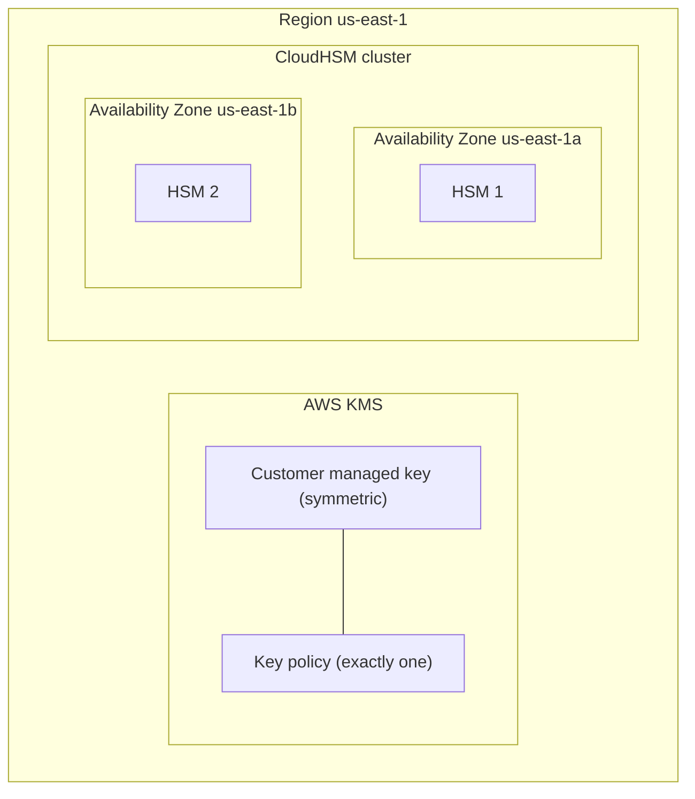
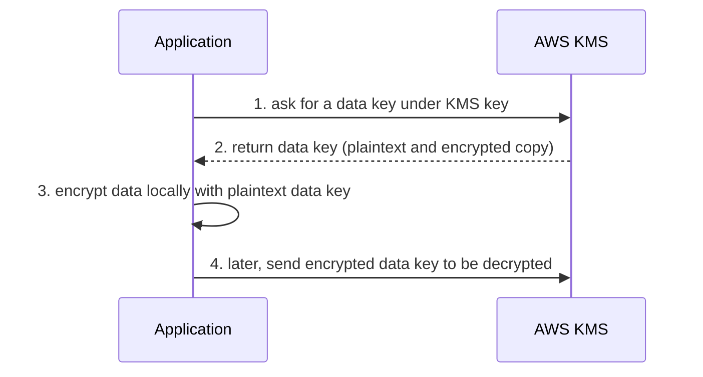
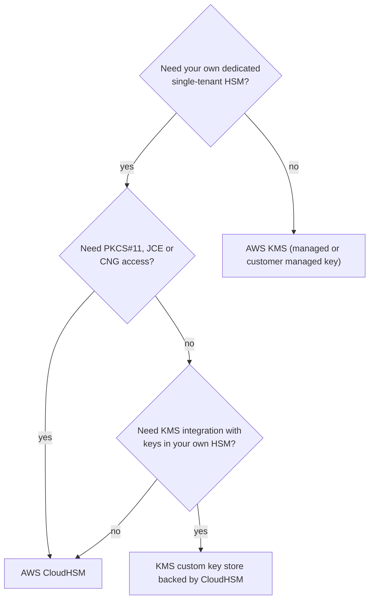

# AWS KMS and CloudHSM

> [!summary] TL;DR
> - **AWS KMS** is a managed service to create and control the keys used for cryptographic operations.[^1]
> - Services encrypt big data with **data keys** (envelope encryption). The data keys are encrypted under a KMS key.[^1]
> - Access to a KMS key is controlled by its **key policy**. Without permission from the key policy, IAM policies that allow permissions have no effect.[^3]
> - Automatic rotation is optional for customer managed keys, with a default of 365 days. Rotation does not re-encrypt your data.[^2]
> - **CloudHSM** gives you dedicated, single-tenant HSMs. Keys are accessible only by you, and you must design the cluster for high availability.[^4]

## Why this exists
Encrypting data is easy. Protecting the encryption keys is the hard part. If the key sits in a config file next to the data, encryption adds little. KMS keeps the keys inside hardware security modules (HSMs, tamper-resistant devices that store keys) and lets you decide who can use them. CloudHSM is for cases where you need the HSM itself to be yours alone.

## Core concepts
- **KMS key:** the top-level logical key in KMS. It is a container for key material and has an ARN.[^5]- **Symmetric / asymmetric / HMAC keys:** KMS can create all three kinds, where the key material is only used within the service.[^1] Asymmetric keys can be used to sign and verify.[^1]
- **Customer managed key:** a KMS key in your account that you create, own, and manage.[^5]
- **AWS managed key:** a KMS key in your account that is created, managed, and used on your behalf by an AWS service integrated with KMS.[^5] These are free to store in your account.[^1]
- **AWS owned key:** a KMS key that an AWS service owns and manages for use in multiple AWS accounts.[^5] You cannot enable or disable rotation for it.[^2]
- **Data key:** a key that KMS generates for you. The data key encrypts your data locally. KMS encrypts the data key under a KMS key you define.[^1]
- **Envelope encryption:** the method of encrypting data with a data key, then encrypting the data key under a KMS key.[^1] KMS can encrypt up to 4 KB directly. Larger data uses a data key.[^1]
- **Key policy:** the resource policy attached to a KMS key. Every KMS key must have exactly one.[^3]
- **Grant:** another way to give access to a KMS key, next to key policies and IAM policies.[^3]
- **HSM:** hardware security module. **CloudHSM cluster:** a group of HSMs that you control.[^4]
- **Custom key store:** a KMS feature that backs KMS keys with your own CloudHSM cluster or an external key manager.[^1]

## Where it lives

> [!info] How to read this
> A single-Region KMS key is stored and used only in the Region where it was created.[^1] A CloudHSM cluster should have two or more HSMs in separate Availability Zones.[^4]

Simplified: VPCs, other accounts and multi-Region keys are left out. Multi-Region primary keys can be replicated into other Regions in the same AWS partition.[^1]

## How it works
Envelope encryption, step by step:

1. The application asks KMS for a data key protected under a KMS key.
2. KMS returns the data key. KMS can return it as ciphertext, in plaintext, or both.[^5]
3. The application encrypts the data locally with the data key.[^1]
4. To read the data later, the encrypted data key is decrypted under the KMS key, and the data is decrypted locally.

> [!info] How to read this
> The big data never goes to KMS. Only the small data key does. This is why KMS can protect large objects without a 4 KB limit.

Simplified: API names, the exact moment the plaintext data key is dropped, and the policy check on each KMS call are left out.

### Rotation
- **Automatic rotation** is optional for customer managed keys. If you do not set a period, the default is 365 days.[^2] The FAQ gives a configurable range of 90 to 2560 days.[^1]
- **AWS managed keys** are rotated automatically every year (about 365 days).[^2]
- **AWS owned keys:** the owning service decides.[^2]
- The key ID and ARN stay the same: "The KMS key is the same logical resource" however often its key material changes. KMS keeps old key material to decrypt old ciphertext.[^2]
- Rotation "does not rotate the data keys that the KMS key generated or re-encrypt any data protected by the KMS key".[^2]
- Automatic and on-demand rotation are **not** supported for asymmetric keys, HMAC keys, or keys in custom key stores. Rotate these manually: create a new KMS key and change applications or aliases to use it.[^2]
- Imported key material (EXTERNAL origin) supports on-demand rotation, not automatic rotation.[^2]

## Key facts and limits
| Fact | Value | Source |
|---|---|---|
| Direct KMS encryption size | up to 4 KB | [^1] |
| Default automatic rotation period (customer managed) | 365 days | [^2] |
| Rotation period range (FAQ) | 90 to 2560 days | [^1] |
| AWS managed key rotation | every year (about 365 days) | [^2] |
| Key deletion waiting period | 7 to 30 days, default 30 | [^1] |
| KMS HSM validation | FIPS 140-3 (Security Level 3 stated in the Security FAQ part of the page) | [^1] |
| CloudHSM validation | FIPS 140-2 Level 3; `hsm2m.medium` instances are described as FIPS 140-3 Level 3 | [^4] |
| CloudHSM client APIs | PKCS#11, Java JCE, OpenSSL Dynamic Engine, Microsoft KSP/CNG | [^4] |
| CloudHSM HA | at least two HSMs in two AZs; you must architect it | [^4] |

## Comparisons
| | KMS | CloudHSM |
|---|---|---|
| Who uses it | Applications and AWS services through KMS and its policies | Your applications through the standard APIs of CloudHSM[^4] |
| HSM access | You define usage and management policies; KMS enforces them[^1] | Dedicated, single-tenant access to each HSM; "keys are accessible only by you"[^4] |
| Availability design | Not a customer task in the sources fetched | "your responsibility to architect your cluster for high availability"[^4] |
| Rotation | Built in for supported key types[^2] | Not covered in the sources fetched |
| Link between them | A custom key store lets KMS keys be backed by CloudHSM[^4] | |

## Choosing in exam scenarios

> [!info] How to read this
> Start with KMS. Move to CloudHSM only when the requirement says dedicated HSM or names those client APIs.

- "Encrypt data at rest with least operational overhead" → KMS, usually through an integrated service using an AWS managed key.
- "Control who can use and rotate the key" → customer managed key, with a key policy.
- "Dedicated, single-tenant HSM", "keys only we can access" → CloudHSM.
- "Rotate the key every year, no code change" → automatic rotation on a symmetric customer managed key.
- "Rotate an asymmetric key" → manual rotation (new key plus alias change).

## Common traps and misconceptions
- **Misconception:** Rotating a KMS key re-encrypts my data. → **Reality:** Rotation has no effect on the data or data keys it protects.[^2] → **Source:** [^2]
- **Misconception:** An IAM policy that allows `kms:*` is enough. → **Reality:** Unless the key policy explicitly allows it, IAM policies cannot allow access to a KMS key.[^3] → **Source:** [^3]
- **Misconception:** Rotation gives me a new key ID. → **Reality:** The KMS key stays the same logical resource.[^2] → **Source:** [^2]
- **Misconception:** Every KMS key can rotate automatically. → **Reality:** Not asymmetric, HMAC, or custom key store keys.[^2] → **Source:** [^2]
- **Misconception:** A KMS key can be deleted at once. → **Reality:** Deletion has a waiting period of 7 to 30 days.[^1] → **Source:** [^1]
- **Misconception:** A single-Region key is usable in any Region. → **Reality:** It is stored and used only in its Region.[^1] → **Source:** [^1]

## Self-check

**Q1.** A bank must keep encryption keys in dedicated hardware that only the bank can access. The application already uses PKCS#11. Which service fits?
A. AWS KMS with an AWS managed key  B. AWS CloudHSM  C. AWS Secrets Manager  D. AWS Certificate Manager

> [!question]- Answer
> **B.** CloudHSM gives dedicated single-tenant HSMs and supports PKCS#11.[^4] A: KMS keys are managed through KMS policies, not a dedicated HSM you own. C stores secrets, not HSM keys. D issues TLS certificates (see [[acm-certificates]]).

**Q2.** A role has an IAM policy allowing `kms:Decrypt` on a customer managed key but gets AccessDenied. What is the most likely cause?
A. Automatic rotation is off  B. The key policy does not allow access or enable IAM policies  C. The key is asymmetric  D. The data is larger than 4 KB

> [!question]- Answer
> **B.** IAM policies have no effect for KMS unless the key policy allows it.[^3] A: rotation does not change access. C: key type is not the stated cause. D: size is about direct encryption, not decrypt permissions.

**Q3.** A team wants a symmetric customer managed key rotated every year with no application change. What should it do?
A. Create a new key every year and re-encrypt all data  B. Enable automatic key rotation  C. Use an AWS owned key  D. Import the key material

> [!question]- Answer
> **B.** Automatic rotation keeps the same key ID and ARN, and old ciphertext still decrypts.[^2] A is manual and not needed. C: you cannot control rotation of AWS owned keys.[^2] D: imported material does not support automatic rotation.[^2]

## Related
[[iam-fundamentals]] · [[acm-certificates]] · [[secrets-manager-vs-parameter-store]] · [[_index-encryption-and-secrets]]

## Sources
[^1]: AWS Key Management Service FAQs — https://aws.amazon.com/kms/faqs/ (accessed 2026-11-08)
[^2]: Rotate AWS KMS keys — https://docs.aws.amazon.com/kms/latest/developerguide/rotate-keys.html (accessed 2026-11-08)
[^3]: Key policies in AWS KMS — https://docs.aws.amazon.com/kms/latest/developerguide/key-policies.html (accessed 2026-11-08)
[^4]: AWS CloudHSM FAQs — https://aws.amazon.com/cloudhsm/faqs/ (accessed 2026-11-08)
[^5]: AWS KMS cryptographic details (key types, data keys) — https://docs.aws.amazon.com/kms/latest/developerguide/concepts.html (accessed 2026-11-08)
