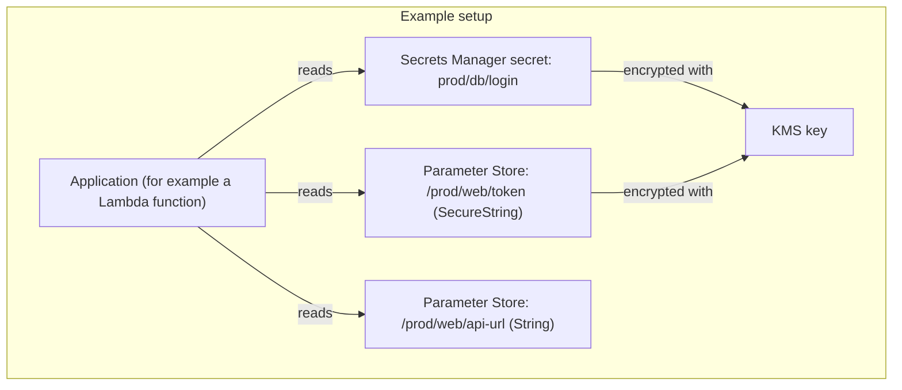
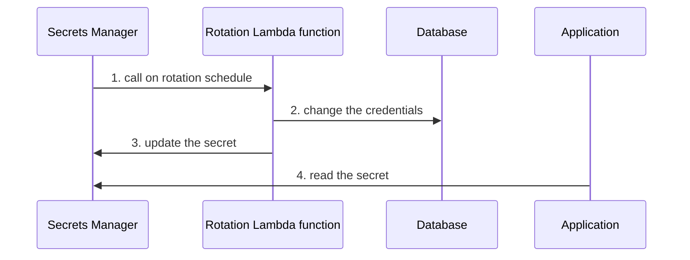
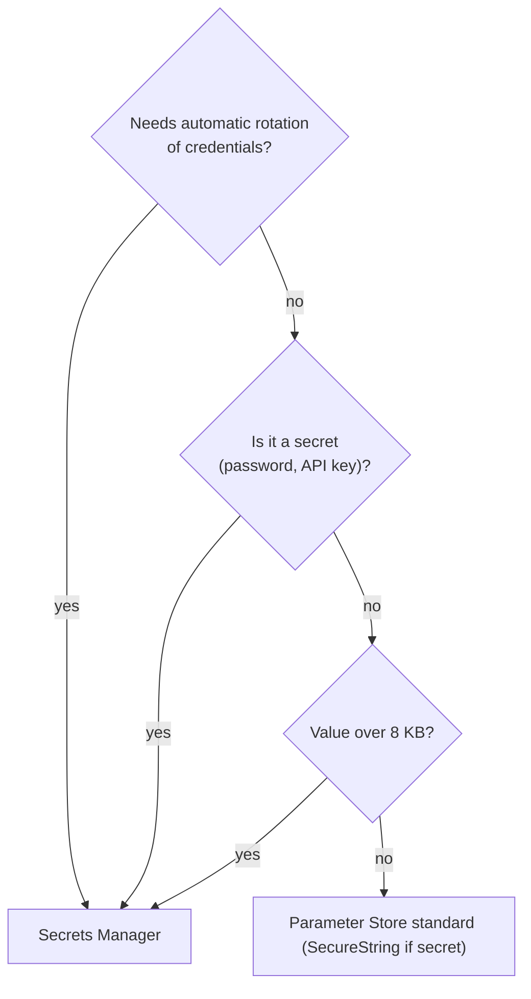

# Secrets Manager vs Systems Manager Parameter Store

> [!summary] TL;DR
> - **Secrets Manager** manages secrets such as database credentials and API keys. It can rotate them on a schedule.[^1][^2][^3]
> - **Parameter Store** is a centralized store for configuration values called parameters. Standard parameters have no additional charge.[^3]
> - Both can encrypt with KMS: Secrets Manager always, Parameter Store for `SecureString` parameters.[^1][^3]
> - AWS recommends Secrets Manager for credentials. The comparison lists automatic rotation only under Secrets Manager.[^3]
> - Secret size limit: 64 KB in Secrets Manager. Parameter value limit: 4 KB standard, 8 KB advanced.[^1][^3]

## Why this exists
Applications need database passwords and settings. Putting them in code or environment files leaks them and makes changes slow. Both services keep them in one place, control access with IAM, and keep the value out of your source code.

## Core concepts
- **Secret:** a value you protect in Secrets Manager, stored as JSON or text of 64 KB or smaller.[^1]
- **Rotation:** "the process of periodically updating a secret." You update the credentials in both the secret and the database or service.[^2]
- **Managed rotation:** the service configures and manages rotation, with no Lambda function. Offered for Aurora, RDS and DocumentDB master user credentials, and Redshift admin passwords.[^2]
- **Lambda rotation:** for other secret types, Secrets Manager calls a Lambda function on the schedule.[^2]
- **Parameter:** a named value in Parameter Store.[^3]
- **Parameter types:** `String` (plain text), `StringList` (comma-separated plain text), `SecureString` (encrypted with KMS).[^3]
- **Standard vs advanced tier:** set per parameter. Advanced allows more parameters and larger values and costs money.[^3]
- **Hierarchy:** a path naming scheme such as `/env/computer-type/app/data` to group parameters.[^3]

## Where it lives

> [!info] How to read this
> The application reads from both stores. The plain `String` parameter is not encrypted. See [[kms-and-cloudhsm]] for the key.

Simplified: IAM policies, Regions, cross-Region copies and cross-account access are left out.

## How it works
Rotation with a Lambda function:

1. Secrets Manager calls the Lambda function according to the rotation schedule you set.[^2]
2. The function updates the credentials in the database or service.[^2]
3. The function updates the secret.[^2]
4. The application reads the secret from Secrets Manager.

> [!info] How to read this
> With managed rotation (RDS, Aurora, DocumentDB, Redshift), steps 1 to 3 happen without a Lambda function that you create or manage.[^2]

Simplified: the order of steps 2 and 3 inside the function is not specified in the sources fetched. Rotation strategies are covered below.

- **Schedule:** you can rotate a secret as often as every four hours. The maximum rotation period is 999 days for rate() expressions.[^2]
- **Strategies for database secrets with Lambda rotation:** *single user* updates credentials for one user in one secret. *Alternating users* updates credentials for two users in one secret. The function clones the first user to create the second.[^2]
- During rotation, new connections that retrieve the secret may get the previous version of the credentials in managed rotation.[^2]

## Key facts and limits
| Fact | Secrets Manager | Parameter Store | Source |
|---|---|---|---|
| Purpose | secrets management | configuration data store | [^1][^3] |
| Max value size | 64 KB | 4 KB standard, 8 KB advanced | [^1][^3] |
| Max count per account per Region | not covered | 10,000 standard, 100,000 advanced | [^3] |
| Cost | billed per secret per month and per API call | standard: no additional charge; advanced: charges apply | [^3] |
| Rotation | on a schedule; managed or Lambda | not listed; the AWS table shows automatic rotation under Secrets Manager only | [^2][^3] |
| Encryption | envelope encryption in KMS | `SecureString` via KMS | [^1][^3] |
| Versions | staging labels | keeps 100 most recent versions | [^3] |
| Minimum rotation interval | every four hours | n/a | [^2] |

## Comparisons
| | Secrets Manager | Parameter Store |
|---|---|---|
| Best for | credentials, API keys, rotation, cross-account access, detailed audit logging[^3] | app configuration, feature settings, hierarchies[^3] |
| Automatic rotation | yes[^2] | no built-in rotation in the comparison[^3] |
| Cost | per secret and per API call[^3] | free at standard tier[^3] |
| Free tier | Free Plan credits for new customers starting July 15, 2025, per the FAQ[^1] | not covered |
| Audit | integrates with CloudTrail, CloudWatch and SNS[^1] | not covered in the page fetched |

## Choosing in exam scenarios

> [!info] How to read this
> Rotation or credentials point to Secrets Manager. Plain configuration at the lowest cost points to Parameter Store.

- "Rotate RDS password automatically, least operational effort" → Secrets Manager (managed rotation).
- "Store configuration, lowest cost" → Parameter Store standard parameters.
- "Share a secret with another account" → Secrets Manager (cross-account listed as a Secrets Manager use case).[^3]
- "Hierarchy of settings per environment" → Parameter Store paths.

## Common traps and misconceptions
- **Misconception:** Parameter Store `String` parameters are encrypted. → **Reality:** `String` is for plain text values. Use `SecureString` for encryption.[^3] → **Source:** [^3]
- **Misconception:** Rotation always needs a Lambda function that I write. → **Reality:** Managed rotation exists for RDS, Aurora, DocumentDB, and Redshift credentials.[^2] → **Source:** [^2]
- **Misconception:** Parameter Store rotates my passwords. → **Reality:** AWS recommends Secrets Manager for credentials, and lists automatic rotation under Secrets Manager.[^3] → **Source:** [^3]
- **Misconception:** Standard and advanced parameters cost the same. → **Reality:** Standard has no additional charge. Advanced has charges.[^3] → **Source:** [^3]

## Self-check

**Q1.** An app needs its RDS password rotated every 30 days with the least operational effort. Which is best?
A. Parameter Store SecureString and a cron job  B. Secrets Manager with managed rotation  C. A text file in S3  D. Environment variables

> [!question]- Answer
> **B.** Managed rotation needs no Lambda function for RDS credentials.[^2] A adds work and Parameter Store has no rotation. C and D leave the password in plain places and have no rotation.

**Q2.** A team stores feature-flag settings for 50 services and wants the lowest cost, no rotation. Which fits?
A. Secrets Manager  B. Parameter Store standard parameters  C. CloudHSM  D. ACM

> [!question]- Answer
> **B.** Standard parameters have no additional charge.[^3] A bills per secret. C and D are not configuration stores.

**Q3.** Which Parameter Store type should hold an API token that must be encrypted with KMS?
A. String  B. StringList  C. SecureString  D. AdvancedString

> [!question]- Answer
> **C.** `SecureString` is encrypted using KMS.[^3] A and B are plain text. D is not a parameter type listed by AWS.

## Related
[[kms-and-cloudhsm]] · [[acm-certificates]] · [[_index-encryption-and-secrets]] · [[iam-fundamentals]]

## Sources
[^1]: AWS Secrets Manager FAQs — https://aws.amazon.com/secrets-manager/faqs/ (accessed 2026-11-08)
[^2]: Rotate AWS Secrets Manager secrets — https://docs.aws.amazon.com/secretsmanager/latest/userguide/rotating-secrets.html (accessed 2026-11-08; the subagent also read linked pages rotate-secrets_lambda.html, rotate-secrets_managed.html, rotation-strategy.html, rotate-secrets_schedule.html)
[^3]: AWS Systems Manager Parameter Store — https://docs.aws.amazon.com/systems-manager/latest/userguide/systems-manager-parameter-store.html (accessed 2026-11-08)
