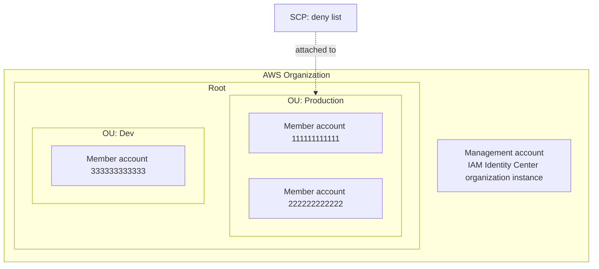
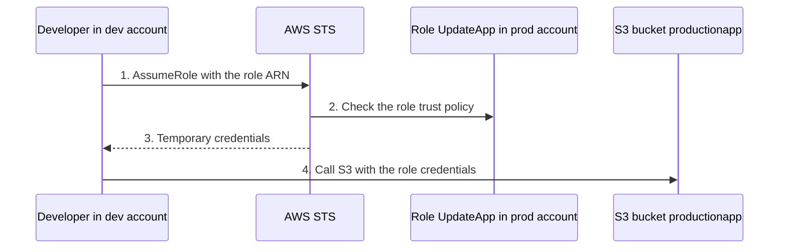
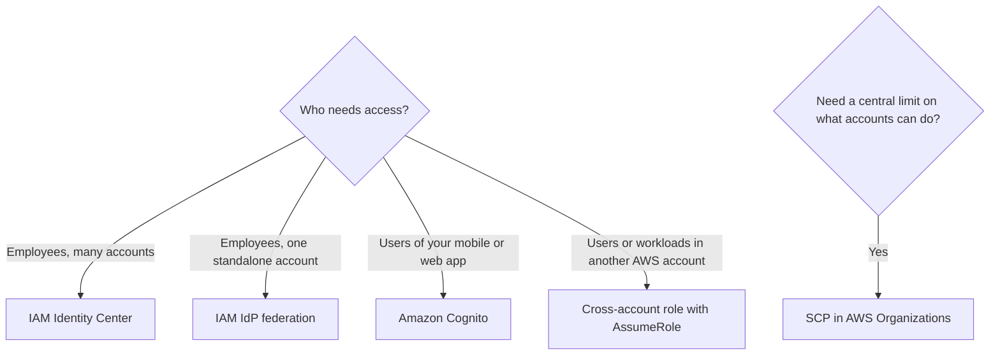

# IAM advanced — STS, cross-account roles, Organizations and SCPs, IAM Identity Center

> [!summary] TL;DR
> - AWS STS (Security Token Service) creates temporary security credentials. Roles, federation, and cross-account access all rely on them.[^2]
> - Cross-account access: the role's trust policy names the other account, and the other account must also grant its users permission to assume the role.[^3]
> - An SCP (service control policy) sets the maximum permissions for IAM users and roles in an organization. It never grants permissions.[^4]
> - SCPs affect member accounts, including each member account's root user. They do not affect users or roles in the management account.[^4]
> - For human users across many accounts, AWS recommends IAM Identity Center.[^8]

This note builds on [[iam-fundamentals]]. It does not re-explain users, groups, roles, or policy evaluation. The exam guide places these ideas under "Design secure access to AWS resources", with skills such as role-based access control (STS, role switching, cross-account access), multi-account security strategy (Control Tower, SCPs), and deciding when to federate a directory service with IAM roles.[^1]

## Why this exists
A real company does not run one AWS account. It runs many, for example one per environment or team. Without extra tools, you would create IAM users in every account, repeat the same policies, and have no central way to stop one account from doing something dangerous. This note covers four tools that solve this: STS for temporary access, cross-account roles for sharing access between accounts, Organizations with SCPs for central limits, and IAM Identity Center for central sign-in.

## Mental model
Assuming a role is like `su` or `sudo -u` to another Linux user. You act with that user's permissions, and you give up your own while you do.

**Where this analogy breaks:** With `su`, the target user's permission is a local setting. With a cross-account role, two accounts must both agree: the role's trust policy names the other account, and the other account must grant its users permission to assume the role.[^3]

## Core concepts

**AWS STS** — the service that creates temporary security credentials for trusted users.[^2] Temporary credentials work almost like long-term access keys, but they expire and are generated on request. After they expire, AWS no longer accepts them, and they cannot be reused.[^2]

**Cross-account role** — a role in one account (the *trusting* account, which owns the resource) that users from another account (the *trusted* account) can assume. The page I used does not call the accounts "trusting" and "trusted". I use those two terms to label its production and development example.[^3]

**AWS Organizations** — a service that centrally manages and governs many AWS accounts. You can create accounts, group them, apply policies, and get one consolidated bill.[^6]

**Organizational unit (OU)** — a group of accounts, for example accounts that serve one application or service.[^6]

**SCP (service control policy)** — a type of organization policy that gives central control over the maximum available permissions for IAM users and roles in the organization.[^4] An SCP is a guardrail. It does not grant permissions.[^4]

**IAM Identity Center** — the AWS solution for connecting workforce users to AWS accounts and applications. It was renamed from AWS Single Sign-On on July 26, 2022.[^7]

**Identity provider (IdP) and federation** — an IdP lets you manage user identities outside AWS and give those users permissions to use AWS resources. IAM supports IdPs compatible with OpenID Connect (OIDC) or SAML 2.0.[^8]

## Where it lives

> [!info] How to read this
> The SCP is attached to the Production OU, so it limits both member accounts below it. It does not limit the management account. The account IDs are examples.

Simplified: the diagram shows only OUs and accounts. SCPs can also be attached at the root or to a single account.[^5] The management account is drawn next to the root because the sources I used do not say where it sits in the hierarchy.

## How it works

### Cross-account access with AssumeRole

> [!info] How to read this
> The developer never gets a long-term key for the production account. Step 4 is limited to what the role's permissions policy allows.

Simplified: the diagram leaves out the console "Switch Role" screen and the permission the dev account must grant for step 1.

Steps, using the documented example of a development account (trusted) and a production account (trusting):[^3]
1. In the production account, an administrator creates the role. Its trust policy names the development account in `Principal`. A permissions policy gives it access, in the example read and write on one S3 bucket.
2. In the development account, an administrator grants a group permission to call the STS `AssumeRole` API for that role's ARN. The page says users "must explicitly" be granted this permission.
3. A user calls `AssumeRole` (or uses Switch Role in the console). STS checks the request against the trust policy and returns temporary credentials.
4. While using the role, the user can perform only the actions the role permits. Their original user permissions are suspended.

Optionally, the role can require that users sign in with MFA before they assume it.[^3]

### SCPs in the hierarchy
For an action to be allowed in a member account, there must be an explicit `Allow` at every level from the root through each OU on the path to the account, including the account itself.[^5] Any SCP on that path can deny an action, and that deny wins even if a lower SCP allows it.[^5] SCP evaluation is deny by default: anything not explicitly allowed is denied.[^5]

AWS Organizations attaches an AWS managed SCP named `FullAWSAccess` to every root, OU, and account when it is created. It allows all services and actions.[^5] If you remove it and do not replace it, the accounts below that level are blocked from all actions.[^5]

The final permissions are the intersection of what the SCPs and RCPs allow and what the identity-based and resource-based policies allow.[^4] A user with no IAM permission policy has no access, even if the SCPs allow all actions.[^4]

## Key facts and limits

| Fact | Value | Source |
|---|---|---|
| STS endpoint | By default, STS is a global service with one endpoint, `https://sts.amazonaws.com`. You can also call endpoints in other supported Regions to reduce latency. | [^2] |
| Where temporary credentials work | They work globally, whichever Region they come from | [^2] |
| SCP availability | Only in an organization with all features enabled. Not available with only consolidated billing. | [^4] |
| SCP and the management account | SCPs do not affect users or roles in the management account | [^4] |
| SCP and the root user of a member account | SCPs affect it | [^4] |
| SCP and service-linked roles | SCPs do not affect service-linked roles | [^4] |
| Default SCP | `FullAWSAccess`, attached to every root, OU, and account when created | [^5] |
| Identity Center instance types | An organization instance is deployed in the management account. It is the only instance type that manages access to AWS accounts. | [^7] |
| Permission sets | Available only for organization instances of IAM Identity Center | [^7] |

## Comparisons

| | SCP | Permissions boundary | IAM policy (identity-based) |
|---|---|---|---|
| Grants permissions? | No[^4] | No ([[iam-fundamentals]]) | Yes |
| Scope | Accounts and OUs in an organization[^4] | One user or role | One identity |
| Purpose | Central guardrail | Limit one identity | Give permissions |

| | IAM Identity Center | Federation directly with IAM (IdP) | IAM users |
|---|---|---|---|
| Best fit | Multiple accounts managed by AWS Organizations[^8] | Single, standalone account[^8] | Only cases federation does not support ([[iam-fundamentals]]) |
| AWS recommendation | Recommended for centralized access management of human users[^8] | Possible for human users in short-term, small-scale deployments[^8] | Not preferred |
| Also covers applications | Yes, user access to applications and to AWS accounts[^7] | No | No |

Amazon Cognito is a different tool: it adds sign-in to your own mobile and web apps, and its identity pools deliver IAM credentials to those users.[^8] It is covered in the threat-protection note later in this plan.

## Choosing in exam scenarios

> [!info] How to read this
> The first question picks how identities reach AWS. The second question is separate: an SCP limits permissions but never grants them, so it is used together with the first group.

- **"Employees sign in with the company directory and need access to many AWS accounts in one organization"** → IAM Identity Center, because it targets multiple accounts managed by Organizations and AWS recommends it for human users.[^8]
- **"Prevent every account in an OU from using a service, even for account administrators"** → an SCP attached to the OU. Even an `AdministratorAccess` policy cannot use a permission the SCP does not allow.[^4]
- **"Users in account A must use a resource in account B without new IAM users"** → a role in account B that account A users can assume.[^3]
- **"Application on EC2 needs access"** → a role on the instance, so no long-term credentials are stored there.[^2]
- **"Do not distribute long-term keys to a mobile app"** → temporary credentials through OIDC federation or Amazon Cognito.[^2][^8]
- **"Least operational overhead for central multi-account governance"** → Organizations with SCPs. AWS Control Tower is also in the exam guide's service list and is not covered here.[^1]

## Common traps and misconceptions

- **Misconception:** An SCP can restrict the management account. → **Reality:** SCPs do not affect users or roles in the management account.[^4]
- **Misconception:** Attaching an SCP that allows a service gives users access to it. → **Reality:** A user with no IAM permission policy has no access, even if the SCPs allow all actions.[^4]
- **Misconception:** An `Allow` SCP at one OU is enough. → **Reality:** An explicit `Allow` is needed at every level on the path from the root to the account, and a deny at any level wins.[^5]
- **Misconception:** Removing `FullAWSAccess` is harmless. → **Reality:** If it is removed and not replaced, the OUs and accounts below that level are blocked from taking any action.[^5]
- **Misconception:** SCPs work with consolidated billing only. → **Reality:** SCPs are available only when all features are enabled.[^4]
- **Misconception:** A trust policy alone lets users in another account assume a role. → **Reality:** In the documented example, the trusted account must also grant its users permission to call `AssumeRole`.[^3]
- **Misconception:** STS credentials from one Region stop working elsewhere. → **Reality:** They work globally, whichever Region they come from.[^2]
- **Misconception:** IAM Identity Center is only for AWS accounts. → **Reality:** It also gives users access to applications.[^7]

## Self-check

**Q1.** A company has 40 AWS accounts in one AWS Organization. Employees sign in with the company identity provider. The company wants central management of employee access to all accounts. What should the architect choose?
- A. Create IAM users in each account and share passwords.
- B. Enable IAM Identity Center and connect the identity provider.
- C. Create one IAM identity provider in each account.
- D. Attach an SCP to the root that grants employees access.

> [!question]- Answer
> **B.** IAM Identity Center is recommended for centralized access management of human users across multiple accounts managed by Organizations.[^8] A is the pattern AWS advises against: federation instead of individual IAM users.[^8] C works for a single account or small deployments, but it is not the recommended central solution for many accounts.[^8] D is wrong because SCPs do not grant permissions.[^4]

**Q2.** A security team wants to make sure no account in the Dev OU can use a specific AWS service, even if an account administrator attaches `AdministratorAccess` to a user. What should they do?
- A. Attach an IAM policy that denies the service to every user in each account.
- B. Attach an SCP to the Dev OU that denies the service.
- C. Attach a bucket policy.
- D. Attach the SCP to the management account.

> [!question]- Answer
> **B.** An SCP restricts permissions for users and roles in member accounts, and a user cannot use a permission the SCP does not allow even with `AdministratorAccess`.[^4] A can be undone by account administrators and needs work in every account. C is a resource-based policy for one resource, not an account-wide guardrail. D is wrong because SCPs do not affect users or roles in the management account, and the target is the Dev OU's member accounts.[^4]

**Q3.** An SCP allows all actions in an OU. A developer in a member account has no IAM policy that allows any action. What can the developer do?
- A. Everything, because the SCP allows it.
- B. Nothing, because SCPs do not grant permissions.
- C. Only read actions, as a default.
- D. Everything, if the developer is in the OU's first account.

> [!question]- Answer
> **B.** A user without any IAM permission policies has no access, even if the applicable SCPs allow all services and all actions.[^4] A treats the SCP as a grant. C and D describe rules that do not appear in the sources.

## Related
- [[iam-fundamentals]] — users, groups, roles, policies, evaluation logic
- Next in the plan: VPC fundamentals (not written yet)

## Sources
[^1]: AWS Certified Solutions Architect – Associate (SAA-C03) Exam Guide, Version 1.1 — https://d1.awsstatic.com/training-and-certification/docs-sa-assoc/AWS-Certified-Solutions-Architect-Associate_Exam-Guide.pdf (accessed 2026-11-08). Cached scope facts are in `_exam-guide.md`.
[^2]: Temporary security credentials in IAM — https://docs.aws.amazon.com/IAM/latest/UserGuide/id_credentials_temp.html (accessed 2026-11-08)
[^3]: Access for an IAM user in another AWS account that you own — https://docs.aws.amazon.com/IAM/latest/UserGuide/id_roles_common-scenarios_aws-accounts.html (accessed 2026-11-08)
[^4]: Service control policies (SCPs) — https://docs.aws.amazon.com/organizations/latest/userguide/orgs_manage_policies_scps.html (accessed 2026-11-08)
[^5]: SCP evaluation — https://docs.aws.amazon.com/organizations/latest/userguide/orgs_manage_policies_scps_evaluation.html (accessed 2026-11-08)
[^6]: What is AWS Organizations? — https://docs.aws.amazon.com/organizations/latest/userguide/orgs_introduction.html (accessed 2026-11-08)
[^7]: What is IAM Identity Center? — https://docs.aws.amazon.com/singlesignon/latest/userguide/what-is.html (accessed 2026-11-08)
[^8]: Identity providers and federation into AWS — https://docs.aws.amazon.com/IAM/latest/UserGuide/id_roles_providers.html (accessed 2026-11-08)
