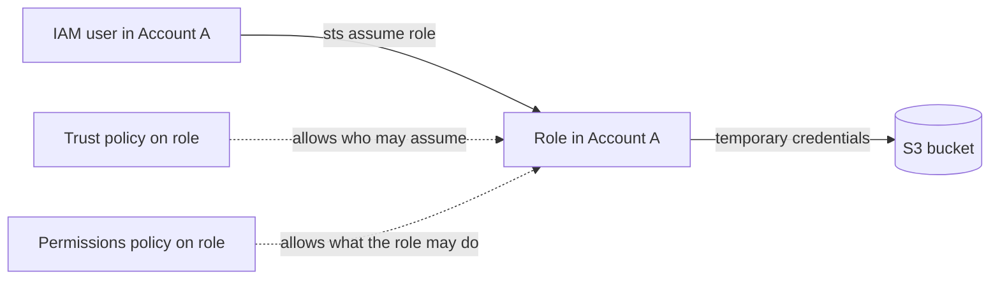

# IAM fundamentals

> [!summary] TL;DR
> - IAM (AWS Identity and Access Management) decides who can do what on which AWS resource. It is offered at no additional charge.[^2]
> - Access is denied by default. It is allowed only when a policy explicitly grants it. An explicit `Deny` always wins over an `Allow`.[^2]
> - An IAM user has long-term credentials. An IAM role has none: whoever assumes it gets temporary credentials.[^6]
> - Give workloads (EC2, Lambda) roles, not access keys. Give human users federated access with temporary credentials.[^5]
> - SCPs, permissions boundaries, and session policies only limit permissions. They never grant any.[^7]

## Why this exists
An AWS account holds many resources: servers, databases, buckets. Without a permission system, anyone who can log in could change everything. IAM lets you define which person or program may call which AWS action on which resource. On-prem, you would do this with OS users, file permissions, and a directory service. The exam guide lists this under "Design secure access to AWS resources".[^1]

## Mental model
Think of IAM as a Kubernetes RBAC setup: a role has rules (policies), and subjects (users, services) are bound to it.

**Where this analogy breaks:** In Kubernetes, a subject is bound to a role and keeps its identity. In IAM, a principal that *assumes* a role temporarily gives up its own permissions and takes on the role's permissions.[^6]

## Core concepts

**Principal** — an entity that can make a request to AWS. The role documentation lists these principals: an AWS account root user, an IAM user, a role, and service principals (AWS services).[^6]

**IAM user** — an identity with long-term credentials.[^2] AWS recommends IAM users only for use cases that identity federation does not support.[^6]

**IAM group** — a set of IAM users. You attach identity-based policies to a group, and its users get those permissions.[^7]

**IAM role** — an IAM identity with specific permissions. It is not tied to one person. Anyone who needs it can assume it, and it has no password or access keys of its own.[^6] Example: an EC2 instance assumes a role to read an S3 bucket, so no key is stored on the server.

**Root user** — the identity of the account itself. You cannot attach identity-based policies to it, and you cannot set a permissions boundary for it.[^7]

**Policy** — a document that defines permissions. Most policies are stored as JSON.[^7] A policy statement has an `Effect` (`Allow` or `Deny`), `Action`, `Resource`, and an optional `Condition`.[^7]

Kinds of identity-based policy:[^7]
- **AWS managed policy** — created and managed by AWS.
- **Customer managed policy** — a managed policy you create in your account. You can attach it to many users, groups, and roles.
- **Inline policy** — added directly to one user, group, or role. It is deleted when that identity is deleted.

**Resource-based policy** — a policy attached to a resource, such as an S3 bucket policy. It grants permissions to the principal named in the policy.[^7]

**Trust policy** — the resource-based policy on a role. It defines which principals can assume the role. Every role needs both a trust policy and an identity-based (permissions) policy.[^6][^7]

**Service role** — a role that an AWS service assumes to act on your behalf.[^6] A **service-linked role** is a service role linked to one AWS service. Its permissions can be viewed but not edited by an IAM administrator.[^6]

## How it works

A request is first authenticated, then AWS gathers the request context to find the applicable policies, then it evaluates them.[^4] The rules the exam tests:

1. Within one account, the permissions from identity-based and resource-based policies are combined (union). If either allows the action, AWS allows it.[^4]
2. A permissions boundary limits the result (intersection).[^4]
3. In an organization, the action must be allowed by the user's policies, the SCPs, and the RCPs.[^4]
4. An explicit deny in any of these overrides the allow.[^4]

## Key facts and limits

| Fact | Value | Source |
|---|---|---|
| IAM cost | No additional charge | [^2] |
| Customer managed policies per account | 1,500 default (maximum quota 10,000) | [^3] |
| Groups per account | 300 default (maximum quota 500) | [^3] |
| Roles per account | 1,000 default (maximum quota 10,000) | [^3] |
| Managed policies per role / user / group | 20 / 10 / 10 default | [^3] |
| Size of one managed policy | Cannot exceed 6,144 characters (white space not counted) | [^3] |
| Role session duration | From 900 seconds (15 minutes) up to the role's maximum session duration setting (1–12 hours) | [^3] |
| Role chaining | Limits the session to a maximum of one hour | [^6] |

## Comparisons

| | IAM user | IAM role |
|---|---|---|
| Credentials | Long-term[^2] | Temporary, per role session[^6] |
| Tied to | One identity | Assumable by anyone who needs it[^6] |
| Typical use | Cases federation does not support[^6] | Workloads, federated humans, cross-account access |

| Policy type | Grants permissions? | Attached to |
|---|---|---|
| Identity-based | Yes | User, group, role[^7] |
| Resource-based | Yes, to the principal in the policy | A resource[^7] |
| Permissions boundary | No, sets the maximum[^7] | User or role |
| SCP / RCP | No, sets the maximum[^5][^7] | Organization root, OU, or account |
| Session policy | No, limits the session[^7] | Passed at assume-role time |

## Choosing in exam scenarios
- **An application on EC2 needs to call S3 or DynamoDB** → attach an IAM role to the instance. Workloads should use temporary credentials from roles, so you do not distribute long-term keys.[^5]
- **Employees need access to AWS** → federate with an identity provider. AWS recommends IAM Identity Center for centralized access management.[^5] (Details in [[iam-advanced]].)
- **Many users need the same permissions** → put them in a group and attach the policy to the group.[^7]
- **Least privilege** → start with AWS managed policies, then reduce permissions with customer managed policies for your use case.[^5]
- **An IAM user or root user must exist** → require MFA.[^5]
- **Limit what a role can ever do, even if someone adds more policies** → permissions boundary or SCP. Neither grants access by itself.[^5]

> [!tip] Exam tip (community)
> Not added. No Tutorials Dojo page was fetched in this run.

## Common traps and misconceptions

- **Misconception:** An SCP or permissions boundary gives users access. → **Reality:** "No permissions are granted by SCPs and RCPs." A permissions boundary does not grant permissions on its own. You still need an identity-based or resource-based policy.[^5]
- **Misconception:** An Allow in one policy beats a Deny in another. → **Reality:** An explicit Deny always prevails over an Allow.[^2]
- **Misconception:** Roles have access keys like users. → **Reality:** A role has no standard long-term credentials. Assuming it gives temporary credentials.[^6]
- **Misconception:** You can put a permissions boundary on a service-linked role. → **Reality:** You cannot.[^6]
- **Misconception:** Inline policies are reusable. → **Reality:** An inline policy has a strict one-to-one relationship with its identity. Use a managed policy to share one across identities.[^7]

## Self-check

**Q1.** An application runs on EC2 instances and must read objects from an S3 bucket. The company wants no long-term credentials stored on the instances. What should the architect do?
- A. Create an IAM user, and store its access keys in the application config.
- B. Create an IAM role with S3 read permissions and attach it to the instances.
- C. Use the root user access keys.
- D. Create an IAM group with S3 permissions and add the instances to it.

> [!question]- Answer
> **B.** A role gives the workload temporary credentials, so no long-term keys are distributed.[^5] A and C use long-term access keys, which AWS advises against for workloads.[^5] D is wrong: groups contain IAM users, not EC2 instances.[^7]

**Q2.** An SCP in an organization allows `s3:*`. An IAM user in a member account has no identity-based policy that allows any S3 action, and the bucket has no resource-based policy. Can the user read objects?
- A. Yes, because the SCP allows it.
- B. Yes, because the user is in the organization.
- C. No, because an SCP does not grant permissions.
- D. No, because SCPs only apply to the root user.

> [!question]- Answer
> **C.** SCPs do not grant permissions, and an action must be allowed by the user's policies and the SCPs.[^4][^7] A and B treat the SCP as a grant. D is wrong: SCPs set the maximum permissions for IAM users and roles in member accounts, and they affect the member account's root user too.[^2][^7]

**Q3.** A user's identity-based policy allows `ec2:TerminateInstances`. A second policy that applies to the same request has an explicit `Deny` for the same action. What is the result?
- A. Allowed, because the Allow was attached first.
- B. Allowed, because the more specific policy wins.
- C. Denied, because an explicit Deny prevails over an Allow.
- D. Denied, because AWS always denies when two policies conflict, even if neither contains a Deny.

> [!question]- Answer
> **C.** An explicit Deny always prevails over an Allow.[^2] A and B invent an order or specificity rule that the sources do not state. D is wrong: the denial comes from the explicit Deny statement. Without one, an Allow in either an identity-based or resource-based policy is enough within one account.[^4]

## Related
- [[iam-advanced]] — STS, cross-account roles, Organizations and SCPs, IAM Identity Center
- [[vpc-security]] — security groups and network ACLs (a different layer from IAM)

## Sources
[^1]: AWS Certified Solutions Architect – Associate (SAA-C03) Exam Guide, Version 1.1 — https://d1.awsstatic.com/training-and-certification/docs-sa-assoc/AWS-Certified-Solutions-Architect-Associate_Exam-Guide.pdf (accessed 2026-11-08). Task statement 1.1 "Design secure access to AWS resources" lists IAM users, groups, roles, policies, MFA for IAM and root users, STS, SCPs, and resource policies.
[^2]: AWS Identity and Access Management FAQs — https://aws.amazon.com/iam/faqs/ (accessed 2026-11-08)
[^3]: IAM and AWS STS quotas — https://docs.aws.amazon.com/IAM/latest/UserGuide/reference_iam-quotas.html (accessed 2026-11-08)
[^4]: Policy evaluation logic — https://docs.aws.amazon.com/IAM/latest/UserGuide/reference_policies_evaluation-logic.html (accessed 2026-11-08)
[^5]: Security best practices in IAM — https://docs.aws.amazon.com/IAM/latest/UserGuide/best-practices.html (accessed 2026-11-08)
[^6]: IAM roles — https://docs.aws.amazon.com/IAM/latest/UserGuide/id_roles.html (accessed 2026-11-08)
[^7]: Policies and permissions in AWS Identity and Access Management — https://docs.aws.amazon.com/IAM/latest/UserGuide/access_policies.html (accessed 2026-11-08)
