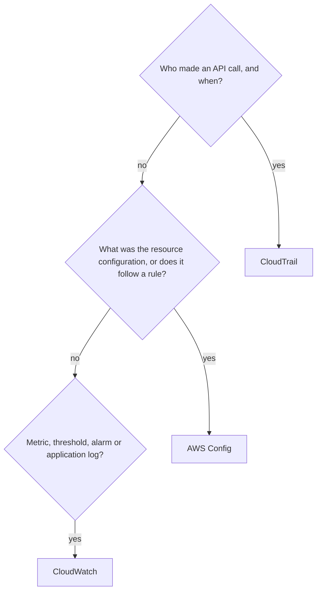

# Monitoring and audit (index)

This topic was too large for one note. CloudWatch, CloudTrail and AWS Config are all in the exam guide's in-scope list under Management and Governance.[^1]

- [[cloudwatch]] — metrics, alarms, alarm actions, logs and metric filters.
- [[cloudtrail]] — API activity events, event history, trails, log file integrity.
- [[aws-config]] — configuration history, Config rules, conformance packs, aggregators.

> [!info] How to read this
> Match the question word: "who" is CloudTrail, "what was the configuration" or "is it compliant" is Config, "how is it performing" or "alert me" is CloudWatch.

Simplified: real designs use all three together. Each note's comparison table lists the differences.

Related: [[ec2-auto-scaling]] · [[sns-and-fan-out]] · [[eventbridge]]

[^1]: SAA-C03 exam guide, in-scope services appendix — https://d1.awsstatic.com/training-and-certification/docs-sa-assoc/AWS-Certified-Solutions-Architect-Associate_Exam-Guide.pdf (cached in `_exam-guide.md`, accessed 2026-11-08)
