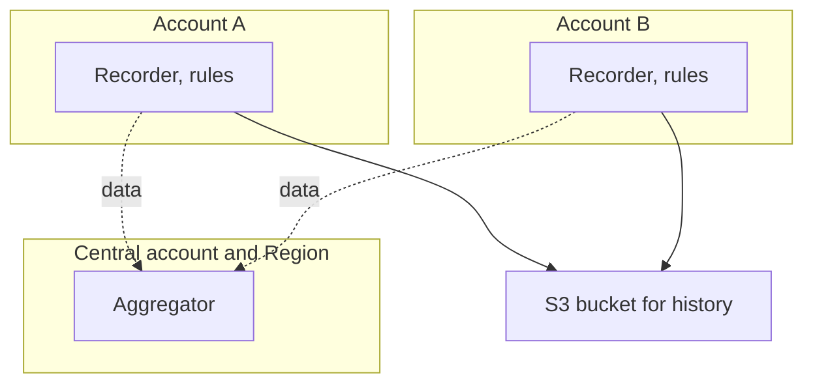
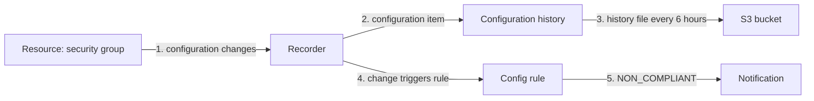

# AWS Config (configuration history and compliance rules)

> [!summary] TL;DR
> - AWS Config gives a detailed view of how your AWS resources are configured.[^1]
> - The **configuration recorder** stores configuration changes as **configuration items**. A **configuration history** is the items for one resource over time.[^4]
> - **Config rules** are compliance checks. A resource that breaks a rule is flagged noncompliant and a notification is sent.[^1]
> - An **aggregator** collects configuration and compliance data from several accounts and Regions.[^4]
> - Config evaluates and reports. Proactive rules do not remediate or prevent deployment.[^4]

## Why this exists
You change a security group and an hour later an application fails. Which setting changed, and when? Or an auditor asks whether every volume is encrypted. Config records configuration over time and checks it against rules.

## Mental model
Think of a git history for resource settings, plus a linter that checks them.

**Where this analogy breaks:** Git stores changes that people commit. Config discovers resources itself and generates configuration items; it also tracks changes not made through the API by examining configurations periodically.[^2]

## Core concepts
- **Configuration item**: a point-in-time view of the attributes of a supported resource. It holds metadata, attributes, relationships, current configuration and related events.[^4]
- **Configuration recorder**: stores configuration changes to the resource types in scope as configuration items.[^4]
- **Configuration history**: the configuration items for a given resource over any time period.[^4]
- **Configuration snapshot**: the configuration items for the supported resources in your account.[^4]
- **Config rule**: a compliance check for your ideal configuration settings. **Managed rules** are predefined, customizable rules created by AWS Config. **Custom rules** you create from scratch, with Lambda functions or Guard.[^4]
- **Conformance pack**: a collection of Config rules and remediation actions deployed as one entity in an account and Region, or across an organization.[^4]
- **Aggregator**: collects Config data from multiple source accounts and Regions. Create it in the Region where you want the combined view.[^4]

## Where it lives

> [!info] How to read this
> Each account records and evaluates its own resources. The aggregator gives one combined view.[^4] History files go to an S3 bucket you specify.[^2]

Simplified: whether Config is set up per Region was not verified. One shared bucket is only an example.

## How it works

1. Config discovers supported resources and tracks changes by calling Describe or List APIs. It also finds changes not made through the API by examining configurations periodically.[^2]
2. The recorder stores each change as a configuration item.[^4]
3. For each recorded resource type Config sends a configuration history file to your S3 bucket every six hours. If nothing changed, it sends no file.[^2]
4. A rule runs on a **configuration change** trigger (the resource matches the rule scope and changes), a **periodic** trigger (a frequency you choose, such as every 24 hours), or both.[^4]
5. Each evaluation is COMPLIANT, NON_COMPLIANT, ERROR or NOT_APPLICABLE.[^4] Config flags a violating resource as noncompliant and sends a notification.[^1]

> [!info] How to read this
> Recording (steps 1–3) and rule checking (steps 4–5) are two jobs of the same service.

## Key facts and limits
| Fact | Value | Source |
|---|---|---|
| History file delivery | Every six hours per recorded resource type; none if no change | [^2] |
| Rule trigger types | Configuration change, periodic, or both | [^4] |
| Evaluation results | COMPLIANT, NON_COMPLIANT, ERROR, NOT_APPLICABLE | [^4] |
| File format | History file and snapshot are JSON | [^2] |

## Comparisons
| | AWS Config | [[cloudtrail]] | [[cloudwatch]] |
|---|---|---|---|
| Focus | Resource configuration state and compliance | Who called which API | Metrics, logs, alarms |
| Time view | Configuration history of one resource | Activity events | Time series of numbers |
| Rules | Config rules | None | Alarms |

## Choosing in exam scenarios
- "What did this resource's configuration look like last week" → Config configuration history.[^4]
- "Check that all resources follow a rule and flag the ones that do not" → Config rule.[^1]
- "Deploy a set of compliance rules together, even across an organization" → conformance pack.[^4]
- "One view of compliance across accounts and Regions" → aggregator.[^4]
- "Block a non-compliant change before it happens" → not Config. Proactive rules do not remediate or prevent deployment.[^4] For account-wide preventive limits see [[iam-advanced]].

## Common traps and misconceptions
- **Misconception**: Config rules stop non-compliant resources from being created. → **Reality**: Config flags them as noncompliant and notifies; proactive rules do not prevent deployment.[^1][^4]
- **Misconception**: Config rules take IAM or Organizations policies into account. → **Reality**: rules directly evaluate the configuration of a resource and do not take such policies into account.[^3]
- **Misconception**: Config answers "who made the change". → **Reality**: Config records configuration; the activity record is [[cloudtrail]]. (Config's own docs do not describe this link, so treat it as a scope split only.)

## Self-check
**Q1.** An auditor asks what the settings of a security group were three months ago. Which service?
A. CloudWatch metrics  B. AWS Config configuration history  C. CloudTrail event history  D. Trusted Advisor

> [!question]- Answer
> **B.** A configuration history is the items for a resource over time.[^4] A holds numbers. C shows only 90 days of management events.[^5] D is not covered in this note.

**Q2.** A company wants to flag any resource that breaks an internal configuration standard and be notified. Which feature?
A. CloudWatch alarm  B. AWS Config rule  C. CloudTrail data events  D. Aggregator

> [!question]- Answer
> **B.** Config rules are compliance checks and flag noncompliant resources with a notification.[^1][^4] A watches a metric. C logs resource operations. D collects data across accounts; it does not define checks.

**Q3.** Security wants one place to see compliance data from many accounts and Regions. What do they create?
A. A conformance pack  B. A Config snapshot  C. An aggregator  D. A metric filter

> [!question]- Answer
> **C.**[^4] A deploys rules together. B lists configuration items of the supported resources in one account. D belongs to CloudWatch Logs.

## Related
[[_index-monitoring-and-audit]] · [[cloudwatch]] · [[cloudtrail]] · [[iam-advanced]]

## Sources
[^1]: AWS Config overview — https://docs.aws.amazon.com/config/latest/developerguide/WhatIsConfig.html (accessed 2026-11-08)
[^2]: How AWS Config works — https://docs.aws.amazon.com/config/latest/developerguide/how-does-config-work.html (accessed 2026-11-08)
[^3]: Evaluating resources with Config rules — https://docs.aws.amazon.com/config/latest/developerguide/evaluate-config.html (accessed 2026-11-08)
[^4]: AWS Config concepts — https://docs.aws.amazon.com/config/latest/developerguide/config-concepts.html (accessed 2026-11-08)
[^5]: Viewing CloudTrail event history — https://docs.aws.amazon.com/awscloudtrail/latest/userguide/view-cloudtrail-events.html (accessed 2026-11-08)
