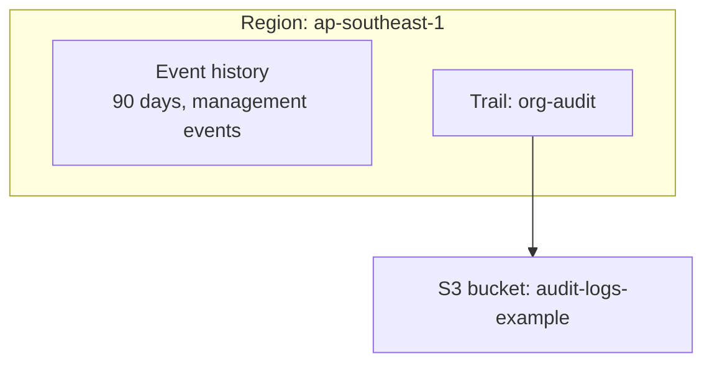
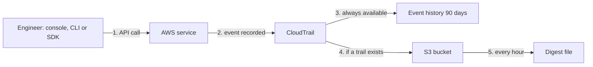

# AWS CloudTrail (API audit log)

> [!summary] TL;DR
> - A CloudTrail **event** is the record of an activity in an AWS account.[^1]
> - **Management events** (control plane operations) are logged by default. **Data events** and **Insights events** are not.[^1]
> - **Event history** is on by default and shows the past 90 days of management events, per Region.[^2]
> - For a longer or ongoing record, create a **trail** or an event data store.[^2]
> - Log file integrity validation tells you if a delivered log file was modified, deleted, or unchanged.[^3]

## Why this exists
After an incident someone asks: who deleted this security group, and when? Without a record of API calls you cannot answer. CloudTrail keeps that record for the AWS account.

## Mental model
Think of the audit log of the Kubernetes API server, but for the whole AWS account.

**Where this analogy breaks:** The Kubernetes audit log only needs to be switched on. CloudTrail event history is on by default, but it only holds 90 days of management events; a longer record needs a trail or event data store.[^2]

## Core concepts
- **Event**: the record of an activity in an AWS account. Events cover activity through the Management Console, SDKs, command line tools and other AWS services.[^1]
- **Management event**: information about management operations on resources in your account, also called control plane operations.[^1]
- **Data event**: information about operations performed on or in a resource.[^1]
- **Insights event**: a separate event type that trails do not log by default.[^1] (Its definition is not covered here.)
- **Event history**: the console view of the past 90 days of management events in a Region.[^2]
- **Trail**: a configuration that delivers events to an S3 bucket. Digest files go to the same bucket as the trail's log files.[^3]

## Where it lives

> [!info] How to read this
> Event history records events in the Region where the event happened.[^2] The trail's S3 bucket is the long-term store.

Simplified: multi-Region and organization trails, CloudTrail Lake and delivery to other services are left out (not verified in this session).

## How it works

1. A person or service makes a call through the console, an SDK, or the command line.[^1]
2. CloudTrail records it as an event.[^1]
3. CloudTrail is enabled by default, so you automatically have event history access.[^2]
4. A trail delivers events to its S3 bucket for a longer record.[^2][^3]
5. If log file integrity validation is enabled, CloudTrail creates a digest file every hour that references the last hour's log files and holds a hash of each. Digest files are delivered to the trail's bucket in a separate folder.[^3]

> [!info] How to read this
> Event history needs no setup. The trail and its integrity checks are things you turn on.

### Worked example
An auditor asks about an API call from 120 days ago. Event history keeps 90 days, so 120 − 90 = 30 days are outside it.[^2] The call is findable only if a trail was already delivering events to S3 at that time. A trail created today records ongoing events, not the past.

## Key facts and limits
| Fact | Value | Source |
|---|---|---|
| Event history window | Past 90 days | [^2] |
| Event history event types | Management events only; not data, Insights or network activity events | [^2] |
| Logged by default (trails and event data stores) | Management events; not data or Insights events | [^1] |
| Digest file frequency | Every hour | [^3] |
| Integrity algorithms | SHA-256 hashing; SHA-256 with RSA signing | [^3] |

## Comparisons
| | CloudTrail | [[aws-config]] | [[cloudwatch]] |
|---|---|---|---|
| Records | API and account activity (who, what, when) | Resource configuration over time | Metrics and logs |
| Typical question | Who terminated this instance? | What did this security group allow last month? | Is CPU high right now? |

## Choosing in exam scenarios
- "Who made this API call / audit user activity" → CloudTrail.
- "Keep audit records longer than 90 days" → a trail delivering to S3.[^2]
- "Prove log files were not changed" → log file integrity validation.[^3]
- "Record object-level actions" → data events, which must be turned on because they are off by default.[^1]

## Common traps and misconceptions
- **Misconception**: Event history keeps everything forever. → **Reality**: it shows the past 90 days of management events in a Region.[^2]
- **Misconception**: Data events are logged automatically. → **Reality**: by default trails log management events, not data events.[^1]
- **Misconception**: CloudTrail setup is needed to see recent management events. → **Reality**: CloudTrail is on by default and event history is available automatically.[^2]
- **Misconception**: Enabling integrity validation checks the files for you. → **Reality**: it makes CloudTrail deliver digest files; it does not itself validate the files.[^3]

## Self-check
**Q1.** Yesterday a security group rule was deleted. Who did it?
A. CloudWatch metrics  B. CloudTrail event history  C. AWS Config compliance dashboard only  D. VPC route table

> [!question]- Answer
> **B.** Deleting a rule is a management event, and event history shows the last 90 days.[^2][^1] A holds numbers, not API callers. C shows compliance and configuration, not the caller (see [[aws-config]]). D is not an audit tool.

**Q2.** A compliance rule requires API activity records for 400 days. What is the best fit?
A. Rely on event history  B. A trail that delivers events to S3  C. A CloudWatch alarm  D. Enable data events

> [!question]- Answer
> **B.** Event history holds 90 days, and a trail or event data store gives an ongoing record.[^2] A is too short. C watches metrics. D adds event types; it does not extend retention.

**Q3.** The security team must detect whether delivered CloudTrail log files were altered. What do they enable?
A. Log file integrity validation  B. Data events  C. Event history  D. A CloudWatch metric filter

> [!question]- Answer
> **A.** It determines if a log file was modified, deleted, or unchanged after delivery.[^3] B logs more operations, not tamper checks. C is a 90-day view only. D turns log text into metrics.

## Related
[[_index-monitoring-and-audit]] · [[cloudwatch]] · [[aws-config]] · [[iam-fundamentals]]

## Sources
[^1]: CloudTrail concepts — https://docs.aws.amazon.com/awscloudtrail/latest/userguide/cloudtrail-concepts.html (accessed 2026-11-08)
[^2]: Viewing event history — https://docs.aws.amazon.com/awscloudtrail/latest/userguide/view-cloudtrail-events.html (accessed 2026-11-08)
[^3]: Log file integrity validation — https://docs.aws.amazon.com/awscloudtrail/latest/userguide/cloudtrail-log-file-validation-intro.html (accessed 2026-11-08)
