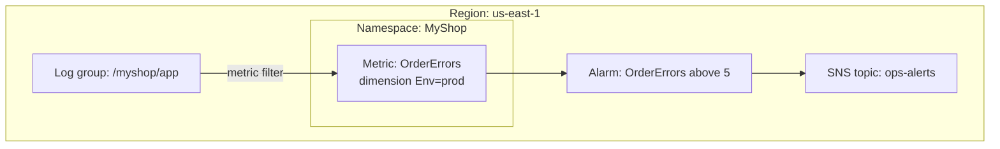
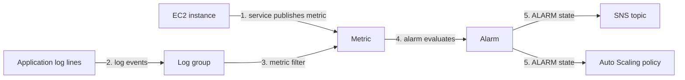

# Amazon CloudWatch (metrics, alarms, logs)

> [!summary] TL;DR
> - A **metric** is a time-ordered set of data points published to CloudWatch. AWS services publish many metrics by default.[^1]
> - A metric is identified by a name, a namespace, and zero or more dimensions.[^1]
> - An **alarm** watches one metric and can notify an SNS topic, scale an Auto Scaling group, or act on an EC2 instance.[^1][^3]
> - **CloudWatch Logs** stores log events in log streams, grouped in log groups. A metric filter turns log events into metric data points.[^5]
> - CloudWatch is for performance and health. For "who called the API" see [[cloudtrail]]. For "how was the resource configured" see [[aws-config]].

## Why this exists
You need to know when a server is overloaded or an application logs errors, and you want something to react. On-premises you would run Prometheus, a log shipper and Alertmanager yourself. CloudWatch is the AWS-managed place where metrics, logs and alarms meet.

## Mental model
Think of Prometheus (metrics store), Alertmanager (alerts) and a log store in one managed service.

**Where this analogy breaks:** Prometheus scrapes its targets. In CloudWatch, metrics are published to the service: AWS services publish them for you, and you can publish custom metrics.[^1]

## Core concepts
- **Metric**: a time-ordered set of data points published to CloudWatch.[^1]
- **Namespace**: a container for metrics. Metrics in different namespaces are isolated from each other.[^1]
- **Dimension**: a name/value pair that is part of the identity of a metric. A metric can have up to 30 dimensions.[^1]
- **Period**: the length of time for a statistic. Valid values are 1, 5, 10, 30, or any multiple of 60 seconds; the default is 60 seconds.[^1]
- **Alarm**: watches a single metric over a time period and runs actions based on the value relative to a threshold over time.[^1]
- **Composite alarm**: an alarm that decides its state from the states of other alarms, combined with Boolean rules.[^4]
- **Log event**: a record of activity from the application or resource. **Log stream**: a sequence of log events from the same source. **Log group**: a group of log streams that share the same retention, monitoring and access control settings.[^5]
- **Metric filter**: extracts metric observations from ingested log events and turns them into data points in a CloudWatch metric.[^5]

## Where it lives

> [!info] How to read this
> Metrics exist only in the Region where they are created.[^1] A log group, its metric filter and the alarm that uses the metric sit together in one Region in this example.

Simplified: IAM permissions, encryption and cross-Region views are left out. Metric math can aggregate metrics from different Regions.[^1]

## How it works

1. An AWS service such as EC2 publishes metrics to CloudWatch by default, or your application publishes a custom metric.[^1]
2. Log events are sent to a log group.[^5]
3. A metric filter can turn matching log events into data points of a metric.[^5]
4. The alarm compares the metric to its threshold over the chosen periods. Pick an alarm period greater than or equal to the metric resolution.[^1]
5. If the alarm changes state and stays there for the set number of periods, it runs its actions. Alarms do not run actions only because they are in a state.[^1]

> [!info] How to read this
> The alarm is the only box that acts. Metrics and logs only hold data. How log lines reach the log group (for example an agent) is not covered in this note.

Alarm states:[^2]
- **OK**: the metric or expression is within the defined threshold.
- **ALARM**: the metric or expression is outside the threshold.
- **INSUFFICIENT_DATA**: the alarm has just started, the metric is not available, or there is not enough data to decide.

Alarm actions: notify subscribers through an SNS topic, invoke a Lambda function, stop, terminate, reboot or recover an EC2 instance (for alarms on EC2 metrics), scale an Auto Scaling group, or create Systems Manager OpsItems or incidents.[^3] Composite alarms can take only SNS, Lambda, OpsItem and incident actions, and cannot trigger Auto Scaling actions.[^4][^3]

## Key facts and limits
| Fact | Value | Source |
|---|---|---|
| Standard resolution metric | 1-minute granularity | [^1] |
| High-resolution metric | 1-second granularity | [^1] |
| Data points under 60 seconds | Available for 3 hours | [^1] |
| 60-second data points | Available for 15 days | [^1] |
| 300-second data points | Available for 63 days | [^1] |
| 3600-second data points | Available for 455 days (15 months) | [^1] |
| Metrics with no new data | Expire after 15 months; cannot be deleted | [^1] |
| Dimensions per metric | Up to 30 | [^1] |
| Metrics scope | Only in the Region where created | [^1] |
| Composite alarm inputs | Must be in the same account and Region | [^4] |

## Comparisons
| | CloudWatch | [[cloudtrail]] | [[aws-config]] |
|---|---|---|---|
| Answers | How is it performing? Is it healthy? | Who did what, through which API call? | What was the configuration, and does it follow my rules? |
| Data | Metrics, logs, alarms | Events (records of activity) | Configuration items, rule results |

## Choosing in exam scenarios
- "Notify when CPU or another metric crosses a threshold" → CloudWatch alarm with an SNS action.
- "Add instances when a metric is high" → CloudWatch alarm with an Auto Scaling action. See [[ec2-auto-scaling]].
- "Alarm when the application logs a certain error" → CloudWatch Logs metric filter plus an alarm on the resulting metric.[^5]
- "Reboot or recover a failed instance automatically" → alarm with an EC2 action.[^3]
- "One alert that combines the state of several alarms" → composite alarm.[^4]

## Common traps and misconceptions
- **Misconception**: Alarms fire every period while in ALARM state. → **Reality**: alarms invoke actions for sustained state changes only.[^1]
- **Misconception**: A composite alarm can scale an Auto Scaling group. → **Reality**: composite alarms cannot trigger Auto Scaling actions; a metric alarm can.[^3]
- **Misconception**: CloudWatch sums custom metrics across dimensions for you. → **Reality**: CloudWatch does not aggregate across dimensions for custom metrics.[^1]
- **Misconception**: A metric in one Region shows up in another. → **Reality**: metrics exist only in the Region where they are created.[^1]

## Self-check
**Q1.** Web servers in an Auto Scaling group must get more instances when average CPU stays high, and the team must get an email. Which design fits?
A. CloudTrail trail with an SNS topic  B. CloudWatch metric alarm with an Auto Scaling action and an SNS action  C. Composite alarm with an Auto Scaling action  D. AWS Config rule

> [!question]- Answer
> **B.** A metric alarm can scale an Auto Scaling group and notify through SNS.[^3] A: CloudTrail records activity, not CPU. C: composite alarms cannot trigger Auto Scaling actions.[^3] D: Config evaluates resource configuration, not CPU load.[^6]

**Q2.** A new alarm shows INSUFFICIENT_DATA. What does that mean?
A. The metric is outside the threshold  B. The metric is within the threshold  C. The alarm just started, or the metric is not available or has too little data  D. The alarm was deleted

> [!question]- Answer
> **C.**[^2] A is ALARM. B is OK. D is not an alarm state.

**Q3.** An application logs the word "PaymentFailed". The team wants an alarm on the count. What is needed?
A. A metric filter on the log group, then an alarm on the new metric  B. A CloudTrail data event  C. A Config conformance pack  D. A dimension on the log group

> [!question]- Answer
> **A.** Metric filters turn log events into metric data points, and alarms watch metrics.[^5][^1] B records resource operations in [[cloudtrail]]. C is a group of Config rules. D: dimensions identify metrics, not log groups.

## Related
[[_index-monitoring-and-audit]] · [[cloudtrail]] · [[aws-config]] · [[ec2-auto-scaling]] · [[sns-and-fan-out]] · [[eventbridge]]

## Sources
[^1]: CloudWatch concepts — https://docs.aws.amazon.com/AmazonCloudWatch/latest/monitoring/cloudwatch_concepts.html (accessed 2026-11-08)
[^2]: CloudWatch alarm evaluation — https://docs.aws.amazon.com/AmazonCloudWatch/latest/monitoring/alarm-evaluation.md (accessed 2026-11-08)
[^3]: CloudWatch alarm actions — https://docs.aws.amazon.com/AmazonCloudWatch/latest/monitoring/alarm-actions.md (accessed 2026-11-08)
[^4]: CloudWatch composite alarms — https://docs.aws.amazon.com/AmazonCloudWatch/latest/monitoring/alarm-combining.md (accessed 2026-11-08)
[^5]: CloudWatch Logs concepts — https://docs.aws.amazon.com/AmazonCloudWatch/latest/logs/CloudWatchLogsConcepts.html (accessed 2026-11-08)
[^6]: AWS Config overview — https://docs.aws.amazon.com/config/latest/developerguide/WhatIsConfig.html (accessed 2026-11-08)
