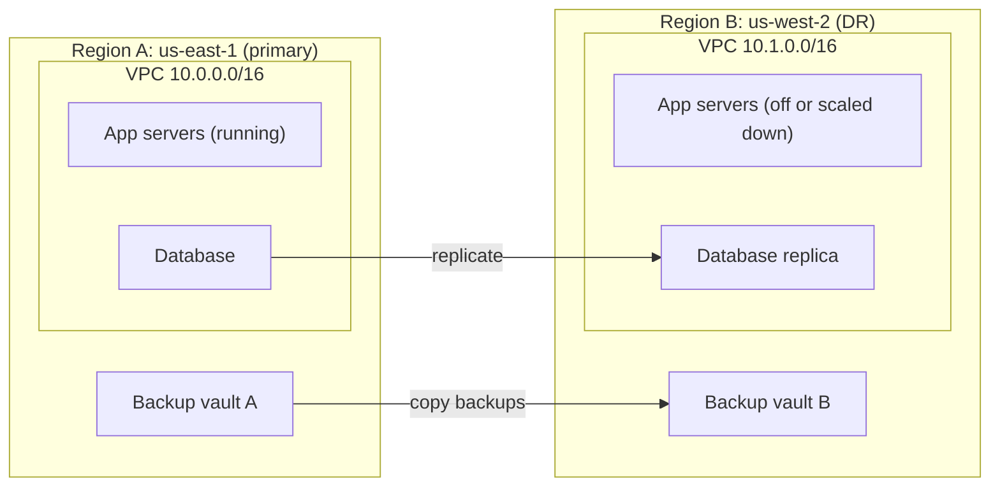
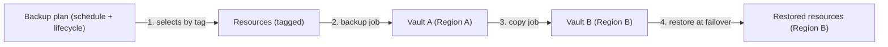
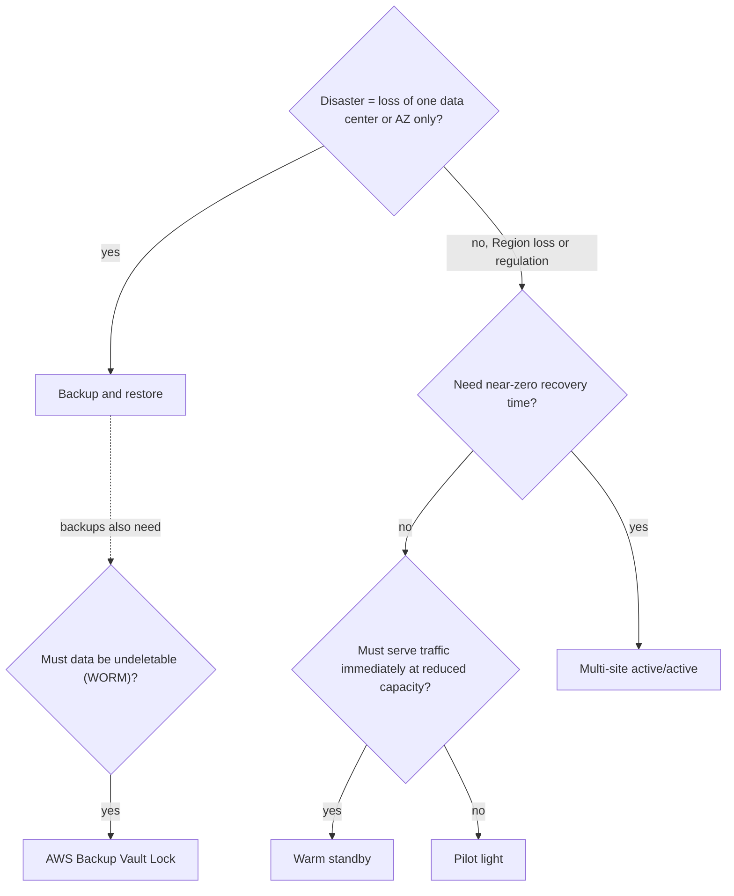

# Disaster recovery strategies and AWS Backup

> [!summary] TL;DR
> - Two numbers drive every DR design: **RTO** (how long you can be down) and **RPO** (how much data age you can lose). The organization sets both.[^2]
> - Four strategies, from low cost and low complexity to high cost and high complexity: backup and restore, pilot light, warm standby, multi-site active/active.[^1]
> - Pilot light cannot process requests until you take action. Warm standby can handle traffic at reduced capacity immediately.[^1]
> - AWS Backup is the central service for backup plans, vaults, cross-Region copy, cross-account copy, and Vault Lock.[^3]
> - Exam scope: task statements 2.2 (highly available and/or fault-tolerant architectures) and 1.3 (backups and replication).[^8]

## Why this exists
A disaster is an event that a normal high-availability design does not handle. The Reliability Pillar names natural disasters, large-scale technical failures, and human threats such as attack or error.[^2] Without a plan, you decide during the outage how to rebuild. A DR strategy decides in advance what to keep ready, where, and at what cost.

## Mental model
Think of DR as a slider between **cost** and **recovery speed**. At one end you keep only copies of data and rebuild everything after a disaster. At the other end you run the full workload in two places all the time. Each of the four strategies is a fixed position on that slider.[^1]

## Core concepts
- **Disaster recovery (DR):** recovery from a one-time event. It focuses on one-time recovery objectives. Availability is different: it measures resiliency over a period of time, against component failures, load spikes, or software bugs.[^2]
- **Recovery Time Objective (RTO):** "the maximum acceptable delay between the interruption of service and restoration of service."[^2]
- **Recovery Point Objective (RPO):** "the maximum acceptable amount of time since the last data recovery point."[^2]
- **Backup and restore:** keep backups, rebuild and restore after the disaster. Suitable for data loss or corruption. It can also cover a Regional disaster if you replicate data to other Regions, and a lack of redundancy in a workload deployed to a single Availability Zone.[^1]
- **Pilot light:** you replicate data from one Region to another and provision a copy of your core infrastructure. Data replication resources such as databases and object storage are always on. Application servers are loaded with code and configuration but are "switched off" until testing or failover.[^1]
- **Warm standby:** a scaled-down but fully functional copy of production in another Region. The workload is always on there, which shortens recovery compared with pilot light.[^1]
- **Multi-site active/active:** the workload runs in multiple Regions at the same time and serves traffic from all of them. In the related *hot standby active/passive* variant, only one Region serves traffic and the other Regions are used only for DR.[^1]
- **AWS Backup:** a fully managed service that centralizes and automates data protection across AWS services, in the cloud, and on premises.[^3]
- **Backup plan:** a backup policy that defines your backup requirements. You apply it to the resources you want to protect.[^3] A plan can use tags to apply it to a group of resources.[^3]
- **Backup vault:** an encrypted storage location in your AWS account. You can create vaults in each Region where AWS Backup is available.[^4]

## Where it lives

> [!info] How to read this
> The primary Region runs the workload. The DR Region holds only what the chosen strategy requires: just a vault (backup and restore), a replica plus switched-off servers (pilot light), or a scaled-down running copy (warm standby).

Simplified: the diagram shows pilot light and warm standby side by side. Backup and restore uses only the vaults. The replication and copy arrows are separate features and are not both required.

## How it works
The most common exam path is backup and restore with AWS Backup. A backup plan runs on a schedule, stores a recovery point in a vault, and copies it to another Region.

1. The backup plan applies to resources, for example by tag.[^3]
2. A backup job stores the recovery point in a backup vault.[^4]
3. The plan copies the backup to another Region (or to another account in the same AWS Organizations structure), on demand or automatically as part of a scheduled plan.[^3]
4. At failover, you restore in the DR Region. Backups stored in the DR Region "must be restored at time of failover." AWS Backup can restore but "does not currently enable scheduled or automatic restoration"; the whitepaper suggests calling the AWS Backup APIs with the AWS SDK to automate it.[^1]

> [!info] How to read this
> Recovery time here includes step 4. That is why backup and restore has the longest RTO of the four: nothing runs in Region B until you restore.

Simplified: the lifecycle, IAM roles, and encryption keys are left out.

### Worked example
A backup plan runs every 6 hours. If the primary Region fails just before the next run, the newest recovery point is up to 6 hours old. That is about 6 hours of data loss, so this plan cannot meet an RPO of 1 hour. The whitepaper states the same rule: how often you run your backup determines your achievable recovery point.[^1] To get a smaller RPO, use continuous backup (below) or replication.

### AWS Backup features the exam uses
- **Cross-Region and cross-account copy.** Backups can be copied to multiple Regions, and to multiple accounts inside your AWS Organizations structure.[^3] Cross-account management needs an existing organization in AWS Organizations.[^3]
- **Continuous backup and point-in-time recovery (PITR).** You can rewind a supported resource to a chosen time, up to a maximum of 35 days back.[^5] Supported: Amazon S3, RDS, Aurora, and SAP HANA on Amazon EC2. Not supported for RDS Multi-AZ clusters.[^5] You opt in when you create a backup plan.[^5]
- **Vault Lock.** An optional feature of a backup vault that gives a write-once-read-many (WORM) setup and protects recovery points from inadvertent or malicious deletion.[^6] See the table below for the two modes.
- **Audit.** AWS Backup Audit Manager helps you find activities and resources that are not compliant with controls you define.[^3]
- **Organizations backup policies.** You can use backup policies to apply backup plans across the accounts in your organization.[^3]

### AWS Elastic Disaster Recovery
AWS Elastic Disaster Recovery replicates on-premises or cloud-based applications into a staging area subnet in your AWS account, in the Region you select. The staging area uses affordable storage and minimal compute. You can launch recovery instances within minutes.[^7]

## Key facts and limits
| Fact | Value | Source |
|---|---|---|
| Continuous backup (PITR) maximum look-back | 35 days | [^5] |
| Vault Lock minimum grace time (compliance mode) | at least 3 days (72 hours) | [^6] |
| After grace time ends | vault and lock are immutable; cannot be changed or deleted by any user or by AWS | [^6] |
| Vault Lock retention settings | min 1 day shortest; max 36500 days longest; backup and copy jobs outside the bounds fail | [^6] |
| Where Vault Lock settings do not apply | recovery points already in the vault keep their previous lifecycle | [^6] |
| Account closure | AWS deletes the vault contents even if Vault Lock was in place, if the account is not reopened within 90 days | [^6] |

## Comparisons
| Strategy | What runs in the DR Region | Can serve traffic right away? | Cost and complexity |
|---|---|---|---|
| Backup and restore | Backups only | No, restore first | Lowest cost, lowest complexity[^1] |
| Pilot light | Data replication on; app servers switched off | No, needs action first[^1] | Higher than backup and restore |
| Warm standby | Scaled-down, fully functional copy | Yes, at reduced capacity[^1] | Higher than pilot light |
| Multi-site active/active | Full workload serving traffic | Yes | Most complex and costly; recovery time can be near zero for most disasters[^1] |

The sources give the endpoints (lowest cost for backup and restore, most costly for multi-site) and the order of the four strategies. The middle ordering follows the order of the whitepaper's list.[^1]

| Vault Lock mode | Who can remove the lock | Use when |
|---|---|---|
| Governance | Users with sufficient IAM permissions[^6] | You want protection but still allow privileged admins to change it |
| Compliance | Nobody after the grace time ends; the lock is immutable[^6] | Contents must never be deleted or altered until retention ends[^6] |

## Choosing in exam scenarios

> [!info] How to read this
> Start at the top with how big the disaster is. The whitepaper says a loss of one data center may need only backup and restore; a Regional disaster or a regulatory requirement points to pilot light, warm standby, or multi-site.[^1]

Simplified: the exam also weighs cost. If cost is the top requirement, move toward the left (backup and restore) as far as the RTO allows.

- **"Lowest cost", RTO of hours is acceptable** → backup and restore, because it sits at the low-cost end.[^1]
- **"Core data always replicated, servers can start after the disaster"** → pilot light.[^1]
- **"Must handle traffic right after failover, reduced capacity is acceptable"** → warm standby.[^1]
- **"Near-zero RTO, most critical workload"** → multi-site active/active.[^1]
- **"Central backup of many services, many accounts"** → AWS Backup with Organizations backup policies.[^3]
- **"Backups must not be deleted, even by an admin"** → Vault Lock in compliance mode.[^6]
- **"Restore to any second in the last days"** → AWS Backup continuous backup, for a supported resource, within 35 days.[^5]
- **"Copy backups to another Region"** → cross-Region copy in the backup plan.[^3]

DNS failover to the DR Region is covered in [[route-53]]. Auto Scaling of the scaled-down copy is covered in [[ec2-auto-scaling]]. AMI copying is in [[ec2-fundamentals]].

## Common traps and misconceptions
- **Misconception:** RTO and RPO measure the same thing. → **Reality:** RTO is about delay in restoring service. RPO is about the time since the last recovery point. → [^2]
- **Misconception:** High availability across Availability Zones is the same as DR. → **Reality:** Availability measures resiliency over time against component failures, load spikes, or software bugs. DR targets one-time events such as natural disasters and large-scale failures. → [^2]
- **Misconception:** Pilot light and warm standby both serve traffic at once. → **Reality:** Pilot light cannot process requests without extra action; warm standby can handle traffic at reduced capacity immediately. → [^1]
- **Misconception:** AWS Backup restores automatically on failover. → **Reality:** It offers restore, but the whitepaper says it does not currently enable scheduled or automatic restoration. You can automate it with the SDK. → [^1]
- **Misconception:** Continuous backup works for every resource and copies everywhere. → **Reality:** It is supported for S3, RDS, Aurora, and SAP HANA on EC2. For S3, cross-Region or cross-account copies do not have PITR. → [^5]
- **Misconception:** You can undo a Vault Lock any time. → **Reality:** You can remove it only during the grace time. After that, a compliance-mode lock is immutable. → [^6]

## Self-check

**Q1.** A company needs to survive the loss of an entire Region. The application must accept traffic within minutes of failover, at reduced capacity at first. Cost should be as low as possible within that need. Which strategy fits?
A. Backup and restore  B. Pilot light  C. Warm standby  D. Multi-site active/active

> [!question]- Answer
> **C.** Warm standby keeps a scaled-down, fully functional copy that can handle traffic immediately.[^1] A is wrong: nothing runs in the DR Region until you restore. B is wrong: pilot light cannot process requests without extra action first.[^1] D would work but is the most complex and costly, and the scenario accepts reduced capacity.[^1]

**Q2.** A compliance team requires that backups cannot be deleted by anyone, including the root user, until retention ends. Which solution meets this?
A. An IAM policy that denies `DeleteRecoveryPoint`  B. AWS Backup Vault Lock in governance mode  C. AWS Backup Vault Lock in compliance mode, after the grace time  D. Copying backups to a second Region

> [!question]- Answer
> **C.** After the grace time, a compliance-mode vault and its lock cannot be changed or deleted by any user or by AWS.[^6] A is wrong: an IAM policy can be changed by an administrator. B is wrong: governance mode lets users with sufficient IAM permissions remove the lock.[^6] D is wrong: a copy adds a location but does not stop deletion.

**Q3.** A database team needs to restore an Amazon RDS (single-instance) database to the state it had 3 days ago, to a chosen second. Which AWS Backup feature fits?
A. Cross-Region copy  B. Continuous backup with point-in-time recovery  C. Warm standby  D. Backup Audit Manager

> [!question]- Answer
> **B.** Continuous backups let you rewind a supported resource to a chosen time, with a maximum of 35 days; RDS is supported (but not RDS Multi-AZ clusters).[^5] A copies backups but does not choose a second. C is a DR strategy, not a restore feature. D reports on compliance of backups.[^3]

## Related
[[route-53]] · [[ec2-auto-scaling]] · [[ec2-fundamentals]] · [[kms-and-cloudhsm]] · [[iam-advanced]]

## Sources
[^1]: Disaster recovery options in the cloud — https://docs.aws.amazon.com/whitepapers/latest/disaster-recovery-workloads-on-aws/disaster-recovery-options-in-the-cloud.html (accessed 2026-11-08)
[^2]: Disaster Recovery (DR) objectives, Reliability Pillar — https://docs.aws.amazon.com/wellarchitected/latest/reliability-pillar/disaster-recovery-dr-objectives.html (accessed 2026-11-08)
[^3]: What is AWS Backup? — https://docs.aws.amazon.com/aws-backup/latest/devguide/whatisbackup.html (accessed 2026-11-08)
[^4]: AWS Backup FAQs — https://aws.amazon.com/backup/faqs/ (accessed 2026-11-08)
[^5]: Continuous backups and point-in-time recovery — https://docs.aws.amazon.com/aws-backup/latest/devguide/point-in-time-recovery.html (accessed 2026-11-08)
[^6]: AWS Backup Vault Lock — https://docs.aws.amazon.com/aws-backup/latest/devguide/vault-lock.html (accessed 2026-11-08)
[^7]: What is Elastic Disaster Recovery? — https://docs.aws.amazon.com/drs/latest/userguide/what-is-drs.html (accessed 2026-11-08)
[^8]: SAA-C03 exam guide (task statements 1.3 and 2.2) — https://d1.awsstatic.com/training-and-certification/docs-sa-assoc/AWS-Certified-Solutions-Architect-Associate_Exam-Guide.pdf (accessed 2026-11-08)
