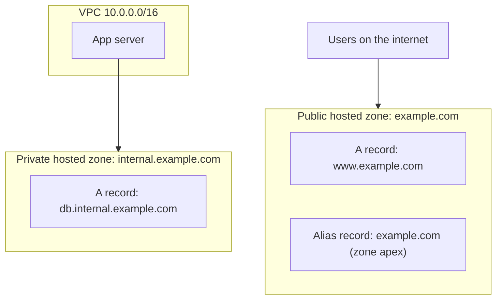
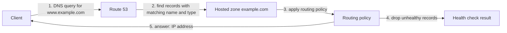
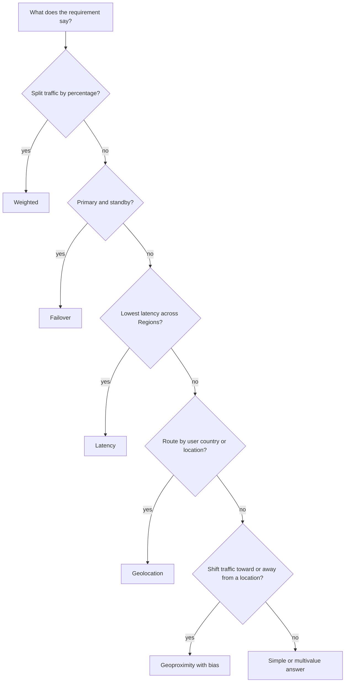

# Route 53 (record types, routing policies, health checks)

> [!summary] TL;DR
> - A **hosted zone** is a container for records. A public hosted zone routes traffic on the internet. A private hosted zone routes traffic in an Amazon VPC.[^10]
> - Each record has a **routing policy** that decides how Route 53 answers a query: simple, weighted, latency, failover, geolocation, geoproximity, IP-based, or multivalue answer.[^1]
> - An **alias record** can sit at the zone apex (a CNAME cannot), and Route 53 does not charge for alias queries to AWS resources.[^8]
> - **Health checks** let Route 53 stop answering with unhealthy resources. Failover routing uses them for active-passive setups.[^11][^12]

## Why this exists
Clients find servers by name, not by IP address. DNS (Domain Name System) turns a name such as `www.example.com` into an IP address. Route 53 is the AWS DNS service. Beyond plain name lookup, it can choose a different answer per query (by weight, location, latency, or health), which is how you build multi-Region and failover designs.[^1]

## Mental model
Think of a hosted zone as a BIND zone file: a list of records for one domain. The extra step is that each record also carries a routing policy, so Route 53 can return different answers to different queries.[^1]

**Where this analogy breaks:** A plain zone file returns the same records to every client. Route 53 can choose the answer per query using weights, user location, latency, or health.[^1]

## Core concepts
- **Hosted zone**: a container for records. Records hold information about how to route traffic for a domain such as `example.com` and its subdomains. A hosted zone has the same name as its domain.[^10]
- **Public hosted zone**: contains records that specify how you want to route traffic on the internet.[^10]
- **Private hosted zone**: contains records that specify how you want to route traffic in an Amazon VPC (see [[vpc-fundamentals]]).[^10]
- **Record**: one entry in a hosted zone. When you create a record, you choose a routing policy.[^1]
- **Routing policy**: the rule that decides how Route 53 responds to queries for a record.[^1]
- **Health check**: a Route 53 check that can monitor a specified resource such as a web server, the status of other health checks, or the status of a CloudWatch alarm.[^11]

### Record types the exam uses
| Type | Purpose (from the docs) |
|---|---|
| A | Routes traffic to a resource using an IPv4 address.[^9] |
| AAAA | Routes traffic to a resource using an IPv6 address.[^9] |
| CNAME | Maps DNS queries for the name of the current record to another domain or subdomain.[^9] |
| MX | Specifies the names of your mail servers and, with two or more, the priority order.[^9] |
| NS | Identifies the name servers for the hosted zone.[^9] |
| SOA | Provides information about a domain and the corresponding Route 53 hosted zone.[^9] |
| PTR | Maps an IP address to the corresponding domain name.[^9] |
| CAA | Specifies which certificate authorities (CAs) are allowed to issue certificates for a domain or subdomain.[^9] |
| TXT | Holds one or more quoted strings.[^9] |

### Alias record
An **alias record** is a Route 53 record type that points a name at selected AWS resources. Examples named in the docs: a CloudFront distribution, an Elastic Load Balancing load balancer, an API Gateway API, an Elastic Beanstalk environment, a Global Accelerator accelerator, a VPC interface endpoint, an S3 bucket configured as a static website, and another record of the same type in the same hosted zone.[^8] See [[elastic-load-balancing]] for load balancers.

The **zone apex** is the top node of a DNS namespace, for example `example.com` itself (not `www.example.com`).[^8] The alias record must have the same type as the record you are routing traffic to.[^8]

## Where it lives

> [!info] How to read this
> Records live inside hosted zones. The public zone answers for the internet, the private zone answers for a VPC.[^10]

Simplified: the diagram does not show how a private hosted zone is associated with a VPC, and does not show which Region the service runs in. Neither was verified in this run.

## How it works

> [!info] How to read this
> The routing policy picks the answer. Health check results remove unhealthy records from the answer.

1. The client sends a DNS query for a name and a record type. Route 53 responds only when the record name and type match the query name and type.[^8]
2. Route 53 finds the matching records in the hosted zone.
3. The routing policy of the records decides how to choose among them.[^1]
4. Records that fail their health check are not used. This applies to the policies that support health checks (for example weighted, failover, multivalue answer).[^3][^4][^7]
5. Route 53 returns the answer to the client.

Simplified: the DNS resolver between the client and Route 53 is not drawn. Health checks run separately from queries, so step 4 uses stored results.

### Routing policies
| Policy | Use when (from the docs) | Notes |
|---|---|---|
| Simple | A single resource performs a given function for your domain.[^1] | You can put several values (for example several IP addresses) in one record, but they are not health checked.[^2] |
| Weighted | You want to route traffic to multiple resources in proportions you specify.[^1] | Share = record weight / sum of all weights. Weight 0 stops traffic to that record.[^3] |
| Latency | You have resources in multiple AWS Regions and want the Region with the best latency.[^1] | |
| Failover | You want active-passive failover.[^1] | Route traffic to a resource when it is healthy, otherwise to a different resource.[^4] |
| Geolocation | You want to route by the location of your users.[^1] | You can create a default record for unmapped locations. Without it, Route 53 returns "no answer" for those queries.[^5] |
| Geoproximity | You want to route by the location of your resources, and optionally shift traffic between locations.[^1] | A bias expands or shrinks the geographic region that sends traffic to a resource.[^6] |
| IP-based | You want to route by the IP addresses the traffic comes from.[^1] | |
| Multivalue answer | You want up to eight healthy records chosen at random.[^1] | With a health check, a record is returned only when healthy. Without one, Route 53 always considers it healthy.[^7] |

### Worked example: weighted routing
Two records for `www.example.com` with weights 1 and 255 (the example used in the docs). The sum is 256. The first record gets 1/256 of the traffic = 0.390625%. The second gets 255/256 = 99.609375%.[^3] A canary release often uses this shape: send a small share to the new version, then raise its weight.

### Health checks and failover
- Health check types: monitor an endpoint (by IP address or domain name), monitor other health checks (a **calculated** health check), or monitor a CloudWatch alarm.[^13]
- **Active-active failover**: all records with the same name, type and routing policy are active unless Route 53 considers them unhealthy. You configure it with any routing policy other than failover.[^12]
- **Active-passive failover**: Route 53 includes only healthy primary resources. If all primary resources are unhealthy, it includes only healthy secondary resources.[^12]
- For AWS resources that support alias records, set **Evaluate Target Health** to Yes on the alias record instead of creating a health check for that resource.[^12]

## Key facts and limits
| Fact | Value | Source |
|---|---|---|
| Multivalue answer returns | up to eight healthy records | [^1] |
| Weight 0 | stops traffic to that record (unless all nonzero records are unhealthy) | [^3] |
| Alias queries to AWS resources | not charged | [^8] |
| CNAME queries | charged | [^8] |
| CNAME at zone apex | not allowed | [^8] |

## Comparisons
| | Alias | CNAME |
|---|---|---|
| At zone apex (`example.com`) | Yes[^8] | No[^8] |
| Query charge | None for AWS resources[^8] | Charged[^8] |
| Can point to | Selected AWS resources and a record of the same type in the same zone[^8] | Any DNS record[^8] |

| | Geolocation | Geoproximity | Latency |
|---|---|---|---|
| Decides by | User location[^5] | User and resource location, with optional bias[^6] | Best latency across Regions[^1] |
| Tuning knob | Default record | Bias | None |

## Choosing in exam scenarios

> [!info] How to read this
> Match the requirement keyword to the first question it answers. This is a study aid, not an AWS rule.

- "Send 10% of traffic to the new version" → **weighted**, because you set the proportions.[^1]
- "Active-passive, switch to standby when primary is unhealthy" → **failover**.[^1]
- "Users in each Region must reach the Region with the best latency" → **latency**.[^1]
- "Users in country X must see content for country X" → **geolocation**; add a default record so other locations get an answer.[^5]
- "Point `example.com` (the apex) at a load balancer or CloudFront" → **alias record**, because a CNAME cannot be used at the apex.[^8]
- "Return several healthy IPs" → **multivalue answer**.[^7]

## Common traps and misconceptions
- **Misconception:** Simple routing with several IP addresses checks their health. → **Reality:** Those addresses are not health checked.[^2] → **Source:** [^2]
- **Misconception:** Setting a weight to 0 deletes the record. → **Reality:** It stops traffic to that record; zero-weighted records are used only if all records with weight above 0 are unhealthy.[^3] → **Source:** [^3]
- **Misconception:** Geolocation always returns an answer. → **Reality:** Without a default record, Route 53 returns "no answer" for unmapped locations.[^5] → **Source:** [^5]
- **Misconception:** Use a CNAME for the root domain. → **Reality:** A CNAME cannot have the same name as the hosted zone. Use an alias record.[^8] → **Source:** [^8]
- **Misconception:** Multivalue answer without a health check skips bad records. → **Reality:** Without a health check, Route 53 always considers the record healthy.[^7] → **Source:** [^7]

## Self-check
**Q1.** A company wants `example.com` (no `www`) to point at an Application Load Balancer, with no DNS query charge. Which record?
A. CNAME to the load balancer DNS name
B. Alias A record to the load balancer
C. NS record
D. TXT record

> [!question]- Answer
> **B.** An alias record works at the zone apex and alias queries to AWS resources are not charged.[^8] A is wrong: a CNAME cannot be created at the apex and its queries are charged.[^8] C identifies name servers.[^9] D holds strings, not routing targets.[^9]

**Q2.** An application runs in three Regions. Each user must be sent to the Region with the best latency. Which policy?
A. Weighted
B. Failover
C. Latency
D. Multivalue answer

> [!question]- Answer
> **C.** Latency routing is for resources in multiple Regions with the best latency.[^1] A splits by proportion.[^1] B is for active-passive.[^1] D returns up to eight healthy random records.[^1]

**Q3.** A site must send all traffic to a primary Region and use a standby Region only when the primary is unhealthy. Which policy?
A. Simple
B. Geolocation
C. Weighted with equal weights
D. Failover

> [!question]- Answer
> **D.** Failover is the active-passive policy.[^1][^12] A has no health check on its values.[^2] B routes by user location.[^5] C splits traffic across both resources instead of using a standby.[^3]

## Related
[[elastic-load-balancing]] · [[vpc-fundamentals]] · [[_index-vpc-connectivity]] · CloudFront and Global Accelerator (not yet covered)

## Sources
[^1]: Choosing a routing policy — https://docs.aws.amazon.com/Route53/latest/DeveloperGuide/routing-policy.html (accessed 2026-11-08)
[^2]: Simple routing — https://docs.aws.amazon.com/Route53/latest/DeveloperGuide/routing-policy-simple.html (accessed 2026-11-08)
[^3]: Weighted routing — https://docs.aws.amazon.com/Route53/latest/DeveloperGuide/routing-policy-weighted.html (accessed 2026-11-08)
[^4]: Failover routing — https://docs.aws.amazon.com/Route53/latest/DeveloperGuide/routing-policy-failover.html (accessed 2026-11-08)
[^5]: Geolocation routing — https://docs.aws.amazon.com/Route53/latest/DeveloperGuide/routing-policy-geo.html (accessed 2026-11-08)
[^6]: Geoproximity routing — https://docs.aws.amazon.com/Route53/latest/DeveloperGuide/routing-policy-geoproximity.html (accessed 2026-11-08)
[^7]: Multivalue answer routing — https://docs.aws.amazon.com/Route53/latest/DeveloperGuide/routing-policy-multivalue.html (accessed 2026-11-08)
[^8]: Choosing between alias and non-alias records — https://docs.aws.amazon.com/Route53/latest/DeveloperGuide/resource-record-sets-choosing-alias-non-alias.html (accessed 2026-11-08)
[^9]: Supported DNS record types — https://docs.aws.amazon.com/Route53/latest/DeveloperGuide/ResourceRecordTypes.html (accessed 2026-11-08)
[^10]: Working with hosted zones — https://docs.aws.amazon.com/Route53/latest/DeveloperGuide/hosted-zones-working-with.html (accessed 2026-11-08)
[^11]: Creating Amazon Route 53 health checks — https://docs.aws.amazon.com/Route53/latest/DeveloperGuide/dns-failover.html (accessed 2026-11-08)
[^12]: Availability and failover types — https://docs.aws.amazon.com/Route53/latest/DeveloperGuide/dns-failover-types.html (accessed 2026-11-08)
[^13]: Types of Route 53 health checks — https://docs.aws.amazon.com/Route53/latest/DeveloperGuide/health-checks-types.html (accessed 2026-11-08)
