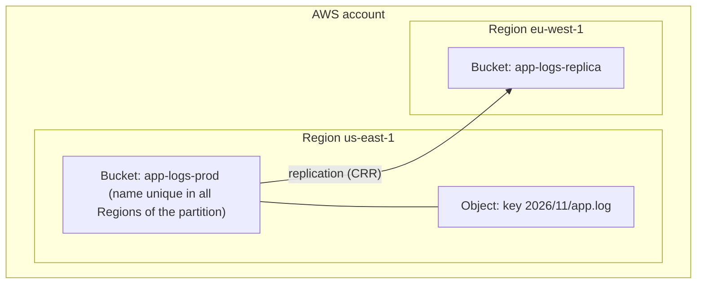
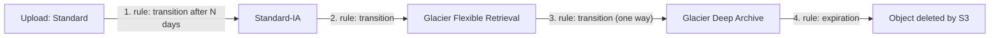
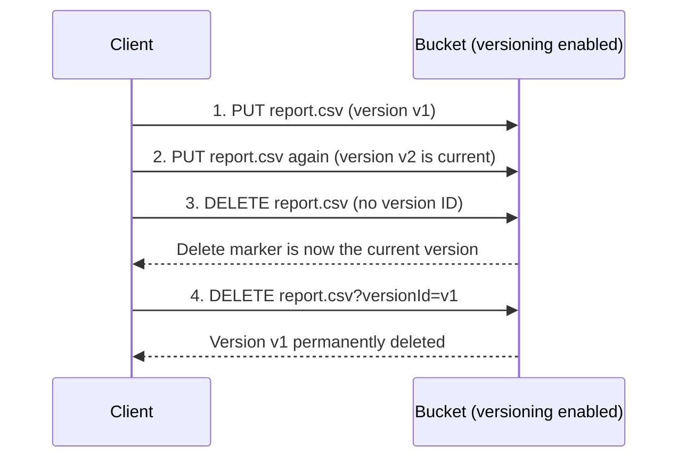
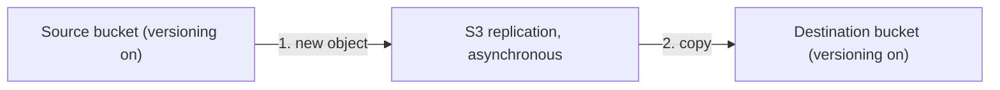
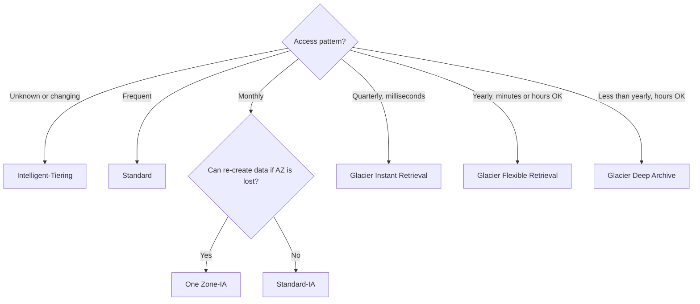

# S3 fundamentals

> [!summary] TL;DR
> - S3 is object storage. A bucket lives in one Region and holds objects found by key.[^9]
> - Pick the storage class by access pattern: Standard, Standard-IA, One Zone-IA, Intelligent-Tiering, or a Glacier class.[^1]
> - Versioning keeps every version. A plain delete only adds a delete marker.[^2][^11]
> - Lifecycle rules move objects to cheaper classes or expire them on a schedule.[^4]
> - Replication (CRR or SRR) copies new objects to another bucket. It needs versioning on both buckets.[^6][^7]

Exam mapping: task statements 3.1 (high-performing and scalable storage), 4.1 (cost-optimized storage) and 1.3 (backups and replication, lifecycle), from [[_exam-guide]].

## Why this exists
A backend engineer often stores files on a disk or a shared file system. That does not grow without limit, and you must manage the servers. S3 stores files as objects behind an API, so you do not manage disks. Storage classes, versioning, lifecycle and replication are the settings that control cost, history, and copies.

## Core concepts
- **Bucket:** a container for objects.[^9]
- **Object:** a file and any metadata that describes the file.[^9]
- **Key:** the unique identifier of an object within its bucket.[^9]
- **Storage class:** a setting on each object that sets availability, minimum storage time, and fees. S3 Standard is the default if you do not choose one.[^1]
- **Versioning:** keeping multiple variants of an object in the same bucket.[^2]
- **Delete marker:** a placeholder S3 inserts when you delete a versioned object without a version ID. It becomes the current version.[^2][^11]
- **Lifecycle configuration:** a set of rules that define actions S3 applies to a group of objects.[^4]
- **Replication:** automatic, asynchronous copying of objects across S3 buckets.[^6]

## Where it lives

> [!info] How to read this
> A bucket belongs to one Region, and objects stay in that Region unless you transfer or replicate them.[^9] Replication to a bucket in another Region is called Cross-Region Replication (CRR).[^6]

Simplified: Availability Zones are not drawn. General purpose buckets store objects redundantly across multiple Availability Zones, except for S3 Express One Zone.[^9]

## How it works

Storage classes. The values below are "designed for" figures from the AWS table.[^1]

| Class | Designed for | Availability | AZs | Min storage duration | Min billable size | Retrieval |
|---|---|---|---|---|---|---|
| Standard | Frequently accessed, millisecond access | 99.99% | >= 3 | None | None | No per-GB fee listed |
| Standard-IA | Infrequent (once a month), millisecond access | 99.9% | >= 3 | 30 days | 128 KB | Per-GB fee |
| One Zone-IA | Recreatable, infrequent, millisecond access | 99.5% | 1 | 30 days | 128 KB | Per-GB fee |
| Intelligent-Tiering | Unknown or changing access | 99.9% | >= 3 | None | None | No retrieval fees; per-object monitoring fee |
| Glacier Instant Retrieval | Archive, once a quarter, millisecond access | 99.9% | >= 3 | 90 days | 128 KB | Per-GB fee |
| Glacier Flexible Retrieval | Archive, once a year, minutes to hours | 99.99% after restore | >= 3 | 90 days | Not applicable (40 KB extra metadata) | Per-GB fee; restore first |
| Glacier Deep Archive | Archive, less than once a year, hours | 99.99% after restore | >= 3 | 180 days | Not applicable (40 KB extra metadata) | Per-GB fee; restore first |

All classes in this table list 99.999999999% designed durability.[^1] One Zone-IA is "not resilient to the loss of the Availability Zone."[^1]

Intelligent-Tiering moves objects that have not been accessed for 30 consecutive days to the Infrequent Access tier, and after 90 consecutive days to the Archive Instant Access tier. Objects under 128 KB are not monitored and stay in the Frequent Access tier.[^1]

### Lifecycle flow

> [!info] How to read this
> Transitions go "down" the chain of colder classes. Deep Archive cannot be converted to another class by a lifecycle rule.[^3]

1. A transition action defines when objects move to another storage class.[^4] Days is "the number of days since object creation."[^5]
2. S3 supports Standard to Standard-IA and Standard-IA to Glacier Flexible Retrieval, among other paths.[^3]
3. Glacier Flexible Retrieval objects "can only be transitioned" to Deep Archive. That transition "can go only one way."[^3]
4. An expiration action defines when objects expire, and S3 deletes expired objects for you.[^4]

Simplified: the diagram shows one chain. Standard can also go directly to any Glacier class, and many other paths exist.[^3]

Rules to know:
- Objects smaller than 128 KB do not transition by default. You can change this with an object size filter.[^3]
- Filters can use key prefix, object tags, or both. An empty filter applies to all objects in the bucket.[^5]
- In a versioned bucket, `Expiration` applies only to the current version. It adds a delete marker.[^5]
- `NoncurrentVersionExpiration` permanently deletes noncurrent versions, and they "can't be recovered."[^5]
- `AbortIncompleteMultipartUpload` sets a maximum number of days for multipart uploads to stay in progress. It cannot be used with a tag filter.[^5]
- Moving objects to Flexible Retrieval or Deep Archive costs one transition request per object, so many small objects cost more.[^3]
- Early deletion in Flexible Retrieval (90 days) or Deep Archive (180 days) is charged a prorated early deletion fee.[^3]

### Versioning flow

> [!info] How to read this
> A delete without a version ID hides the object but keeps the data. Only a delete with a version ID removes a version permanently.[^11]

1. With versioning on, new objects are versioned and given a unique version ID.[^2]
2. Overwriting adds a new version. Each version is a full object, so you are charged for each version.[^2]
3. A delete without a version ID inserts a delete marker and does not remove the object permanently.[^2][^11]
4. To delete permanently, you must use `DELETE Object versionId`.[^11]

Versioning states: unversioned (the default), versioning-enabled, and versioning-suspended. After you enable it, a bucket "can never return to an unversioned state," but you can suspend versioning. Objects stored before versioning have version ID `null`.[^2]

### Replication flow

> [!info] How to read this
> Replication is automatic and asynchronous. Both buckets need versioning.[^6][^7]

1. Live replication copies objects created after you add a replication configuration.[^6]
2. Source and destination can be in different Regions (CRR) or the same Region (SRR), and can belong to different accounts.[^6]

Rules to know:
- "Both source and destination buckets must have versioning enabled."[^7]
- Live replication "doesn't replicate any objects that existed in the bucket before you set up replication." Use S3 Batch Replication for existing objects.[^6]
- A delete with a version ID is not replicated to the destination.[^8]
- With the latest replication configuration (a `Filter` element), delete markers are not replicated by default. You can add delete marker replication to non-tag-based rules.[^8]
- Objects that are replicas are not replicated again to a third bucket. Replicas can be replicated only with Batch Replication.[^8][^6]
- The destination storage class can differ, for example Glacier Deep Archive.[^6]
- CRR use cases listed by AWS: compliance, lower latency, operational efficiency. SRR: aggregate logs, link production and test accounts, data sovereignty.[^6]

## Key facts and limits

| Fact | Value | Source |
|---|---|---|
| Bucket name uniqueness | Unique across all accounts in all Regions of a partition (general purpose buckets) | [^9] |
| Consistency | Strong read-after-write for PUT and DELETE | [^9] |
| Object size | 0 to 50 TB | [^10] |
| Default class | S3 Standard | [^1] |
| Versioning default | Disabled | [^2] |
| Lifecycle default for small objects | Under 128 KB not transitioned | [^3] |
| Intelligent-Tiering | 30 days to Infrequent Access; 90 days to Archive Instant Access | [^1] |

## Comparisons

| Need | Standard-IA | One Zone-IA | Intelligent-Tiering | Glacier Instant | Flexible / Deep Archive |
|---|---|---|---|---|---|
| Access pattern | Monthly | Monthly, recreatable | Unknown | Quarterly | Yearly / less than yearly |
| Access speed | Milliseconds | Milliseconds | Milliseconds in frequent tiers | Milliseconds | Restore first |
| Survives loss of an AZ | Yes | No | Yes | Yes | Yes |

Source for all cells: [^1].

| | Versioning | Replication |
|---|---|---|
| Protects against | Overwrite and delete by mistake | Loss in one bucket or Region; distance and compliance needs |
| Needs versioning | It is versioning | On both buckets |

## Choosing in exam scenarios

> [!info] How to read this
> Start from how often data is read and how fast it must come back. The table above holds the facts behind each branch.[^1]

- Access pattern unknown → Intelligent-Tiering, because it moves data by itself and lists no retrieval fees.[^1]
- Data changes age profile on a known schedule → lifecycle rules.[^4]
- Protect against accidental delete or overwrite → versioning.[^2]
- Copy to another Region or account → CRR. Same Region (for example, aggregate logs) → SRR.[^6]
- Replicate objects that already exist → S3 Batch Replication.[^6]

## Common traps and misconceptions
- **Misconception:** Deleting an object in a versioned bucket removes the data. → **Reality:** A simple delete inserts a delete marker; the data stays and is billed. → [^11][^2]
- **Misconception:** Turning replication on copies the whole bucket. → **Reality:** Only objects created after the configuration are replicated by live replication. → [^6]
- **Misconception:** You can turn versioning off again. → **Reality:** You can only suspend it. → [^2]
- **Misconception:** One Zone-IA is as available as Standard-IA. → **Reality:** It has the same listed durability but lower availability (99.5% vs 99.9%) and one AZ. → [^1]
- **Misconception:** Lifecycle can move Glacier objects back to Standard. → **Reality:** Deep Archive cannot be converted by a lifecycle rule; you restore and copy. → [^3]
- **Misconception:** Deleting a version on the source also deletes it on the destination. → **Reality:** Version-specific deletes are not replicated. → [^8]

## Self-check

**Q1.** Compliance data is read less than once a year, and waiting hours for a retrieval is acceptable. Which class fits?
A. Standard-IA  B. Glacier Instant Retrieval  C. Glacier Deep Archive  D. S3 Express One Zone

> [!question]- Answer
> C. The table lists Deep Archive for data accessed less than once a year with retrieval in hours.[^1] A is for monthly access with millisecond access. B is for quarterly access with millisecond access. D is a single-AZ class for latency-sensitive applications.[^1]

**Q2.** Access patterns for a data set are unpredictable. The team wants no retrieval fees and no manual tuning. Which choice fits?
A. One Zone-IA  B. Intelligent-Tiering  C. Standard-IA  D. Glacier Flexible Retrieval

> [!question]- Answer
> B. Intelligent-Tiering is for unknown or changing patterns and lists no retrieval fees.[^1] A and C list per-GB retrieval fees. D requires a restore before access and lists per-GB fees.[^1]

**Q3.** You enable Cross-Region Replication on a bucket that already holds 50,000 objects. You need those objects in the destination too. What do you do?
A. Wait; live replication copies them  B. Use S3 Batch Replication  C. Change the destination to One Zone-IA  D. Suspend versioning on the source

> [!question]- Answer
> B. Live replication does not replicate objects that existed before setup; Batch Replication does that on demand.[^6] A is wrong for that reason. C changes the storage class, not what is copied. D is wrong because both buckets must have versioning enabled.[^7]

## Related
- [[disaster-recovery-and-aws-backup]] for how replication fits recovery plans.
- [[kms-and-cloudhsm]] for encryption keys used with S3 objects.
- S3 security and performance (bucket policies, encryption, presigned URLs) is the next S3 note on the to-do list.

## Sources
[^1]: Understanding and managing Amazon S3 storage classes — https://docs.aws.amazon.com/AmazonS3/latest/userguide/storage-class-intro.html (accessed 2026-11-08)
[^2]: Retaining multiple versions of objects with S3 Versioning — https://docs.aws.amazon.com/AmazonS3/latest/userguide/Versioning.html (accessed 2026-11-08)
[^3]: Transitioning objects using S3 Lifecycle (general considerations) — https://docs.aws.amazon.com/AmazonS3/latest/userguide/lifecycle-transition-general-considerations.html (accessed 2026-11-08)
[^4]: Managing the lifecycle of objects — https://docs.aws.amazon.com/AmazonS3/latest/userguide/object-lifecycle-mgmt.html (accessed 2026-11-08)
[^5]: Lifecycle configuration elements — https://docs.aws.amazon.com/AmazonS3/latest/userguide/intro-lifecycle-rules.html (accessed 2026-11-08)
[^6]: Replicating objects within and across Regions — https://docs.aws.amazon.com/AmazonS3/latest/userguide/replication.html (accessed 2026-11-08)
[^7]: Requirements and considerations for replication — https://docs.aws.amazon.com/AmazonS3/latest/userguide/replication-requirements.html (accessed 2026-11-08)
[^8]: What does Amazon S3 replicate? — https://docs.aws.amazon.com/AmazonS3/latest/userguide/replication-what-is-isnot-replicated.html (accessed 2026-11-08)
[^9]: What is Amazon S3? — https://docs.aws.amazon.com/AmazonS3/latest/userguide/Welcome.html (accessed 2026-11-08)
[^10]: Amazon S3 objects overview — https://docs.aws.amazon.com/AmazonS3/latest/userguide/UsingObjects.html (accessed 2026-11-08)
[^11]: Deleting object versions from a versioning-enabled bucket — https://docs.aws.amazon.com/AmazonS3/latest/userguide/DeletingObjectVersions.html (accessed 2026-11-08)
