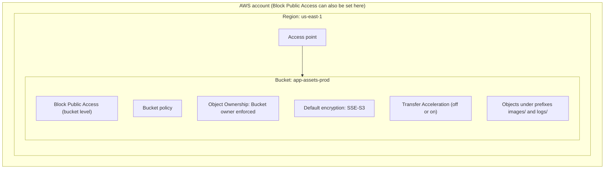
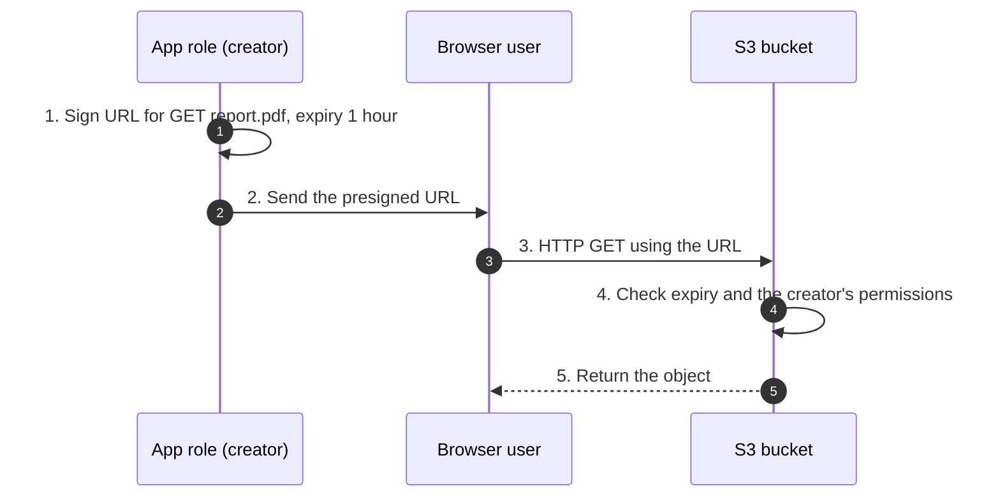
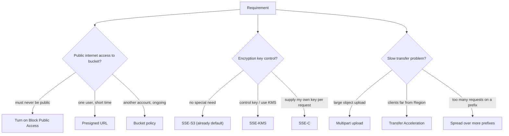

# S3 security and performance

> [!summary] TL;DR
> - Access control: bucket policy (resource-based JSON policy) + Block Public Access (a guard that can override public grants). ACLs are disabled on new buckets.[^10][^1][^11]
> - Encryption at rest is always on: new objects get SSE-S3 automatically. Choose SSE-KMS when you need control over the key; SSE-C is the "you hold the key" option.[^2][^3]
> - A presigned URL gives time-limited access using the creator's permissions. Anyone who holds the URL can use it.[^4]
> - Speed: multipart upload for big objects, byte-range GETs for fast downloads, more prefixes/connections for more requests, Transfer Acceleration for long distances.[^5][^9][^8][^7]

This note builds on [[s3-fundamentals]] (buckets, objects, storage classes). IAM policy basics are in [[iam-fundamentals]]. Keys are in [[kms-and-cloudhsm]].

## Why this exists
A new S3 bucket holds data from many callers: your own users, other AWS accounts, and sometimes the public internet. You need a way to say who may read or write, to protect data at rest, and to move large files quickly from far away. Without these controls you would build your own gateway in front of the bucket.

## Core concepts
- **Bucket policy:** a resource-based policy in JSON attached to a bucket. It grants or denies access to the bucket and its objects.[^10] Only the bucket owner can attach one.[^10]
- **Block Public Access (BPA):** four settings that stop public access being granted through policies or ACLs. They apply to an access point, a bucket, or a whole account. If levels differ, S3 uses the most restrictive combination.[^1]
- **ACL (access control list):** an older per-object permission list. New buckets have ACLs disabled (Object Ownership = Bucket owner enforced), and AWS recommends keeping them disabled unless you must control access per object.[^11]
- **SSE (server-side encryption):** S3 encrypts the object when it writes it and decrypts it when you read it.[^3] There are four mutually exclusive options.[^3]
- **Presigned URL:** a URL that grants time-limited access to one object without changing the bucket policy.[^4]
- **Multipart upload:** uploading one object as a set of parts.[^5]
- **Prefix:** the leading part of an object key, used here as the unit for request-rate limits.[^8]
- **Transfer Acceleration:** a bucket-level feature that routes uploads and downloads through CloudFront edge locations.[^7]

### The four Block Public Access settings[^1]
| Setting | Effect when TRUE |
|---|---|
| BlockPublicAcls | `PutBucketAcl`, `PutObjectAcl` fail if the ACL is public; `PutObject` fails if it includes a public ACL |
| IgnorePublicAcls | S3 ignores all public ACLs on the bucket and its objects |
| BlockPublicPolicy | `PutBucketPolicy` is rejected if the policy allows public access |
| RestrictPublicBuckets | Access to a bucket or access point with a public policy is limited to AWS service principals and authorized users in the owner's account |

BPA does not change existing policies or ACLs. Removing a BPA setting makes a bucket with a public policy public again.[^1]

### The four server-side encryption options[^3]
| Option | Who manages the key | Notes |
|---|---|---|
| SSE-S3 | S3 | Default. Each object has its own key; AES-256[^2][^3] |
| SSE-KMS | AWS KMS keys (AWS managed or customer managed) | You get more control over the keys[^3] |
| DSSE-KMS | AWS KMS plus an S3-managed key | Two independent layers of AES-256[^3] |
| SSE-C | You | You supply the key; S3 does the encryption work[^3] |

## Where it lives

> [!info] How to read this
> Security and speed settings are properties of the bucket. BPA can also be set on the account and on an access point.[^1] Transfer Acceleration and Object Ownership are bucket-level settings.[^7][^11]

Simplified: other bucket settings (versioning, lifecycle) are in [[s3-fundamentals]].

## How it works
### Presigned URL flow

> [!info] How to read this
> The user has no AWS credentials. S3 treats the request as coming with the creator's permissions, so the creator must be allowed to do `s3:GetObject`.[^4]

1. The creator (an IAM principal) signs a URL for one operation on one object, with an expiry time.
2. The creator hands the URL to the user.
3. The user sends an HTTP request with the URL.
4. S3 checks the expiry at request time and the creator's permissions.[^4]
5. S3 returns the object. The same URL works many times until it expires.[^4]

Simplified: signature details are left out. Presigned URLs also work for `PUT` uploads.[^4]

Expiry limits:[^4]
- S3 console: 1 minute to 12 hours.
- CLI or SDK: up to 7 days.
- If you sign with temporary credentials (for example an IAM role session), the URL expires when the session expires, even if you asked for longer.

### Multipart upload and parallel reads
1. Start the upload. S3 keeps every part until you complete or stop it.[^5]
2. Upload parts independently, in parallel, in any order. A failed part can be sent again alone.[^5]
3. Complete the upload. Or stop it; S3 then deletes the parts.[^5]

AWS says to consider multipart upload when an object reaches 100 MB.[^5][^6] For downloads, use the `Range` header to fetch byte ranges over concurrent connections for higher total throughput.[^9]

### Worked example
Limits: parts are 5 MiB to 5 GiB, at most 10,000 parts per upload, and there is no minimum size for the last part.[^6]
- 10,000 parts × 5 GiB = 48.83 TiB, which matches the listed maximum object size of 48.8 TiB.[^6]
- A 100 GiB object with 5 MiB parts would need 20,480 parts. That exceeds 10,000. So the part size must be at least 100 × 1024 / 10,000 = 10.24 MiB.
- A 1 GiB object with 100 MiB parts needs 11 parts (10 full parts + one smaller last part).

(Computed with Python.)

## Key facts and limits
| Fact | Value | Source |
|---|---|---|
| New objects are encrypted at rest | SSE-S3 for all new uploads since January 5, 2023; cannot be disabled | [^2] |
| SSE-C on new general purpose buckets | Disabled by default; an application must enable it with `PutBucketEncryption` | [^3] |
| Presigned URL expiry | Console 1 min–12 h; CLI/SDK up to 7 days | [^4] |
| Multipart part size / count | 5 MiB–5 GiB; up to 10,000 parts | [^6] |
| Maximum object size | 48.8 TiB | [^6] |
| Request rate | At least 3,500 PUT/COPY/POST/DELETE or 5,500 GET/HEAD per second per partitioned prefix | [^8] |
| Prefixes per bucket | No limit | [^8] |
| Transfer Acceleration endpoint | `bucket-name.s3-accelerate.amazonaws.com` | [^7] |
| Transfer Acceleration bucket names | DNS-compliant, no periods | [^7] |
| Transfer Acceleration start-up | Up to 20 minutes after enabling before speed increases | [^7] |
| Bucket Keys | Can cut KMS request cost by up to 99 percent (depends on request patterns) | [^13] |

## Comparisons
| | SSE-S3 | SSE-KMS | SSE-C | Client-side |
|---|---|---|---|---|
| Who holds the key | S3 | AWS KMS key you choose or AWS managed | You | You, outside S3 |
| Default? | Yes[^2] | No | No (disabled on new buckets)[^3] | No |
| Use when | No special key requirement | You need control over the key[^3] | You must supply the key on each request | Data must be encrypted before it leaves your app |

Client-side: S3 receives ciphertext and adds its own SSE-S3 layer.[^2]

| Need | Tool |
|---|---|
| Give one outsider temporary access to one object | Presigned URL[^4] |
| Give an account or role standing access | Bucket policy[^10] |
| Make sure nothing becomes public | Block Public Access[^1] |
| Faster uploads from far away | Transfer Acceleration[^7] |
| Cache for lower latency or higher single-connection rates | CloudFront or ElastiCache in front of S3[^8] |

## Choosing in exam scenarios

> [!info] How to read this
> Start from the keyword in the question. Each branch ends in one S3 feature.

- "Share a private file with a customer for a few hours, no AWS account" → presigned URL.[^4]
- "Grant another AWS account access to the bucket" → bucket policy.[^10]
- "Prevent accidental public exposure across all buckets" → BPA at account level.[^1]
- "Force HTTPS" → bucket policy that denies requests where `aws:SecureTransport` is `false`.[^12]
- "Require MFA for a folder" → bucket policy with `aws:MultiFactorAuthAge`.[^12]
- "Customers worldwide upload to one central bucket" → Transfer Acceleration.[^7]
- "Upload very large files reliably, resume after failure" → multipart upload.[^5]
- "Lower KMS cost for SSE-KMS" → S3 Bucket Keys.[^13]
- "Higher read rate" → more prefixes and parallel connections; AWS also points to CloudFront or ElastiCache for caching.[^8][^9]

## Common traps and misconceptions
- **Misconception:** New objects are unencrypted unless I turn encryption on. → **Reality:** SSE-S3 is applied to all new object uploads and cannot be disabled. → [^2]
- **Misconception:** A presigned URL carries its own permissions. → **Reality:** It is limited by the permissions of the principal that created it. → [^4]
- **Misconception:** A presigned URL for 7 days always lasts 7 days. → **Reality:** If signed with an IAM role session, it expires when the session expires. → [^4]
- **Misconception:** Turning on Block Public Access cleans up public policies. → **Reality:** It does not alter existing policies or ACLs; removing BPA re-exposes them. → [^1]
- **Misconception:** A bucket policy covers every object in the bucket. → **Reality:** It applies to objects owned by the bucket owner, not to objects owned by other accounts. With ACLs disabled, the bucket owner owns all objects. → [^10][^11]
- **Misconception:** Prefix count is limited, so spread keys carefully. → **Reality:** There is no limit on prefixes; the rate is per partitioned prefix. → [^8]
- **Misconception:** Transfer Acceleration works with any bucket name. → **Reality:** The name must be DNS-compliant and have no periods. → [^7]

## Self-check

**Q1.** A company wants a contractor with no AWS account to download one report for the next 2 hours. The bucket must stay private. Which solution has the least operational effort?
A. Make the bucket public for 2 hours  B. Create an IAM user and share its keys  C. Create a presigned URL with a 2-hour expiry  D. Add the contractor's IP to a bucket ACL

> [!question]- Answer
> C. A presigned URL gives time-limited access without changing the bucket policy.[^4] A exposes the whole bucket to the internet.[^1] B creates long-lived credentials for a short need. D relies on ACLs, which are disabled by default on new buckets.[^11]

**Q2.** Users in Asia and Europe upload multi-gigabyte files to one bucket in us-east-1. Uploads are slow over the public internet. The bucket name is `media-uploads`. What helps most?
A. Enable S3 Transfer Acceleration and use the accelerate endpoint  B. Enable SSE-KMS  C. Add a bucket policy that requires HTTPS  D. Disable Block Public Access

> [!question]- Answer
> A. Transfer Acceleration routes data through CloudFront edge locations to S3 over an optimized path, for long-distance transfers.[^7] B and C change security, not network path. D changes public-access guards and does not speed anything up.

**Q3.** A team stores objects with SSE-KMS and sees high AWS KMS request costs from many reads. They want to cut that cost without changing the encryption type. What should they do?
A. Switch to SSE-C  B. Configure an S3 Bucket Key  C. Switch to DSSE-KMS  D. Enable Transfer Acceleration

> [!question]- Answer
> B. A Bucket Key reduces S3-to-KMS traffic and can cut KMS request cost by up to 99 percent.[^13] A changes the encryption type and moves key handling to the team.[^3] C is wrong because Bucket Keys are not supported for DSSE-KMS.[^13] D is about network path, not KMS calls.

## Related
- [[s3-fundamentals]] for storage classes, versioning, lifecycle, replication.
- [[kms-and-cloudhsm]] for KMS keys used by SSE-KMS.
- [[iam-fundamentals]] for how identity policies and resource policies combine.
- [[vpc-endpoints-and-privatelink]] for private access to S3 from a VPC.
- CloudFront and ElastiCache (caching in front of S3) are on the to-do list and are not explained here.

## Sources
[^1]: Blocking public access to your Amazon S3 storage — https://docs.aws.amazon.com/AmazonS3/latest/userguide/access-control-block-public-access.html (accessed 2026-11-08)
[^2]: Default encryption FAQ — https://docs.aws.amazon.com/AmazonS3/latest/userguide/default-encryption-faq.html (accessed 2026-11-08)
[^3]: Protecting data with server-side encryption — https://docs.aws.amazon.com/AmazonS3/latest/userguide/serv-side-encryption.html (accessed 2026-11-08)
[^4]: Sharing objects with presigned URLs — https://docs.aws.amazon.com/AmazonS3/latest/userguide/using-presigned-url.html (accessed 2026-11-08)
[^5]: Uploading and copying objects using multipart upload — https://docs.aws.amazon.com/AmazonS3/latest/userguide/mpuoverview.html (accessed 2026-11-08)
[^6]: Amazon S3 multipart upload limits — https://docs.aws.amazon.com/AmazonS3/latest/userguide/qfacts.html (accessed 2026-11-08)
[^7]: Configuring fast, secure file transfers using Amazon S3 Transfer Acceleration — https://docs.aws.amazon.com/AmazonS3/latest/userguide/transfer-acceleration.html (accessed 2026-11-08)
[^8]: Best practices design patterns: optimizing Amazon S3 performance — https://docs.aws.amazon.com/AmazonS3/latest/userguide/optimizing-performance.html (accessed 2026-11-08)
[^9]: Performance guidelines for Amazon S3 — https://docs.aws.amazon.com/AmazonS3/latest/userguide/optimizing-performance-guidelines.html (accessed 2026-11-08)
[^10]: Bucket policies for Amazon S3 — https://docs.aws.amazon.com/AmazonS3/latest/userguide/bucket-policies.html (accessed 2026-11-08)
[^11]: Controlling ownership of objects and disabling ACLs for your bucket — https://docs.aws.amazon.com/AmazonS3/latest/userguide/about-object-ownership.html (accessed 2026-11-08)
[^12]: Examples of Amazon S3 bucket policies — https://docs.aws.amazon.com/AmazonS3/latest/userguide/example-bucket-policies.html (accessed 2026-11-08)
[^13]: Reducing the cost of SSE-KMS with Amazon S3 Bucket Keys — https://docs.aws.amazon.com/AmazonS3/latest/userguide/bucket-key.html (accessed 2026-11-08)
