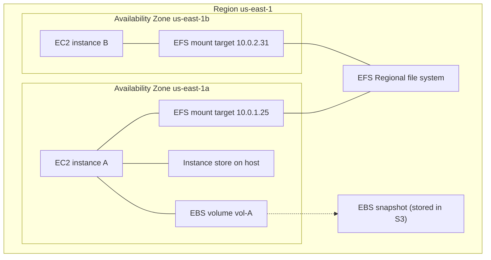
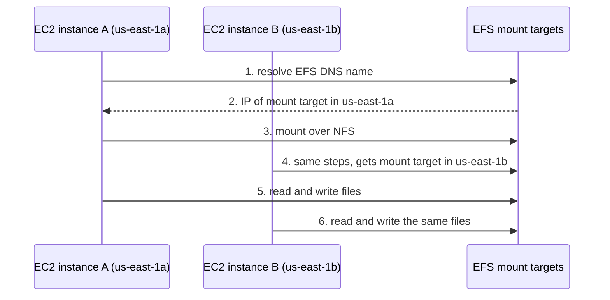
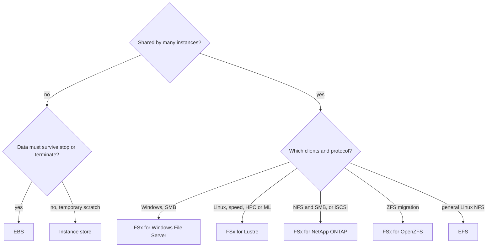

# Block and file storage (EBS, instance store, EFS, FSx)

> [!summary] TL;DR
> - EBS is block storage for one EC2 instance. A volume lives in one Availability Zone and survives the instance.[^2]
> - Instance store is disk on the host. Its data is lost on stop, hibernate, terminate, or disk failure.[^6]
> - EFS is a shared NFS file system for Linux. A Regional file system keeps data in multiple AZs.[^8][^9]
> - FSx is four managed file systems: Windows File Server, Lustre, NetApp ONTAP, OpenZFS. Pick the one that matches your current technology or workload.[^11]
> - Multi-Attach lets one io1/io2 volume attach to many instances, but only in the same AZ.[^4]

Exam mapping: task statements 3.1 (high-performing and scalable storage) and 4.1 (cost-optimized storage), from [[_exam-guide]]. Object storage is in [[s3-fundamentals]].

## Why this exists
A server needs disk for its operating system, a database, or shared files. On-premises you buy disks, SAN, or NAS. AWS offers three shapes: block storage (a raw disk), file storage (a shared folder over the network), and object storage (covered in [[s3-fundamentals]]).[^12] The exam asks you to match the shape to the requirement.

## Mental model
Think of four things.
- **EBS** is a network-attached virtual disk. It is like a persistent volume you attach to one VM.
- **Instance store** is a disk inside the host machine. It is like a local scratch disk.
- **EFS** is a shared Linux folder over NFS. It is like an NFS server you do not run.
- **FSx** is a managed file server of a kind you already know (Windows, Lustre, NetApp, ZFS).

**Where this analogy breaks:** a Kubernetes PersistentVolume is usually reachable from any node the cluster can schedule on. An EBS volume can be attached only to an instance in the same Availability Zone.[^2]

## Core concepts
- **Block storage:** divides data into equal-sized blocks and stores them on physical storage for fast access.[^12] You format it with a file system yourself.
- **EBS volume:** a storage volume you attach to an EC2 instance and use like a local hard drive.[^1] It persists independently from the running life of the instance.[^2]
- **Snapshot:** a point-in-time backup of an EBS volume. It is incremental, and AWS stores it in Amazon S3 in buckets you cannot access directly.[^1][^7]
- **Instance store:** temporary block-level storage from disks physically attached to the host computer.[^5]
- **File storage:** data in a hierarchy of files and folders, often through network-attached storage.[^12]
- **EFS mount target:** an IP address for an NFSv4 endpoint where you mount the file system. You create one mount target per AZ in a Region.[^10]
- **EFS file system types:** Regional stores data redundantly across multiple AZs. One Zone stores data in a single AZ.[^9]
- **FSx:** a service that offers four file systems: Lustre, NetApp ONTAP, OpenZFS, and Windows File Server.[^11]

## Where it lives

> [!info] How to read this
> The EBS volume and the instance store sit inside one AZ with their instance. EFS is a Regional file system that each AZ reaches through its own mount target.

Simplified: FSx, Multi-Attach, and VPC details are left out. Snapshot data is replicated across all AZs in the Region.[^7]

## How it works

> [!info] How to read this
> Both instances use the same DNS name. Each gets the mount target in its own AZ, and both see the same file system.

1. Instance A resolves the file system DNS name.
2. The name resolves to the IP of the mount target in the same AZ as the instance.[^10]
3. Instance A mounts the file system as an NFS client.
4. Instance B repeats this and gets the mount target in its own AZ.
5. Both instances read and write the same file system. EFS can be accessed concurrently from multiple NFS clients.[^10]

Simplified: security group rules and mount helper options are left out.

## Key facts and limits

| Fact | Value | Source |
|---|---|---|
| EBS attach rule | Volume and instance must be in the same AZ | [^2] |
| EBS volume types | gp2, gp3, io1, io2, st1, sc1, and Magnetic (standard) | [^2] |
| gp3 | 1 GiB – 64 TiB; max 80,000 IOPS; max 2,000 MiB/s; boot supported | [^3] |
| gp2 | 1 GiB – 16 TiB; max 16,000 IOPS; max 250 MiB/s; boot supported | [^3] |
| io2 Block Express | 4 GiB – 64 TiB; max 256,000 IOPS; 99.999% durability; Multi-Attach supported | [^3] |
| io1 | 4 GiB – 16 TiB; max 64,000 IOPS; Multi-Attach supported | [^3] |
| st1 / sc1 | 125 GiB – 16 TiB; boot volume not supported; st1 for big data, data warehouses, log processing; sc1 for infrequently accessed data and lowest cost | [^3] |
| Multi-Attach | io1 and io2 only; up to 16 Nitro instances in the same AZ; cannot be a boot volume | [^4] |
| Instance store after reboot | Data persists | [^6] |
| Instance store after stop, hibernate, terminate | Data does not persist | [^6] |
| Instance store price | No additional charge; included in the instance price | [^5] |
| EFS protocol | NFSv4.1 and NFSv4.0 | [^8] |
| EFS storage classes | Standard, Infrequent Access (IA), Archive | [^9] |
| EFS and Windows instances | Not supported | [^8] |
| FSx Multi-AZ | Windows, ONTAP, OpenZFS: Single-AZ and Multi-AZ. Lustre: Single-AZ only (Persistent or Scratch) | [^11] |

## Comparisons

| | EBS | Instance store | EFS | FSx |
|---|---|---|---|---|
| Type | Block | Block | File (NFS) | File (depends on the FSx type) |
| Shared by many instances | One instance, unless Multi-Attach (io1/io2, same AZ)[^4] | No (disks on one host)[^5] | Yes, many NFS clients[^10] | Yes |
| AZ scope | One AZ[^2] | The host[^5] | Regional (multi-AZ) or One Zone[^9] | Per type[^11] |
| Survives instance stop | Yes[^2] | No[^6] | Not verified | Not verified |
| Price | Not verified | Included in instance price[^5] | Not verified | Not verified |

| FSx type | Protocols / clients | Pick it when |
|---|---|---|
| Windows File Server | SMB; Windows, Linux, macOS clients[^11] | You replace Microsoft Windows Server[^11] |
| Lustre | Linux clients; latency under 1 ms; automatic import/export of S3 data sets[^11] | Speed matters: ML, HPC, video processing, financial modeling[^12] |
| NetApp ONTAP | SMB, NFS, iSCSI[^11] | You replace NetApp ONTAP or other NAS appliances[^11] |
| OpenZFS | NFS[^11] | You move on-premises ZFS or other Linux-based file servers to AWS[^12] |

## Choosing in exam scenarios

> [!info] How to read this
> Start with "shared or not". Then match the client OS and protocol in the requirement.

Simplified: Multi-Attach (io1/io2, same AZ) is the exception to "not shared → EBS".

- Low-latency, durable disk for one instance, such as a database → EBS.[^12]
- Shared read and write access across many EC2 instances or containers, or from on-premises servers → EFS (a file system).[^12]
- Temporary buffers, caches, or scratch data → instance store.[^5]
- SMB and Windows → FSx for Windows File Server.[^12]
- Highest speed for ML, HPC, video → FSx for Lustre.[^12]
- NFS and SMB on the same data → FSx for NetApp ONTAP.[^12]
- Rarely accessed file data, lower cost → EFS Archive or IA class with lifecycle management.[^9][^12]
- Big sequential throughput at low cost, not a boot disk → st1 (frequent) or sc1 (infrequent).[^3]
- More than 16,000 IOPS or sustained IOPS for a database → Provisioned IOPS SSD (io1/io2).[^3]
- EBS data needed in another AZ → create a snapshot, then restore a volume in any AZ in the Region.[^7]

## Common traps and misconceptions
- **Misconception:** "Instance store survives a reboot, so it is safe." → **Reality:** it persists on reboot but not on stop, hibernate, terminate, or disk failure.[^6]
- **Misconception:** "Attach an EBS volume to an instance in another AZ." → **Reality:** the volume and instance must be in the same AZ.[^2]
- **Misconception:** "Multi-Attach makes a normal EBS volume shared storage." → **Reality:** it needs io1 or io2, and standard file systems such as XFS and EXT4 are not designed for simultaneous access by multiple servers.[^4]
- **Misconception:** "EFS works for my Windows servers." → **Reality:** EFS with Windows-based EC2 instances is not supported. Use FSx for Windows File Server.[^8][^12]
- **Misconception:** "st1 or sc1 can be a boot disk." → **Reality:** the volume-type table lists boot volume as not supported for both.[^3]
- **Misconception:** "EFS One Zone survives an AZ failure." → **Reality:** it is not resilient to the loss of the AZ.[^9]

## Self-check

1. A company runs a MariaDB server on one EC2 instance. It needs low-latency storage that keeps data after the instance stops. Which option fits?
   A. Instance store  B. EBS volume  C. EFS  D. FSx for Lustre

> [!question]- Answer
> **B.** EBS is block storage for a single instance and persists independently of the instance.[^2][^12] A: data is lost on stop.[^6] C: EFS is shared file storage, not the block disk a database server needs here.[^12] D: Lustre targets speed-focused workloads such as HPC and ML, not a single-instance database.[^12]

2. Web servers in three AZs must read and write the same files. The servers run Linux. Which option has the least operational effort?
   A. One EBS volume with Multi-Attach  B. Instance store on each server  C. EFS Regional file system  D. EBS snapshots restored per AZ

> [!question]- Answer
> **C.** A Regional EFS file system stores data across AZs and many NFS clients can use it at once.[^9][^10] A: Multi-Attach works only in one AZ.[^4] B: instance store is local to one host.[^5] D: snapshots copy data; they do not share live files.[^7]

3. A Windows application needs SMB file shares. Which service fits?
   A. EFS  B. FSx for Lustre  C. FSx for Windows File Server  D. st1 volume

> [!question]- Answer
> **C.** It provides managed Microsoft Windows file servers with SMB support.[^12] A: EFS with Windows instances is not supported.[^8] B: Lustre has Linux clients.[^11] D: st1 is a block volume for one instance, not an SMB share.[^3]

## Related
- [[s3-fundamentals]] for object storage, [[ec2-fundamentals]] for instances and AMIs.
- [[disaster-recovery-and-aws-backup]] for backing up these services.
- Later topics: RDS and Aurora, EC2 purchasing options, cost-optimized storage.

## Sources
[^1]: What is Amazon EBS — https://docs.aws.amazon.com/ebs/latest/userguide/what-is-ebs.html (accessed 2026-11-08)
[^2]: Amazon EBS volumes — https://docs.aws.amazon.com/ebs/latest/userguide/ebs-volumes.html (accessed 2026-11-08)
[^3]: Amazon EBS volume types — https://docs.aws.amazon.com/ebs/latest/userguide/ebs-volume-types.html (accessed 2026-11-08)
[^4]: Attach an EBS volume to multiple instances with Multi-Attach — https://docs.aws.amazon.com/ebs/latest/userguide/ebs-volumes-multi.html (accessed 2026-11-08)
[^5]: Amazon EC2 instance store — https://docs.aws.amazon.com/AWSEC2/latest/UserGuide/InstanceStorage.html (accessed 2026-11-08)
[^6]: Data persistence for instance store volumes — https://docs.aws.amazon.com/AWSEC2/latest/UserGuide/instance-store-lifetime.html (accessed 2026-11-08)
[^7]: Amazon EBS snapshots — https://docs.aws.amazon.com/ebs/latest/userguide/ebs-snapshots.html (accessed 2026-11-08)
[^8]: What is Amazon EFS — https://docs.aws.amazon.com/efs/latest/ug/whatisefs.html (accessed 2026-11-08)
[^9]: EFS features — https://docs.aws.amazon.com/efs/latest/ug/features.html (accessed 2026-11-08)
[^10]: How Amazon EFS works — https://docs.aws.amazon.com/efs/latest/ug/how-it-works.html (accessed 2026-11-08)
[^11]: Help me choose an Amazon FSx file system — https://aws.amazon.com/fsx/when-to-choose-fsx/ (accessed 2026-11-08)
[^12]: Choosing an AWS storage service — https://docs.aws.amazon.com/decision-guides/latest/decision-guides/choosing-aws-storage-service.html (accessed 2026-11-08)
