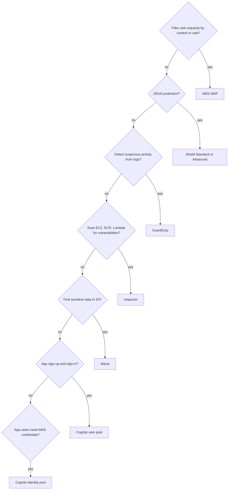

# Threat protection (index)

This topic was too large for one note. It maps to exam task statement 1.2 (design secure workloads and applications: Cognito, GuardDuty, Macie, Shield, WAF). Inspector is in the exam guide's in-scope services list.

- [[waf-and-shield]] — AWS WAF web ACLs, rate-based rules, Shield Standard vs Advanced.
- [[guardduty-inspector-macie]] — threat detection, vulnerability scanning, and sensitive data discovery.
- [[cognito]] — user pools vs identity pools.

> [!info] How to read this
> Read the exam requirement, then follow the first question that matches. Each service answers one kind of problem.

Simplified: Shield Standard is automatic. Choose Shield Advanced only for its extra capabilities, see [[waf-and-shield]].

Related: [[_index-encryption-and-secrets]] · [[_index-vpc-connectivity]] · [[iam-fundamentals]]
