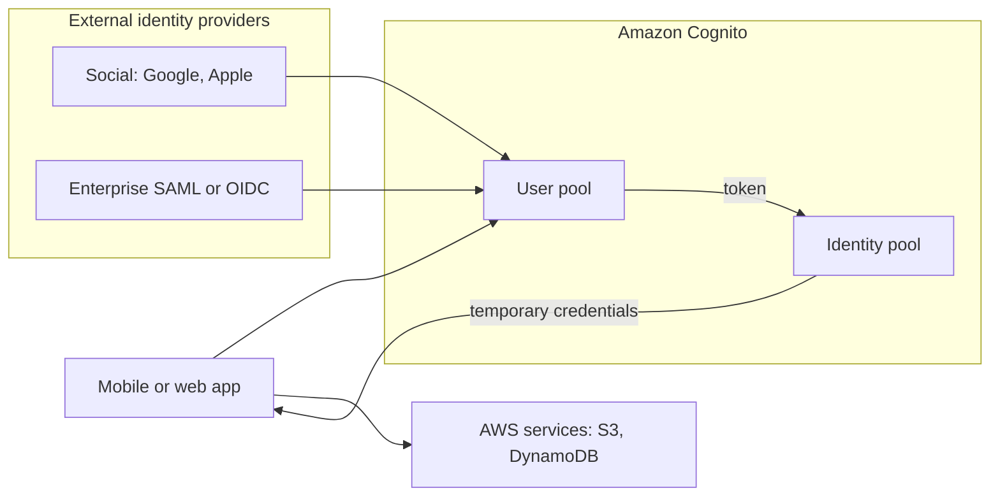
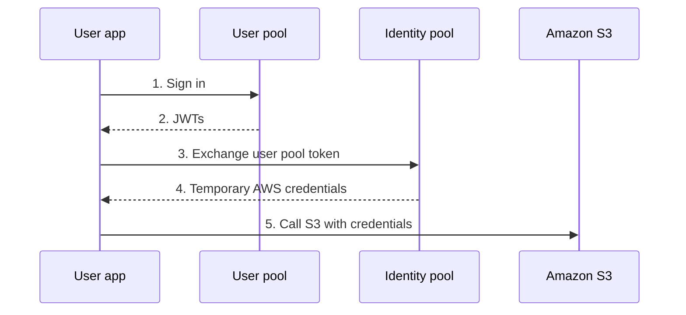

# Amazon Cognito

> [!summary] TL;DR
> - A **user pool** is a user directory. It handles sign-up and sign-in and issues JSON web tokens (JWTs).[^1]
> - An **identity pool** exchanges a trusted token for temporary, limited-privilege AWS credentials.[^1]
> - Use both together when users sign in and also need direct access to AWS resources. Neither requires the other.[^1]
> - User pools can sign users in through social providers and SAML or OIDC providers.[^1]

## Why this exists
A mobile or web app needs sign-up, sign-in, and sometimes direct access to AWS services such as S3. Without Cognito you would build the user database and login flow yourself, and find a safe way to give the app AWS access.

## Mental model
A user pool answers "who is this user?". An identity pool answers "what AWS access does this user get?". It is like your Yii app's user table and login code (user pool) next to a service that hands out short-lived cloud credentials (identity pool).

**Where this analogy breaks:** A Yii user table is code and data you host and maintain. A user pool is a managed directory that also federates sign-in to outside identity providers.

## Core concepts
- **JWT (JSON web token):** a signed token that carries claims about a user. A user pool issues JWTs to your app or API.[^1]
- **User pool:** "a user directory that draws from the OpenID Connect (OIDC) standard to authenticate users and issue JSON web tokens". Users can sign in directly, through social providers like Google and Apple, or through enterprise SAML and OIDC providers.[^1]
- **Identity pool:** "exchanges a trusted token (from a user pool, a social provider, or a SAML or OIDC provider) for temporary, limited-privilege AWS credentials". It can also grant credentials to guest users (unauthenticated identities).[^1]
- **MFA:** user pools support time-based one-time password (TOTP) and SMS message MFA. The page notes this feature is not available to federated users.[^1]
- **API Gateway:** you can use the access token from a user pool to authorize requests, or let API Gateway validate the token and gate access to a Lambda function or your own API.[^1]
- **WAF:** an Amazon Cognito user pool is a resource type that an AWS WAF web ACL can protect. See [[waf-and-shield]].[^2]

## Where it lives

> [!info] How to read this
> The user pool is where sign-in happens. The identity pool is only needed when the app calls AWS services directly.

Simplified: an identity pool can also accept tokens directly from social, SAML, and OIDC providers without a user pool.[^1] Region scope and IAM roles are left out.

## How it works

> [!info] How to read this
> Steps 1-2 are authentication. Steps 3-5 are access to AWS resources.

1. The user signs in to the user pool.
2. The user pool returns JWTs.
3. The app sends the user pool token to the identity pool.
4. The identity pool returns temporary, limited-privilege AWS credentials.
5. The app calls an AWS service such as S3 on the user's behalf.[^1]

For how temporary credentials work in general, see [[iam-advanced]].

## Key facts and limits
| Fact | Value | Source |
|---|---|---|
| User pool output | JWTs for your app or API | [^1] |
| Identity pool output | Temporary, limited-privilege AWS credentials | [^1] |
| MFA in user pools | TOTP and SMS; not available to federated users | [^1] |
| Dependency | Neither user pools nor identity pools require the other | [^1] |

## Comparisons
| | User pool | Identity pool |
|---|---|---|
| Role | User directory, sign-up and sign-in | Exchanges tokens for AWS credentials |
| Issues | JWTs | Temporary AWS credentials |
| Use for | App authentication, SSO via social, SAML, OIDC | Direct access to AWS resources, including guest users |

For workforce access to AWS accounts, see [[iam-advanced]].

## Choosing in exam scenarios
The decision diagram is in [[_index-threat-protection]].

- App needs sign-up and sign-in, or social login → Cognito user pool.
- Mobile app must upload straight to S3 for each user → user pool plus identity pool.
- Guest users need limited AWS access → identity pool with unauthenticated identities.[^1]
- Protect the sign-in endpoints from web attacks → AWS WAF web ACL on the user pool.[^2]

## Common traps and misconceptions
- **Misconception:** An identity pool is where users sign in. → **Reality:** Users sign in with a user pool or another trusted provider. The identity pool exchanges the token for AWS credentials. → **Source:** [^1]
- **Misconception:** You always need both pools. → **Reality:** Neither component requires the other. → **Source:** [^1]
- **Misconception:** MFA covers every user. → **Reality:** The page says the MFA feature is not available to federated users. → **Source:** [^1]

## Self-check
1. A mobile app needs user sign-up and sign-in with Google login. Which Cognito feature?
   A. Identity pool only. B. User pool. C. AWS WAF. D. Amazon Macie.

> [!question]- Answer
> **B.** User pools handle sign-up and sign-in and support social providers.[^1] A: an identity pool issues AWS credentials. It is not the sign-in directory. C and D do not authenticate users.

2. Signed-in users of a mobile app must upload files directly to S3 with their own temporary access. What is needed?
   A. A user pool token only. B. An identity pool, usually fed by the user pool token. C. Shield Advanced. D. GuardDuty.

> [!question]- Answer
> **B.** The identity pool exchanges the token for temporary, limited-privilege AWS credentials.[^1] A: a JWT alone is not AWS credentials. C and D are not authentication services.

3. A company wants guest visitors to read one S3 object without signing in, using Cognito. What is the matching feature?
   A. User pool MFA. B. Identity pool unauthenticated identities. C. Macie managed data identifiers. D. Inspector.

> [!question]- Answer
> **B.** Identity pools can grant temporary AWS credentials to guest users.[^1] A is a sign-in factor. C finds sensitive data. D scans for vulnerabilities.

## Related
[[_index-threat-protection]] · [[waf-and-shield]] · [[guardduty-inspector-macie]] · [[iam-fundamentals]] · [[iam-advanced]]

## Sources
[^1]: What is Amazon Cognito? — https://docs.aws.amazon.com/cognito/latest/developerguide/what-is-amazon-cognito.html (accessed 2026-11-08)
[^2]: What is AWS WAF? — https://docs.aws.amazon.com/waf/latest/developerguide/what-is-aws-waf.html (accessed 2026-11-08)
