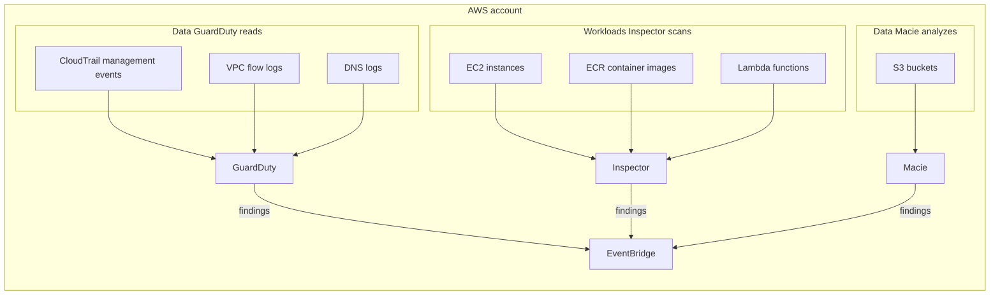
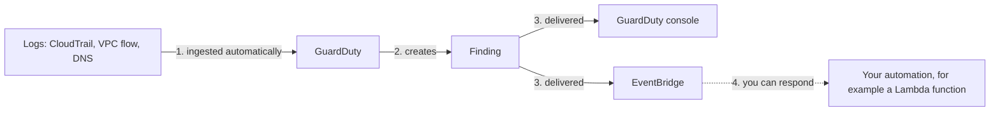

# GuardDuty, Inspector, and Macie

> [!summary] TL;DR
> - **GuardDuty** = threat detection. It analyzes CloudTrail management events, VPC flow logs, and DNS logs and creates findings.[^1]
> - **Inspector** = vulnerability management. It scans EC2 instances, ECR container images, and Lambda functions for software vulnerabilities and unintended network exposure.[^2]
> - **Macie** = sensitive data discovery in S3, using machine learning and pattern matching.[^3]
> - All three create findings. You decide how to respond. Findings go to Amazon EventBridge.[^1][^2][^3]

## Why this exists
You cannot read every log line, track every new CVE, or open every S3 object to look for personal data. These three services watch for you and report findings. Each one watches a different thing, so exam questions ask you to match the problem to the service.

A finding is a report about one issue that the service detected.[^2] A CVE (common vulnerabilities and exposures) is a published identifier for a known software vulnerability.[^2]

## Mental model
Think of three security guards with different jobs. GuardDuty watches behavior in your logs. Inspector checks your workloads for known weak spots. Macie looks inside S3 for sensitive data.

**Where this analogy breaks:** Guards can stop people at the door. These services, as described in the pages I read, create findings. Any blocking or fixing is something you build around the findings.

## Core concepts
- **GuardDuty:** "a threat detection service that continuously monitors, analyzes, and processes AWS data sources and logs".[^1] When you enable it, it automatically ingests CloudTrail management events, VPC flow logs (from EC2 instances), and DNS logs.[^1] The FAQ says it pulls independent data streams from these sources.[^4]
- **GuardDuty protection plans:** optional plans such as S3 Protection, EKS Protection, Runtime Monitoring, Malware Protection for EC2, Malware Protection for S3, RDS Protection, and Lambda Protection.[^1]
- **Inspector:** "a vulnerability management service" that discovers workloads and scans them. It rescans automatically after changes, such as a new package, a patch, or a newly published CVE.[^2]
- **Macie:** a data security service. It analyzes objects in S3 buckets using managed data identifiers (built-in criteria for types such as PII, financial information, and credentials) and custom data identifiers (criteria you define, such as a regular expression).[^3]
- **Macie findings:** a policy finding is created for a potential issue with the security or privacy of a bucket. A sensitive data finding is created when Macie detects sensitive data in an S3 object.[^3]

## Where it lives

> [!info] How to read this
> Each service reads a different input. Only the output is shared: findings go to EventBridge.

Simplified: GuardDuty is a Regional service.[^4] Macie works in each Region where you use it.[^3] I did not verify the Region scope of Inspector. Protection plans and multi-account setup are left out.

## How it works

> [!info] How to read this
> GuardDuty only produces the finding. Step 4 is optional automation that you build.

1. GuardDuty ingests the foundational data sources when you enable it. You do not enable anything else for it to start analyzing them.[^1]
2. It creates a security finding.
3. It delivers the finding to the GuardDuty console and to EventBridge.[^4]
4. You can set up automated remediation based on a finding. The FAQ gives the example of a Lambda function that changes security group rules.[^4]

Simplified: Inspector and Macie follow the same pattern (they publish findings to EventBridge).[^2][^3]

## Key facts and limits
| Fact | Value | Source |
|---|---|---|
| GuardDuty scope | Regional service | [^4] |
| GuardDuty agents | No extra security software, sensors, or network appliances to deploy for the foundational sources | [^4] |
| GuardDuty free trial | 30 days; first-time enable includes all protection plans except Runtime Monitoring | [^1] |
| Inspector resources | EC2 instances, ECR container images, Lambda functions | [^2] |
| Inspector scanning | You do not need to manually schedule or configure scans | [^2] |
| Macie data | Objects in S3 buckets | [^3] |
| Multi-account | GuardDuty: AWS Organizations (recommended) or invitation. Inspector: delegated administrator account. Macie: AWS Organizations or invitation | [^1][^2][^3] |

## Comparisons
| | GuardDuty | Inspector | Macie |
|---|---|---|---|
| Question it answers | Is something suspicious happening? | Do my workloads have known weaknesses? | Where is sensitive data in S3? |
| Looks at | CloudTrail, VPC flow logs, DNS logs | EC2, ECR images, Lambda | S3 buckets and objects |
| Output | Findings | Findings | Policy and sensitive data findings |

For web request filtering see [[waf-and-shield]]. For encrypting the S3 data Macie reports on, see [[kms-and-cloudhsm]].

## Choosing in exam scenarios
The decision diagram for the whole topic is in [[_index-threat-protection]].

- Detect unusual activity or suspicious behavior in an account, with no agents → GuardDuty.[^4]
- Find software vulnerabilities or CVEs in EC2, container images, or Lambda → Inspector.[^2]
- Find PII or other sensitive data in S3 → Macie.[^3]
- Automatically react to a finding → EventBridge plus your own automation (for example Lambda).[^1][^4]

## Common traps and misconceptions
- **Misconception:** I must turn on VPC flow logs and CloudTrail before GuardDuty works. → **Reality:** The FAQ says GuardDuty pulls independent data streams directly from these sources. → **Source:** [^4]
- **Misconception:** Inspector finds sensitive data. → **Reality:** Inspector scans for software vulnerabilities and unintended network exposure. Macie discovers sensitive data in S3. → **Source:** [^2][^3]
- **Misconception:** Macie scans any data store. → **Reality:** The page describes analyzing objects in S3 buckets. → **Source:** [^3]
- **Misconception:** I have to schedule Inspector scans. → **Reality:** You do not need to schedule or configure them. → **Source:** [^2]
- **Misconception:** GuardDuty is global. → **Reality:** It is a Regional service. → **Source:** [^4]

## Self-check
1. A security team wants to detect suspicious activity in an AWS account without deploying agents. Which service?
   A. Amazon Inspector. B. Amazon Macie. C. Amazon GuardDuty. D. AWS WAF.

> [!question]- Answer
> **C.** GuardDuty analyzes CloudTrail, VPC flow logs, and DNS logs and needs no extra software.[^1][^4] A: Inspector checks workloads for vulnerabilities. B: Macie looks for sensitive data in S3. D: WAF filters web requests, see [[waf-and-shield]].

2. A company must find personal data stored in many S3 buckets. Which service?
   A. Amazon Macie. B. Amazon GuardDuty. C. Amazon Inspector. D. AWS Shield.

> [!question]- Answer
> **A.** Macie discovers sensitive data in S3 using machine learning and pattern matching.[^3] B detects threats from logs. C scans EC2, ECR, and Lambda. D is DDoS protection.

3. A company wants continual scanning of its EC2 instances and Lambda functions for known software vulnerabilities, including newly published CVEs. Which service?
   A. Amazon Macie. B. Amazon GuardDuty. C. AWS WAF. D. Amazon Inspector.

> [!question]- Answer
> **D.** Inspector scans EC2, ECR images, and Lambda, and rescans when a new CVE is published.[^2] A is for S3 data. B detects threats from logs. C filters web requests.

## Related
[[_index-threat-protection]] · [[waf-and-shield]] · [[cognito]] · [[kms-and-cloudhsm]] · [[vpc-fundamentals]]

## Sources
[^1]: What is Amazon GuardDuty? — https://docs.aws.amazon.com/guardduty/latest/ug/what-is-guardduty.html (accessed 2026-11-08)
[^2]: What is Amazon Inspector? — https://docs.aws.amazon.com/inspector/latest/user/what-is-inspector.html (accessed 2026-11-08)
[^3]: What is Amazon Macie? — https://docs.aws.amazon.com/macie/latest/user/what-is-macie.html (accessed 2026-11-08)
[^4]: Amazon GuardDuty FAQs — https://aws.amazon.com/guardduty/faqs/ (accessed 2026-11-08)
