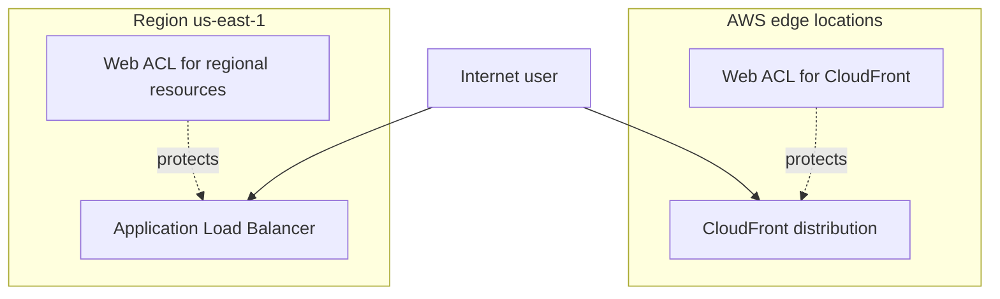
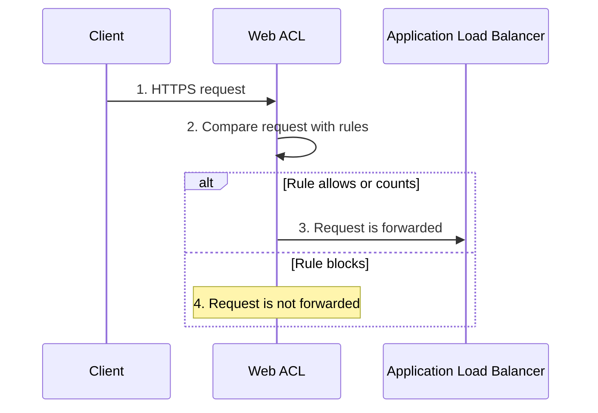
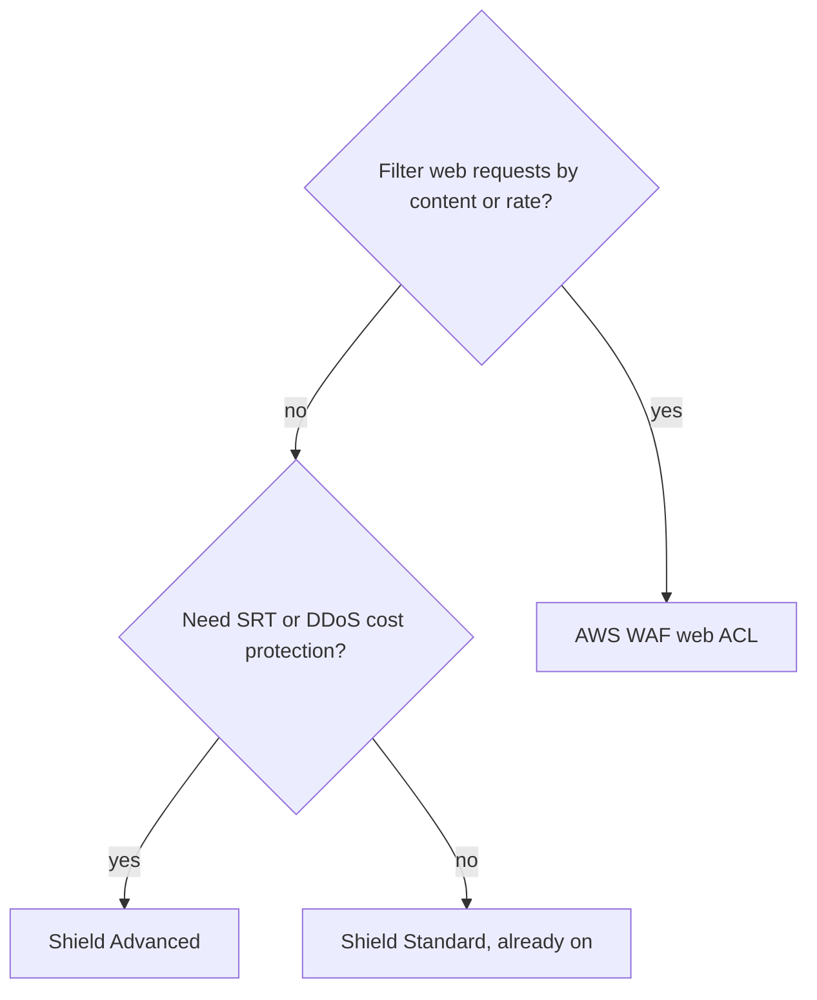

# AWS WAF and AWS Shield

> [!summary] TL;DR
> - AWS WAF is a web application firewall. It monitors the HTTP and HTTPS requests sent to a protected resource and can allow, block, or count them.[^1]
> - A rate-based rule in AWS WAF counts requests and rate limits them. By default it groups requests by IP address.[^4]
> - AWS Shield Standard is included automatically at no extra charge.[^2]
> - AWS Shield Advanced is a subscription. It adds the Shield Response Team, some cost protection, and automatic layer 7 mitigation (you configure it).[^3]
> - WAF answers "which web requests do I allow?". Shield answers "how do I survive a DDoS attack?".

## Why this exists
A public web application receives requests from anyone. Some requests are attacks, such as SQL injection or floods of requests. Without these services you would write filtering code in your application or run your own firewall appliances.

A DDoS attack (Distributed Denial of Service) is an attack that tries to make an application unavailable by overwhelming it with traffic from many sources. AWS Shield is the service for this problem.[^2]

## Mental model
Think of AWS WAF as a rule-based request filter placed in front of your web application, like a ModSecurity-style filter in front of a PHP (Yii) app. You write rules about what a request looks like, and each rule decides what happens to a matching request.

**Where this analogy breaks:** AWS WAF is a managed service that you attach to specific AWS resources. You do not install it on your own server.

## Core concepts
- **Web ACL (web access control list):** the AWS WAF object you use to protect a resource. It holds rules and rule groups.[^1][^3]
- **Rule:** matches requests by criteria and can allow, block, or count them.[^1]
- **Managed rule group:** a set of rules provided by AWS or by AWS Marketplace sellers.[^1]
- **Rate-based rule:** counts incoming requests and rate limits them when they come too fast. By default it groups requests by the request IP address. It can also group by a forwarded IP address in a header, or by custom keys such as the HTTP method or a query argument.[^4]
- **Actions:** allow, block, count, and CAPTCHA or challenge checks. Count tracks traffic without changing how the request is handled.[^1]
- **Shield Standard:** DDoS protection that AWS provides automatically.[^2]
- **Shield Advanced:** a subscription with extra protections (see the table below).[^3]

## Where it lives
Resource types you can protect with AWS WAF include a CloudFront distribution, an Application Load Balancer, an API Gateway REST API, an AWS AppSync GraphQL API, and an Amazon Cognito user pool.[^1] When you use AWS WAF on CloudFront, the rules run in all AWS edge locations. On regional services such as an Application Load Balancer, the rules run in the Region.[^5]

> [!info] How to read this
> Dotted lines show which web ACL protects which resource. The CloudFront web ACL runs at the edge. The other one runs in the Region.

Simplified: other protectable resource types are left out, and the two web ACLs are separate objects in this picture.

## How it works

> [!info] How to read this
> The web ACL sits in front of the resource. A count action does not change how the request is handled, so the request still goes forward.

1. A client sends an HTTP or HTTPS request to the protected resource.
2. The web ACL compares the request with its rules.
3. If the matching rule allows (or only counts) the request, the request goes to the application.
4. If a rule blocks the request, it is not forwarded.

Simplified: CAPTCHA and challenge actions, and rule evaluation order, are left out.

## Key facts and limits
| Fact | Value | Source |
|---|---|---|
| Shield Standard cost | Provided automatically and at no extra charge | [^2] |
| Shield Standard and Advanced protection layers | Network and transport layers (3 and 4) and application layer (7) | [^2] |
| Shield Advanced protects | EC2 instances, Elastic Load Balancing load balancers, CloudFront distributions, Route 53 hosted zones, Global Accelerator standard accelerators | [^1] |
| Shield Response Team (SRT) | Contact at any time during a DDoS attack that affects availability; needs Business Support or Enterprise Support plan | [^3] |
| Cost protection | Shield Advanced offers some cost protection against bill spikes from DDoS, in the form of Shield Advanced service credits | [^3] |
| WAF cost with Shield Advanced | Subscription covers standard AWS WAF capabilities for protected resources, up to 50 billion requests per calendar month | [^3] |
| Automatic layer 7 mitigation | You can configure Shield Advanced to respond automatically; it adds a rule group using 150 WCUs to the web ACL | [^3] |

## Comparisons
| | AWS WAF | Shield Standard | Shield Advanced |
|---|---|---|---|
| Purpose | Allow, block, or count web requests by rules | DDoS protection | Higher DDoS protection |
| Cost | Not covered in this note | No extra charge | Subscription |
| Expert help | Not covered in sources read | Not covered in sources read | SRT (needs Business or Enterprise Support) |
| Rules | You define rules, or use managed rule groups | Not applicable | Uses WAF web ACLs; automatic layer 7 mitigation is configurable |

For port and IP filtering inside a VPC, see [[security-groups-vs-nacls]]. AWS WAF is about web requests to the resources listed above.

## Choosing in exam scenarios

> [!info] How to read this
> Start at the left question. WAF and Shield are not exclusive: Shield Advanced itself uses WAF web ACLs for layer 7 protection.[^3]

- Block SQL injection or cross-site scripting → AWS WAF, because the FAQ lists these attacks.[^5]
- Limit how fast one client can send requests → rate-based rule in a web ACL.[^4]
- DDoS protection with no extra work or cost → Shield Standard.[^2]
- Expert help during an attack, or protection against DDoS-caused bill spikes → Shield Advanced.[^3]

## Common traps and misconceptions
- **Misconception:** Shield Advanced replaces WAF. → **Reality:** Shield Advanced uses WAF web ACLs, rules, and rule groups for its application layer protections. → **Source:** [^3]
- **Misconception:** Shield Advanced covers all WAF costs. → **Reality:** It covers standard WAF capabilities for resources protected by Shield Advanced. It does not cover WAF for other resources or non-standard WAF costs. → **Source:** [^3]
- **Misconception:** Shield Advanced cost protection covers every bill spike. → **Reality:** The page says it "can include" coverage for spikes such as data transfer out fees, as service credits. → **Source:** [^3]
- **Misconception:** A CloudFront web ACL runs in one Region. → **Reality:** On CloudFront the rules run in all edge locations. → **Source:** [^5]

## Self-check
1. A company runs a web application behind an Application Load Balancer. Logs show SQL injection attempts. What should the architect do?
   A. Subscribe to Shield Standard. B. Attach an AWS WAF web ACL with rules to the load balancer. C. Enable Amazon Inspector. D. Enable Amazon Macie.

> [!question]- Answer
> **B.** AWS WAF filters HTTP requests and the FAQ names SQL injection.[^5] A: Shield Standard is automatic DDoS protection, not a rule filter you tune for SQL injection.[^2] C: Inspector finds vulnerabilities in workloads; see [[guardduty-inspector-macie]]. D: Macie finds sensitive data in S3.

2. A team wants access to the Shield Response Team during attacks and some protection against DDoS-caused cost spikes. Which option fits?
   A. Shield Standard. B. A rate-based rule. C. Shield Advanced with a Business Support plan. D. Amazon GuardDuty.

> [!question]- Answer
> **C.** SRT access and cost protection are Shield Advanced capabilities, and SRT needs Business or Enterprise Support.[^3] A: Shield Standard is automatic with no extra charge and is not described with SRT access. B: a rate-based rule limits requests but gives no expert help or credits. D: GuardDuty detects threats from log data, not DDoS cost protection.

3. A login page behind CloudFront gets too many requests from single IP addresses. What is the most direct control?
   A. Shield Standard. B. A rate-based rule in an AWS WAF web ACL. C. Amazon Macie. D. Amazon Inspector.

> [!question]- Answer
> **B.** Rate-based rules count requests, group them (by default by IP address), and rate limit them.[^4] CloudFront is a supported resource for web ACLs.[^1] A is automatic DDoS protection, not a per-IP rate limit rule. C and D are for S3 data and workload vulnerabilities.

## Related
[[_index-threat-protection]] · [[guardduty-inspector-macie]] · [[cognito]] · [[security-groups-vs-nacls]] · [[vpc-fundamentals]]

## Sources
[^1]: What is AWS WAF? — https://docs.aws.amazon.com/waf/latest/developerguide/what-is-aws-waf.html (accessed 2026-11-08)
[^2]: AWS Shield and DDoS overview — https://docs.aws.amazon.com/waf/latest/developerguide/ddos-overview.html (accessed 2026-11-08)
[^3]: Shield Advanced capabilities and options — https://docs.aws.amazon.com/waf/latest/developerguide/ddos-advanced-summary-capabilities.html (accessed 2026-11-08)
[^4]: Rate-based rule statement, and aggregation options — https://docs.aws.amazon.com/waf/latest/developerguide/waf-rule-statement-type-rate-based.html and https://docs.aws.amazon.com/waf/latest/developerguide/waf-rule-statement-type-rate-based-aggregation-options.html (accessed 2026-11-08)
[^5]: AWS WAF FAQs — https://aws.amazon.com/waf/faqs/ (accessed 2026-11-08)
