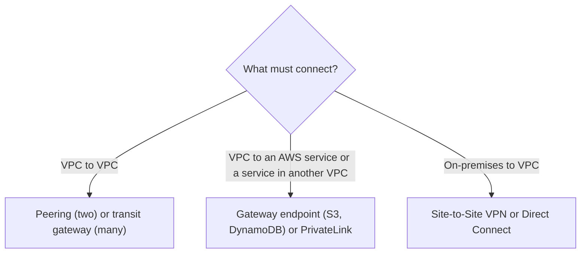

# VPC connectivity (index)

- [[vpc-peering-and-transit-gateway]] — connect VPCs to each other: one-to-one peering vs a transit gateway hub.
- [[vpc-endpoints-and-privatelink]] — reach AWS services or another VPC's service privately: gateway and interface endpoints.
- [[hybrid-connectivity-vpn-and-direct-connect]] — connect on-premises to AWS: Site-to-Site VPN and Direct Connect.

Prerequisites: [[vpc-fundamentals]], [[security-groups-vs-nacls]].

> [!info] How to read this
> Pick the left-hand question first, then open the matching note.
