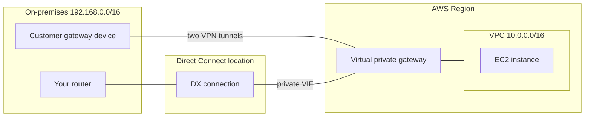
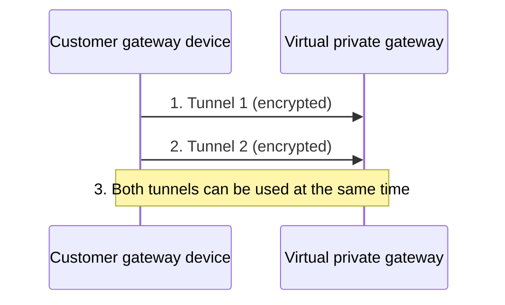
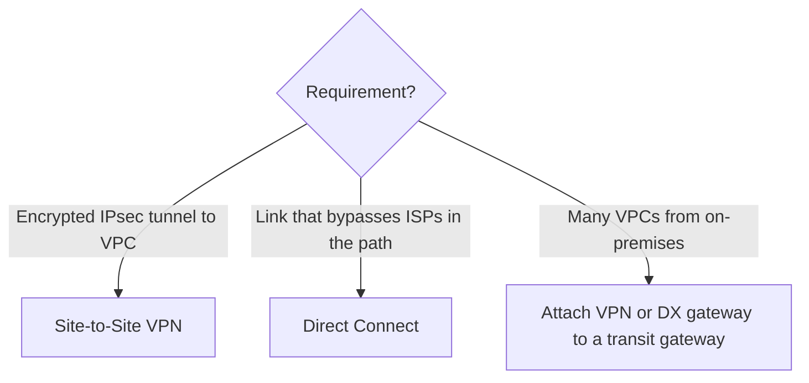

# Hybrid connectivity — Site-to-Site VPN and Direct Connect

> [!summary] TL;DR
> - **Site-to-Site VPN** supports IPsec VPN connections between your VPC and your on-premises network.[^1]
> - Each VPN connection includes **two tunnels** you can use at the same time for high availability.[^1]
> - **Direct Connect (DX)** links your network to a DX location with an Ethernet fiber-optic cable, and its virtual interfaces bypass internet service providers in your network path.[^2]
> - DX uses **virtual interfaces (VIFs)**: private, public, or transit.[^2]
> - A VPN can end on a virtual private gateway or a transit gateway.[^1]

## Why this exists
On-premises servers often need private access to VPC resources. You need a defined link between your data center and AWS. VPN builds an encrypted link. DX builds a physical link. Which one fits depends on the requirement.

## Core concepts
- **VPN tunnel:** "An encrypted link where data can pass from the customer network to or from AWS."[^1]
- **Virtual private gateway:** "the VPN endpoint on the Amazon side of your Site-to-Site VPN connection."[^1]
- **Customer gateway:** "An AWS resource which provides information to AWS about your customer gateway device."[^1]
- **Customer gateway device:** "A physical device or software application on your side".[^1]
- **Transit gateway:** another Amazon-side endpoint option; see [[vpc-peering-and-transit-gateway]].[^1]
- **Direct Connect location:** provides access to AWS in the Region it is associated with.[^2]
- **Virtual interface (VIF):** private (reach a VPC using private IPs), public (reach AWS public services using public IPs), transit (reach transit gateways associated with Direct Connect gateways).[^2]
- **Direct Connect gateway:** a private VIF connected to it can reach multiple virtual private gateways across any account and Region (except the AWS China Regions).[^2]

## Where it lives

> [!info] How to read this
> Two separate ways to reach the same VPC: VPN tunnels from the customer gateway device, or a DX connection with a private VIF.

Simplified: DX gateway, transit VIF, and the customer gateway resource in AWS are left out.

## How it works
VPN:

> [!info] How to read this
> One VPN connection has two tunnels, not one.

1. and 2. The connection has two tunnels.[^1]
3. They can be used "simultaneously ... for high availability."[^1]

DX: you create a connection in a DX location to link your premises to an AWS Region, then create virtual interfaces on it.[^2]

## Key facts and limits
| Fact | Value | Source |
|---|---|---|
| Tunnels per VPN connection | Two | [^1] |
| Bandwidth per tunnel | Standard 1.25 Gbps; large bandwidth tunnel up to 5 Gbps, available for VPN connections attached to Transit Gateway or Cloud WAN | [^1] |
| VPN cost | Per VPN connection hour while provisioned and available; plus data transfer out from EC2 to the internet | [^1] |
| Accelerated VPN | AWS creates and manages two accelerators; hourly and data transfer cost per accelerator | [^1] |
| DX VIF types | Three: private, public, transit | [^2] |
| DX cost | Port-hour pricing depends on capacity and connection type (dedicated or hosted) | [^2] |

## Comparisons
| | Site-to-Site VPN | Direct Connect |
|---|---|---|
| What it is | IPsec VPN connection with encrypted tunnels[^1] | Fiber-optic link from your network to a DX location[^2] |
| Path | Not verified here | Bypasses internet service providers in your network path[^2] |
| Redundancy built in | Two tunnels per connection[^1] | Not verified here |
| Cost model | Per connection-hour[^1] | Port-hour (capacity, connection type)[^2] |

## Choosing in exam scenarios

> [!info] How to read this
> Match the keyword to the service. Details not in this note (encryption on DX, lead time, resiliency design) are not verified; check them in another source.

- "IPsec / encrypted tunnel from on-premises" → Site-to-Site VPN.[^1]
- "Bypass the ISP in the path" → Direct Connect.[^2]
- "Reach S3 or other AWS public services over DX" → public VIF.[^2]
- "Reach VPC private IPs over DX" → private VIF; "reach transit gateways" → transit VIF.[^2]

## Common traps and misconceptions
- **Misconception:** One VPN connection is one tunnel. → **Reality:** two tunnels per connection.[^1]
- **Misconception:** A VPC peered with the VPC that holds the VPN can share it. → **Reality:** peering does not support this; see [[vpc-peering-and-transit-gateway]].
- **Misconception:** A private VIF reaches S3's public endpoints. → **Reality:** the public VIF accesses AWS public services; the private VIF accesses a VPC.[^2]

## Self-check
**Q1.** A company needs an encrypted IPsec connection from its office to a VPC, and wants two tunnels for availability.
A) Direct Connect public VIF. B) Site-to-Site VPN. C) VPC peering. D) Gateway endpoint.

> [!question]- Answer
> B. A VPN connection includes two tunnels.[^1] A: DX links via a DX location, not IPsec tunnels.[^2] C: connects VPCs only. D: reaches S3/DynamoDB only.

**Q2.** Over Direct Connect, on-premises servers must call Amazon S3 using public IP addresses. Which VIF?
A) Private. B) Public. C) Transit. D) None; DX cannot do this.

> [!question]- Answer
> B. The public VIF accesses AWS public services using public IP addresses.[^2] A reaches a VPC. C reaches transit gateways. D contradicts the DX documentation.

**Q3.** Which Amazon-side endpoints can a Site-to-Site VPN use?
A) Virtual private gateway or transit gateway. B) NAT gateway. C) Gateway endpoint. D) Internet gateway only.

> [!question]- Answer
> A.[^1] The others are not listed as VPN endpoints.

## Related
[[vpc-fundamentals]] · [[vpc-peering-and-transit-gateway]] · [[vpc-endpoints-and-privatelink]] · [[_index-vpc-connectivity]]

## Sources
[^1]: What is AWS Site-to-Site VPN? — https://docs.aws.amazon.com/vpn/latest/s2svpn/VPC_VPN.html (accessed 2026-11-08)
[^2]: What is AWS Direct Connect? — https://docs.aws.amazon.com/directconnect/latest/UserGuide/Welcome.html (accessed 2026-11-08)
