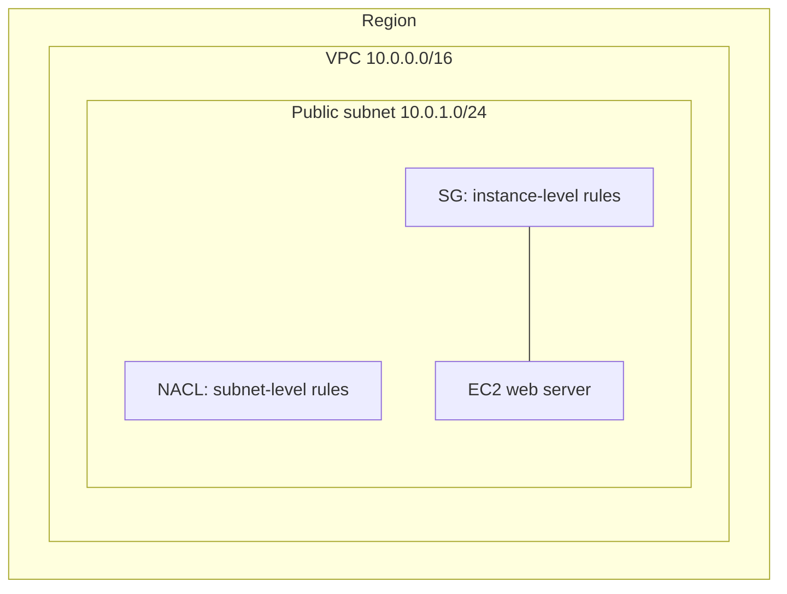
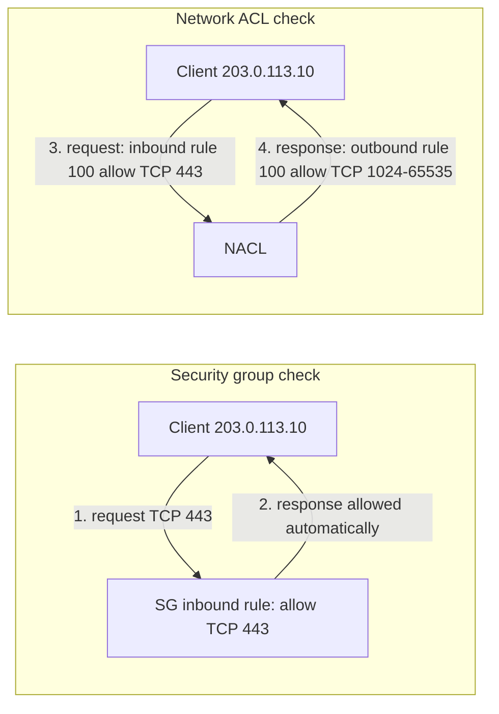
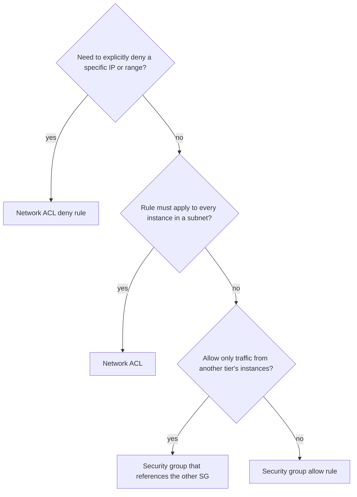

# Security groups vs network ACLs

> [!summary] TL;DR
> - A **security group** (SG) controls traffic for the resources it is associated with, for example an EC2 instance. It is **stateful** and has **allow rules only**.[^1][^2]
> - A **network ACL** (NACL) allows or denies traffic at the **subnet level**. It is **stateless** and has **allow and deny rules**.[^5]
> - NACL rules are checked from the lowest number up. The first matching rule is applied.[^5]
> - Default NACL: allows all traffic. New SG: no inbound rules, one allow-all outbound rule.[^7][^2]
> - To block one IP address, you need a NACL deny rule. An SG cannot deny.[^2][^5]

## Why this exists
A VPC (see [[vpc-fundamentals]]) needs traffic filtering. On-premises you would use a host firewall on each server and a firewall at the network edge. AWS gives you both: the SG works per resource, the NACL works per subnet. Most designs use SGs as the main control. NACLs add a subnet-wide rule set, mainly when you need an explicit deny.

## Mental model
Two independent rule sets apply to a packet. One is attached to the subnet (NACL). One is attached to the resource (SG). Each has its own rules and its own memory behavior: the SG remembers a connection, the NACL does not.

## Core concepts
- **Security group (SG):** a set of rules that "controls the traffic that is allowed to reach and leave the resources that it is associated with".[^1] You can assign multiple SGs to one resource.[^1]
- **Network ACL (NACL):** a set of numbered rules that "allows or denies specific inbound or outbound traffic at the subnet level".[^5]
- **Stateful:** the SG allows the response to an allowed request without a rule for the response.[^1]
- **Stateless:** the NACL keeps no information about earlier traffic. A rule that allows inbound traffic does not automatically allow the response.[^5]
- **Ephemeral port:** a temporary port chosen by the client that starts a request. The server's response goes back to that port, so a NACL needs a rule that covers it.[^6]
- **Referencing an SG:** a rule can name another SG as source or destination. Then the rule affects all instances associated with that SG. No rules are copied from the referenced SG.[^2]

## Where it lives

> [!info] How to read this
> The NACL belongs to the subnet. The SG is associated with the EC2 instance. A subnet has one NACL at a time. One NACL can serve many subnets.[^5]

Simplified: Availability Zones, route tables and the internet gateway are left out. The diagram shows scope only, not packet order.

## How it works
Example: a client at `203.0.113.10` opens HTTPS to a web server.

> [!info] How to read this
> The two boxes are separate checks, not a sequence. Steps 1–2 show the SG: one inbound rule is enough. Steps 3–4 show the NACL: you need a rule for each direction.

1. The SG needs an inbound rule that allows TCP 443. The SG then allows the response regardless of its outbound rules.[^1]
2. The response is allowed automatically because the SG is stateful.[^1]
3. The NACL needs an inbound allow rule for TCP 443.
4. The NACL also needs an outbound allow rule for the response. "For every rule that you add, there must be an inbound or outbound rule that allows response traffic."[^6] The documentation says you can open ephemeral ports 1024-65535 to cover different client types.[^6]

Simplified: the diagram does not show which check happens first.

## Key facts and limits

| Fact | Value | Source |
|---|---|---|
| New SG, inbound | No rules, so no inbound traffic is allowed | [^2] |
| New SG, outbound | One rule that allows all outbound traffic | [^2] |
| Default SG of a VPC, inbound | Allows inbound from resources assigned to the same SG | [^3] |
| Default SG of a VPC, outbound | Allows all outbound IPv4 traffic (and IPv6 if the VPC has an IPv6 CIDR block) | [^3] |
| Multiple SGs on one resource | Rules from each SG are aggregated into one set | [^2] |
| SG quotas (defaults, adjustable) | 60 inbound or outbound rules per SG; 5 SGs per network interface; 2,500 SGs per Region | [^4] |
| NACL rule numbers | 1 to 32766; lowest number first; first match applies | [^5] |
| Default NACL | Rule 100 allows all IPv4 traffic in and out; the `*` rule denies traffic that matches no numbered rule | [^7] |
| Custom NACL | Has a `*` rule that denies traffic that matches no other rule; you cannot delete it | [^6] |
| Subnet association | Every subnet has a NACL; if you do not choose one, the default NACL is used | [^5] |
| Not filtered by NACLs | Amazon DNS, DHCP, EC2 instance metadata, Amazon Time Sync Service, and others in the list | [^5] |
| Cost | No additional charge for SGs or NACLs | [^1][^5] |

## Comparisons

| Criterion | Security group | Network ACL |
|---|---|---|
| Applies to | Resources it is associated with (for example EC2) | Subnet |
| State | Stateful | Stateless |
| Rule types | Allow only | Allow and deny |
| Rule evaluation | Rules of all associated SGs are aggregated | Numbered, lowest first, first match applies |
| Can reference another group | Yes, an SG can name an SG as source or destination | Not covered in the pages used |
| Association | Many SGs per resource | One NACL per subnet; one NACL for many subnets |
| New one, default | No inbound rules, allow-all outbound | Custom: `*` rule denies unmatched traffic |
| Cost | No additional charge | No additional charge |

## Choosing in exam scenarios

> [!info] How to read this
> Deny needs a NACL. Everything else starts with an SG.

- "Block a specific IP address" → NACL, because SGs have allow rules only.[^2][^5]
- "Allow database access only from the application servers" → SG rule with the application SG as source, because a rule can reference another SG.[^2]
- "Responses are blocked even though the request is allowed" → check the NACL outbound rules, because NACLs are stateless.[^5]
- "No extra cost" → both are free to use.[^1][^5]

## Common traps and misconceptions
- **An SG can deny a bad IP.** → SGs support allow rules only. → [^2]
- **Allowing inbound on a NACL is enough.** → Responses are not automatically allowed. You also need an outbound rule that covers the ephemeral port. → [^5][^6]
- **The default NACL blocks everything.** → The default NACL allows all traffic in and out. Only the `*` rule denies, and only unmatched traffic. → [^7]
- **A higher rule number wins.** → The lowest number is evaluated first, and the first match applies. → [^5]
- **A new SG allows no traffic at all.** → It has no inbound rules, but it has an allow-all outbound rule. → [^2]

## Self-check

**Q1.** A web server accepts HTTPS on an instance. Responses to clients are dropped. Security group inbound allows TCP 443. The subnet uses a custom NACL with inbound rule 100 allow TCP 443 and no other numbered rules. What fixes this?
A. Add an SG outbound rule for TCP 443.
B. Add a NACL outbound allow rule that covers the ephemeral ports.
C. Replace the NACL with the default NACL's `*` rule.
D. Add an SG inbound rule for ephemeral ports.

> [!question]- Answer
> **B.** The NACL is stateless, so responses need an outbound allow rule.[^5][^6] A is wrong: the SG is stateful and allows responses regardless of outbound rules.[^1] C is wrong: the `*` rule denies unmatched traffic.[^6] D is wrong: the response is not a new inbound request, and the SG allows it already.[^1]

**Q2.** A company must block traffic from one malicious IP address to all instances in a subnet. Which is the best choice?
A. Remove the allow rule from each SG.
B. Add an SG deny rule.
C. Add a NACL deny rule on the subnet.
D. Add an outbound SG rule.

> [!question]- Answer
> **C.** NACLs support deny rules at the subnet level.[^5] B is wrong: SGs have no deny rules.[^2] A and D do not address a single IP across a whole subnet; A also changes access for others.

**Q3.** Which statements are true for a new custom NACL and a new SG? Pick one.
A. SG: no inbound rules, allow-all outbound. NACL: `*` rule denies traffic that matches no other rule.
B. SG: allow-all inbound. NACL: allows all traffic.
C. SG: no rules at all. NACL: allows all traffic.
D. SG: allow-all inbound, no outbound. NACL: no rules.

> [!question]- Answer
> **A.**[^2][^6] B is wrong: it describes the opposite for the SG, and the default NACL (not a custom one) is the one that allows all.[^7] C and D contradict the SG defaults.[^2]

## Related
[[vpc-fundamentals]] · [[iam-fundamentals]] (IAM controls API actions, not network traffic)

## Sources
[^1]: Control traffic to your AWS resources using security groups — https://docs.aws.amazon.com/vpc/latest/userguide/vpc-security-groups.html (accessed 2026-11-08)
[^2]: Security group rules — https://docs.aws.amazon.com/vpc/latest/userguide/security-group-rules.html (accessed 2026-11-08)
[^3]: Default security groups for your VPCs — https://docs.aws.amazon.com/vpc/latest/userguide/default-security-group.html (accessed 2026-11-08)
[^4]: Amazon VPC quotas — https://docs.aws.amazon.com/vpc/latest/userguide/amazon-vpc-limits.html (accessed 2026-11-08)
[^5]: Control subnet traffic with network access control lists — https://docs.aws.amazon.com/vpc/latest/userguide/vpc-network-acls.html (accessed 2026-11-08)
[^6]: Custom network ACLs for your VPC — https://docs.aws.amazon.com/vpc/latest/userguide/custom-network-acl.html (accessed 2026-11-08)
[^7]: Default network ACL for a VPC — https://docs.aws.amazon.com/vpc/latest/userguide/default-network-acl.html (accessed 2026-11-08)
