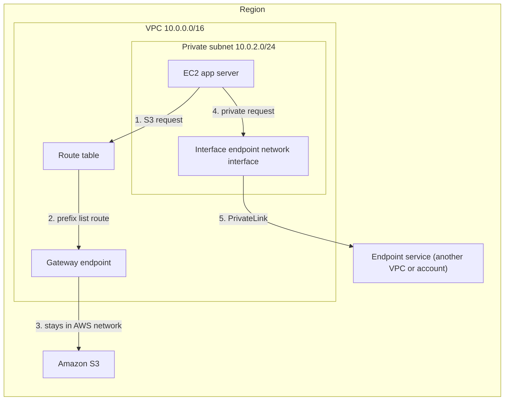
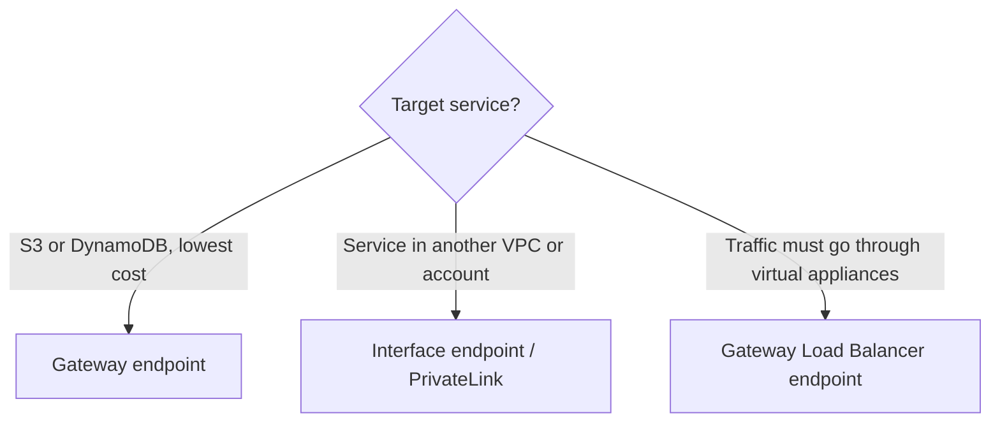

# VPC endpoints and AWS PrivateLink

> [!summary] TL;DR
> - A **VPC endpoint** connects your VPC to a service without an internet gateway or NAT device.[^1][^2]
> - A **gateway endpoint** supports only **Amazon S3 and DynamoDB**, and has no additional charge.[^1][^2]
> - An **interface endpoint** uses **AWS PrivateLink** to reach an endpoint service. Gateway endpoints do not use PrivateLink.[^1]
> - PrivateLink works across VPC and account boundaries.[^3]
> - Traffic between an endpoint and the service stays within the AWS network.[^1]

## Why this exists
A server in a private subnet (see [[vpc-fundamentals]]) normally needs a NAT gateway to reach S3. That path leaves your VPC toward the internet. Endpoints give a direct private path, so you can remove the NAT dependency for that traffic.

## Core concepts
- **VPC endpoint:** created by a consumer "to connect their VPC to an endpoint service or resource."[^1]
- **Endpoint service:** created by a provider to make a service available in a Region. The provider "must specify a load balancer when creating an endpoint service."[^1]
- **Gateway endpoint:** "creates a gateway endpoint to send traffic to Amazon S3 or DynamoDB."[^1] A route is added automatically to each route table you select. Its destination is an AWS-owned prefix list for the service, and its target is the gateway endpoint.[^2]
- **Interface endpoint:** "send TCP or UDP traffic to an endpoint service." For each subnet you choose, AWS creates an endpoint network interface in that subnet.[^1]
- **Gateway Load Balancer endpoint:** sends traffic to a fleet of virtual appliances using private IP addresses.[^1] It is a different endpoint type from the two above.
- **AWS PrivateLink:** "a highly available, scalable technology that you can use to privately connect your VPC to services and resources as if they were in your VPC."[^3]

## Where it lives

> [!info] How to read this
> Path 1–3: gateway endpoint, chosen by a route table entry. Path 4–5: interface endpoint, reached through a network interface in your subnet. No internet gateway or NAT appears in either path.

Simplified: availability zones, security groups and the provider's load balancer are left out.

## How it works
1. The app server sends a request to S3.
2. The route table has a route whose destination is the S3 prefix list and whose target is the gateway endpoint.[^2]
3. Traffic goes to S3 without an internet gateway or NAT device.[^2]
4. For a PrivateLink service, the app sends traffic to the endpoint network interface in its subnet.[^1]
5. PrivateLink carries it to the endpoint service. You do not need an internet gateway, NAT device, public IP address, Direct Connect connection, or Site-to-Site VPN connection for this.[^3]

Prefix lists are specific to a Region. Traffic for S3 or DynamoDB in a different Region goes to the internet gateway.[^2]

## Key facts and limits
| Fact | Value | Source |
|---|---|---|
| Gateway endpoint services | S3 and DynamoDB | [^1][^2] |
| Gateway endpoint cost | "There is no additional charge" | [^2] |
| S3 and DynamoDB endpoint types | Both gateway and interface endpoints are supported | [^2] |
| Interface endpoint pricing | See the PrivateLink pricing page (not fetched) | [^3] |
| Cross-account | Supported | [^3] |

## Comparisons
| | Gateway endpoint | Interface endpoint (PrivateLink) | VPC peering ([[vpc-peering-and-transit-gateway]]) |
|---|---|---|---|
| Targets | S3, DynamoDB only[^1] | Endpoint services and resources[^1][^3] | A whole other VPC[^4] |
| Uses PrivateLink | No[^1] | Yes[^1] | No |
| How traffic is steered | Route table entry[^2] | Endpoint network interface in subnet[^1] | Route table entries[^4] |
| Extra charge | None[^2] | Charged; see pricing page[^3] | None to create[^4] |
| CIDR overlap | Not a peering-style restriction; not tested here | Not verified | Not allowed[^4] |

## Choosing in exam scenarios

> [!info] How to read this
> Start from what you are connecting to, not from the endpoint type.

- "Private subnet reaches S3, no internet, lowest cost" → gateway endpoint.[^2]
- "Expose my service to other VPCs/accounts privately without joining networks" → PrivateLink.[^3]
- "Send traffic to a fleet of inspection appliances" → Gateway Load Balancer endpoint.[^1]

## Common traps and misconceptions
- **Misconception:** Gateway endpoints work for any AWS service. → **Reality:** only S3 and DynamoDB.[^1]
- **Misconception:** Gateway endpoints use PrivateLink. → **Reality:** "Gateway endpoints do not use AWS PrivateLink".[^1]
- **Misconception:** A gateway endpoint is just configured on the service. → **Reality:** it works through route tables, so the subnet's route table needs the route.[^2]

## Self-check
**Q1.** Servers in a private subnet read from S3. Requirement: no internet path, lowest cost.
A) NAT gateway. B) Gateway endpoint. C) Interface endpoint. D) VPC peering.

> [!question]- Answer
> B. Gateway endpoints reach S3 without internet gateway or NAT, at no additional charge.[^2] A: uses an internet-facing path. C: possible for S3,[^2] but is charged and not the lowest cost; its price is on the PrivateLink pricing page.[^3] D: peering connects VPCs, not S3.[^4]

**Q2.** A SaaS provider in another account offers a service. You must reach it privately with no internet gateway, NAT, VPN or Direct Connect.
A) Gateway endpoint. B) Interface endpoint via PrivateLink. C) Internet gateway. D) Site-to-Site VPN.

> [!question]- Answer
> B. PrivateLink works across accounts and needs none of those components.[^3] A: gateway endpoints are for S3/DynamoDB only.[^1] C and D are the components the requirement excludes.

**Q3.** Which services can a gateway endpoint target?
A) S3 and EC2. B) S3 and DynamoDB. C) Any AWS API. D) DynamoDB and SQS.

> [!question]- Answer
> B.[^1]

## Related
[[vpc-fundamentals]] · [[vpc-peering-and-transit-gateway]] · [[security-groups-vs-nacls]] · [[hybrid-connectivity-vpn-and-direct-connect]] · [[_index-vpc-connectivity]]

## Sources
[^1]: AWS PrivateLink concepts — https://docs.aws.amazon.com/vpc/latest/privatelink/concepts.html (accessed 2026-11-08)
[^2]: Gateway endpoints — https://docs.aws.amazon.com/vpc/latest/privatelink/gateway-endpoints.html (accessed 2026-11-08)
[^3]: What is AWS PrivateLink? — https://docs.aws.amazon.com/vpc/latest/privatelink/what-is-privatelink.html (accessed 2026-11-08)
[^4]: VPC peering basics — https://docs.aws.amazon.com/vpc/latest/peering/vpc-peering-basics.html (accessed 2026-11-08)
