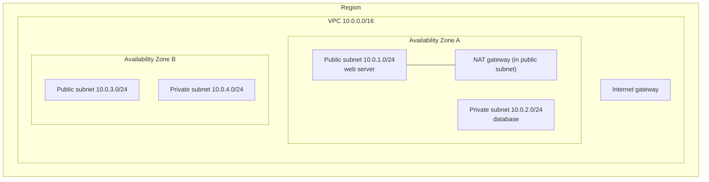
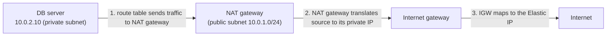
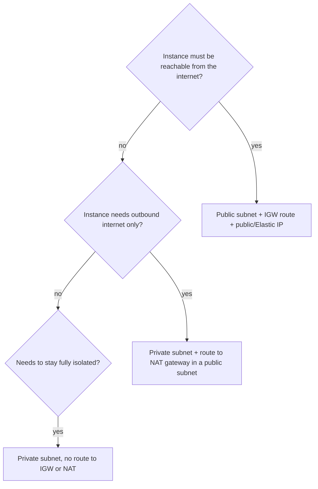

# VPC fundamentals

> [!summary] TL;DR
> - A VPC (Virtual Private Cloud) is your own logically isolated virtual network in AWS.[^1][^2]
> - A subnet is a range of IP addresses in the VPC and must live in a single Availability Zone.[^1]
> - A subnet is *public* if its route table has a route to an internet gateway. Otherwise it is *private*.[^3]
> - A public NAT gateway lets instances in private subnets start outbound connections to the internet. It does not accept connections that start from the internet.[^4]
> - Every subnet loses 5 IP addresses to AWS.[^5]

## Why this exists
Without a VPC you would have no private network of your own: your servers would share one flat address space with every other customer. A VPC gives you your own IP range, subnets, and routing rules, like the network in your own data center.[^1] You decide which parts face the internet and which do not.

## Mental model
Think of a VPC as a data center network you rent. Subnets are VLAN-like segments with an IP range. Route tables decide where each packet goes. The internet gateway is the door to the internet. The NAT gateway is a one-way door: inside machines can go out, outsiders cannot start a connection in.[^4]

**Where this analogy breaks:** In a physical data center, a segment can span several racks and rooms. A VPC subnet cannot span Availability Zones, so high availability means one subnet per AZ.[^1]

## Core concepts
- **VPC**: a virtual network that closely resembles a traditional network you would run in your own data center.[^1] It has at least one IPv4 CIDR block (an IP range written like `10.0.0.0/16`).[^5a]
- **Subnet**: a range of IP addresses in your VPC. It must reside in a single Availability Zone.[^1]
- **Route table**: a set of routes. Each route has a destination (a CIDR block or prefix list) and a target, such as an internet gateway, NAT gateway, VPC peering connection, or VPN connection.[^6] A VPC gets a main route table at creation, and you can add more.[^6]
- **Internet gateway (IGW)**: a horizontally scaled, redundant, highly available VPC component that connects your VPC to the internet.[^3] For IPv4 it also does network address translation (NAT, mapping a private address to a public one).[^3] You must attach it to a VPC and configure routing.[^3]
- **Public subnet / private subnet**: public if the subnet's route table has a route to an IGW; private if it does not.[^3]
- **Public IP or Elastic IP**: instances in a public subnet must have one of these to talk to the internet over the IGW.[^3] An Elastic IP is a static public IPv4 address you allocate.
- **NAT gateway**: lets instances in private subnets reach the internet (public NAT gateway) or other VPCs/on-premises networks (private NAT gateway). Neither accepts unsolicited inbound connections.[^4]
- **Default VPC**: each account has a default VPC in each Region, ready for launching EC2 instances at once.[^1] Its CIDR is 172.31.0.0/16 and its subnets are /20 blocks.[^2]

## Where it lives

> [!info] How to read this
> Each subnet sits inside exactly one Availability Zone. The VPC contains subnets from several zones. The NAT gateway is created in a public subnet, in one zone.[^4][^7]

Simplified: route tables, Elastic IP, and the second zone's NAT gateway are not drawn. The VPC is drawn inside a Region because the docs describe a default VPC in each Region; the pages fetched do not state this scope in one explicit sentence.

## How it works
Case: a private database server downloads a software patch from the internet.

> [!info] How to read this
> The traffic always starts inside the VPC. The private subnet itself has no route to the IGW; only the NAT gateway's path does.[^4]

Simplified: the return path, and the exact route destination for the NAT gateway entry, are not drawn (the page fetched does not state that destination).

1. The private subnet's route table has a route whose target is the NAT gateway. Traffic is routed by destination IP address.[^6]
2. The NAT gateway maps the instance's private source IP to its own private IP.[^4]
3. The internet gateway maps the NAT gateway's private IP to the Elastic IP attached to the NAT gateway.[^4] You route traffic from the NAT gateway to the IGW.[^4]

### Worked example
Plan a VPC `10.0.0.0/16` (computed with Python `ipaddress`):

| Plan | Result |
|---|---|
| `/16` VPC | 65,536 addresses |
| Split into `/24` subnets | 256 subnets, each 256 addresses |
| Usable per `/24` | 256 − 5 = 251 |
| Split into `/28` subnets | 4,096 subnets, each 16 addresses, 11 usable |
| `10.0.1.0/24` reserved | `.0` network, `.1` VPC router, `.2` DNS, `.3` future use, `.255` broadcast[^5] |

Subnets in one VPC cannot overlap.[^5a] `10.0.1.0/24` and `10.0.1.128/25` overlap, so the second is invalid next to the first.

## Key facts and limits
| Fact | Value | Source |
|---|---|---|
| VPC and subnet IPv4 block size | between /16 and /28 | [^5][^5a] |
| Reserved addresses per subnet | first 4 and last 1 (5 total) | [^5] |
| Resize an existing CIDR block | not possible | [^5a] |
| Remove the primary CIDR block | not possible | [^5a] |
| Secondary IPv4 CIDR blocks | allowed; must not overlap existing blocks of the VPC | [^5a] |
| Subnets per VPC (FAQ) | 200 | [^2] |
| IPv4 CIDRs per VPC (FAQ) | 5 (1 primary + 4 secondary) | [^2] |
| Default VPC CIDR / subnet size | 172.31.0.0/16 / /20 | [^2] |
| Charge for a VPC itself | none; some components (for example NAT gateways) are charged | [^1] |
| Route choice | most specific route wins (longest prefix match) | [^8] |
| NAT gateway bandwidth | 5 Gbps, scales automatically to 100 Gbps | [^7] |
| NAT gateway placement | created in one specific AZ, redundant inside that zone | [^7] |
| Security groups on NAT gateway | cannot be associated; use network ACLs | [^7] |

## Comparisons
| | Internet gateway | Public NAT gateway |
|---|---|---|
| Purpose | Two-way path between VPC and internet[^3] | Outbound-only for private subnets[^4] |
| Lives in | Attached to the VPC[^3] | One public subnet, one AZ[^4][^7] |
| Needs Elastic IP | Instance needs public IP or Elastic IP[^3] | NAT gateway needs Elastic IP[^4] |
| Inbound connections from internet | Yes, to instances with public IPs and routes[^3] | No[^4] |
| Availability | Redundant, highly available[^3] | Per AZ; use one per AZ[^7] |

## Choosing in exam scenarios

> [!info] How to read this
> Start with who opens the connection. Internet-initiated means public subnet. VPC-initiated outbound means NAT. Neither means a plain private subnet.

- "Web tier reachable from the internet" → public subnet, IGW, public IP.[^3]
- "Database must not be directly reachable from the internet but needs updates" → private subnet with a public NAT gateway.[^4]
- "Higher availability for NAT" → one NAT gateway in each AZ, with each AZ's subnets routed to the NAT gateway in the same AZ.[^7]
- "Highly available VPC design" → subnets in at least two AZs, since a subnet is one AZ.[^1]

## Common traps and misconceptions
- **A private subnet is private because it has a special setting** → Reality: a subnet is public or private depending on whether its route table has a route to an IGW.[^3]
- **A NAT gateway makes a private instance reachable from the internet** → Reality: connections must be started from inside the VPC.[^4]
- **One NAT gateway covers all AZs safely** → Reality: if its AZ fails, resources in other AZs lose internet access.[^7]
- **Attaching an IGW is enough** → Reality: you must also configure routing, and instances need a public or Elastic IP.[^3]
- **Security groups protect a NAT gateway** → Reality: you cannot associate a security group with a NAT gateway.[^7]

## Self-check
**Q1.** A VPC `10.0.0.0/16` has a `/24` subnet. How many IP addresses can you assign to instances?
A) 256  B) 254  C) 251  D) 250
> [!question]- Answer
> **C.** AWS reserves the first four and the last address.[^5] A is the total. B is the classic non-AWS count (network + broadcast only). D subtracts one too many.

**Q2.** An app in a private subnet must download updates but must not accept connections from the internet. Which design fits?
A) Attach an IGW and give the instance a public IP
B) Public NAT gateway in a public subnet, route private subnet traffic to it
C) Put the instance in a public subnet with no route table
D) Create a private NAT gateway
> [!question]- Answer
> **B.** A public NAT gateway sits in a public subnet and blocks unsolicited inbound connections.[^4] A makes it reachable from the internet. C: a public subnet needs an IGW route, and no route means no internet path.[^3] D: a private NAT gateway connects to other VPCs or on-premises, not the internet.[^4]

**Q3.** A team has instances in two AZs sharing one NAT gateway in AZ A. AZ A fails. What happens?
A) Nothing; NAT gateways span AZs
B) Instances in AZ B lose internet access
C) The IGW takes over NAT
D) AWS creates a new NAT gateway in AZ B
> [!question]- Answer
> **B.** A NAT gateway is created in a specific AZ, and resources in other AZs sharing it lose internet access.[^7] A is false for the same reason. C: the IGW does not replace the NAT gateway's role for private instances. D: the page describes no automatic recreation; you create one per AZ.[^7]

## Related
Neighbours (not yet written): [[vpc-security-groups-vs-nacls]], [[vpc-connectivity]]. Earlier notes: [[iam-fundamentals]], [[iam-advanced]].

## Sources
[^1]: What is Amazon VPC? — https://docs.aws.amazon.com/vpc/latest/userguide/what-is-amazon-vpc.html (accessed 2026-11-08)
[^2]: Amazon VPC FAQs — https://aws.amazon.com/vpc/faqs/ (accessed 2026-11-08)
[^3]: Internet gateways — https://docs.aws.amazon.com/vpc/latest/userguide/VPC_Internet_Gateway.html (accessed 2026-11-08)
[^4]: NAT gateways — https://docs.aws.amazon.com/vpc/latest/userguide/vpc-nat-gateway.html (accessed 2026-11-08)
[^5]: Subnet CIDR blocks — https://docs.aws.amazon.com/vpc/latest/userguide/subnet-sizing.html (accessed 2026-11-08)
[^5a]: VPC CIDR blocks — https://docs.aws.amazon.com/vpc/latest/userguide/vpc-cidr-blocks.html (accessed 2026-11-08)
[^6]: Configure route tables — https://docs.aws.amazon.com/vpc/latest/userguide/VPC_Route_Tables.html (accessed 2026-11-08)
[^7]: NAT gateway basics — https://docs.aws.amazon.com/vpc/latest/userguide/nat-gateway-basics.html (accessed 2026-11-08)
[^8]: How route priority works — https://docs.aws.amazon.com/vpc/latest/userguide/route-tables-priority.html (accessed 2026-11-08)
