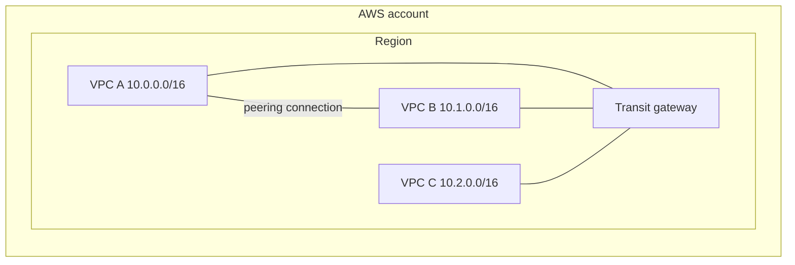
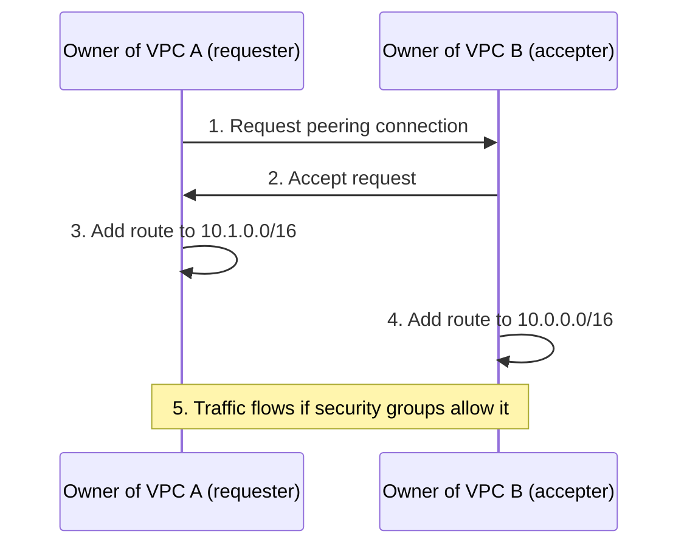
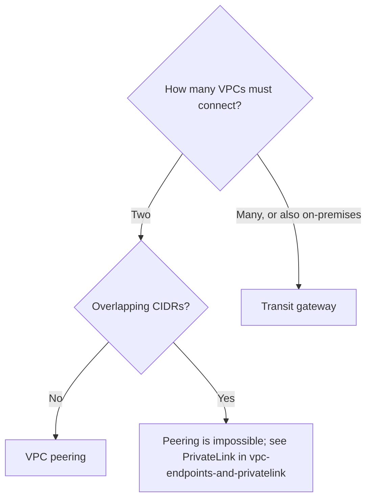

# VPC peering and Transit Gateway

> [!summary] TL;DR
> - A **VPC peering connection** links two VPCs so they can talk over private IP addresses. It works across accounts and Regions.[^1]
> - Peering is **one to one** and **not transitive**. VPC B cannot use VPC A's internet gateway, VPN, or Direct Connect.[^2]
> - Peered VPCs cannot have matching or overlapping CIDR blocks.[^2]
> - A **transit gateway** is a hub that connects many VPCs and on-premises networks through attachments.[^3]
> - Both need route entries. Peering has no charge to create; a transit gateway is charged per attachment-hour and per traffic processed.[^1][^3]

## Why this exists
Two VPCs are isolated from each other by default (see [[vpc-fundamentals]]). You could send traffic between them over the internet, but that needs public addressing. Peering and Transit Gateway give private paths instead.

## Core concepts
- **VPC peering connection:** "a networking connection between two VPCs that enables you to route traffic between them using private IPv4 addresses or IPv6 addresses."[^1] It is neither a gateway nor a VPN, and the page says it has no single point of failure or bandwidth bottleneck.[^1]
- **Requester and accepter:** one VPC owner sends the request. "The owner of the accepter VPC accepts the VPC peering connection request to activate" it.[^2]
- **Transitive peering:** using a middle VPC to reach a third network. "VPC peering does not support transitive peering relationships."[^2]
- **Transit gateway (TGW):** "a network transit hub used to interconnect virtual private clouds (VPCs) and on-premises networks."[^3]
- **Attachment:** the link between a TGW and something else. Listed types include VPCs, a Direct Connect gateway, a VPN connection, and a peering connection with another transit gateway.[^3]
- **TGW route table:** a route table in the TGW. "Each attachment is associated with exactly one route table."[^3]

## Where it lives

> [!info] How to read this
> A and B are linked directly by peering (one to one). A, B and C each have a TGW attachment, so the TGW can connect all three.

Simplified: route tables, subnets and cross-Region links are left out. Peering can also be inter-Region and cross-account.[^1]

## How it works
Peering setup:

> [!info] How to read this
> Peering is not usable until it is accepted and both sides have routes.

1. The requester VPC owner sends the request.
2. The accepter VPC owner accepts, which activates the connection.[^2]
3. and 4. "the owner of each VPC ... must manually add a route to one or more of their VPC route tables" that points to the other VPC's IP range.[^2]
5. Traffic can flow "provided that your security groups and route tables allow the flow of traffic."[^2]

With a TGW, you attach each VPC instead, and each attachment uses a TGW route table that picks the next hop from the destination IP.[^3]

## Key facts and limits
| Fact | Value | Source |
|---|---|---|
| Peering across accounts and Regions | Allowed | [^1] |
| Connections between the same two VPCs at one time | Not more than one | [^2] |
| Overlapping CIDR | Not allowed | [^2] |
| Peering charge | No charge to create. Data within one AZ is free. Cross-AZ and cross-Region data transfer is charged. | [^1] |
| TGW charge | Hourly per attachment, plus traffic processed | [^3] |
| Security group reference to a peer VPC's SG | Only if both VPCs are in the same Region | [^2] |

## Comparisons
| | VPC peering | Transit gateway |
|---|---|---|
| Shape | One to one between two VPCs[^2] | Hub; many attachments[^3] |
| Transitive routing through the middle | Not supported[^2] | The TGW itself routes between attachments using its route tables[^3] |
| Connects on-premises | No: a peer cannot use the other VPC's VPN or Direct Connect[^2] | VPN and Direct Connect gateway attachments are supported[^3] |
| Charges | None to create; data transfer rules apply[^1] | Per attachment-hour and per traffic[^3] |

## Choosing in exam scenarios

> [!info] How to read this
> Count the networks first, then check CIDR overlap.

- "Connect two VPCs privately, simple, no extra hourly cost" → peering.
- "Connect many VPCs and on-premises through one hub" → transit gateway.
- "VPC B must use VPC A's VPN/Direct Connect/internet gateway" → peering cannot do this.[^2]
- "Overlapping CIDR" → peering is not allowed.[^2] See [[vpc-endpoints-and-privatelink]] for exposing one service instead of a whole network.

## Common traps and misconceptions
- **Misconception:** A–B and B–C peering means A reaches C. → **Reality:** no transitive peering.[^2]
- **Misconception:** Peering is a VPN. → **Reality:** "neither a gateway nor a VPN connection".[^1]
- **Misconception:** After accepting, traffic just works. → **Reality:** both owners must add routes.[^2]

## Self-check
**Q1.** VPC A peers with B, and B peers with C. Instances in A must reach C. What is needed?
A) Nothing, it works. B) Add routes in B only. C) Create a direct A–C peering or use a transit gateway. D) Create a second A–B peering.

> [!question]- Answer
> C. Peering is not transitive.[^2] A: false for the same reason. B: routes in B cannot make B a transit point. D: only one peering between two VPCs is allowed at a time, and it would not reach C.[^2]

**Q2.** Two VPCs both use 10.0.0.0/16. Can they be peered?
A) Yes. B) Yes, if in different Regions. C) No. D) Yes, if in different accounts.

> [!question]- Answer
> C. Matching or overlapping CIDR blocks block peering.[^2] Region and account do not change that rule.

**Q3.** An on-premises network connects by VPN to VPC A. VPC B is peered with A. Can B use that VPN?
A) Yes. B) Yes, with a route in B. C) No. D) Only with IPv6.

> [!question]- Answer
> C. A peer VPC cannot use the other VPC's VPN connection.[^2] Routes (B) do not change that. Use a transit gateway with a VPN attachment instead.[^3]

## Related
[[vpc-fundamentals]] · [[security-groups-vs-nacls]] · [[vpc-endpoints-and-privatelink]] · [[hybrid-connectivity-vpn-and-direct-connect]] · [[_index-vpc-connectivity]]

## Sources
[^1]: What is VPC peering? — https://docs.aws.amazon.com/vpc/latest/peering/what-is-vpc-peering.html (accessed 2026-11-08)
[^2]: VPC peering basics — https://docs.aws.amazon.com/vpc/latest/peering/vpc-peering-basics.html (accessed 2026-11-08)
[^3]: What is AWS Transit Gateway? — https://docs.aws.amazon.com/vpc/latest/tgw/what-is-transit-gateway.html (accessed 2026-11-08)
